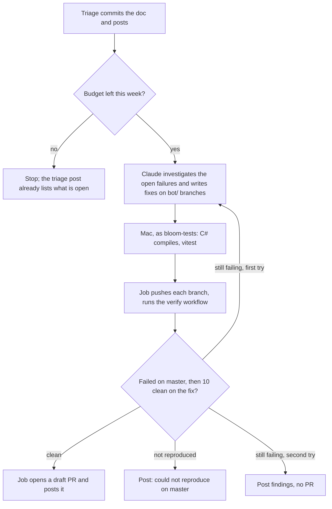

# Plan: the Bloom bot fixes nightly failures

Status: proposal, 2026-11-03. Nothing here is built yet.

## Where things stand

Every morning the Bloom bot on the team's Mac (`bloom-bot/poll-nightly.mjs` in
bloom-team-skills) triages the scheduled nightly with the `nightly-triage` skill: it names each
failure, says whether it is new, takes a first look, commits `docs/nightly-failures/README.md` to
master, and posts a summary to Zulip and `#bloom-team-developers`.

This plan adds the next step: the bot fixes the open failures and offers the fix as a draft PR,
posted to the same channels.

## What the bot can check where

| Check | Where it runs |
|---|---|
| C# compiles | The Mac, as `bloom-tests`: `dotnet build src/BloomTests/BloomTests.csproj -p:EnableWindowsTargeting=true` (~14 s once warm) |
| TypeScript unit tests (vitest) | The Mac, as `bloom-tests` |
| E2E, visual regression, C# unit, React component tests | A GitHub Windows runner, through the verify workflow below |

Anything on the Mac that runs code from the branch (a test, or the repo's MSBuild steps) runs as
the macOS account `bloom-tests`: hidden, with no password anyone knows, and unable to read John's
home folder, where the bot's tokens are. John's account runs commands as it through one
`sudoers` rule. `bloom-tests` has its own Node 24.13.0, pnpm 11.5.2, .NET 8 SDK and BloomDesktop
clone; the bot hands it the branch's changes as a patch.

The React component tests do not run on this Mac yet: there, the component-tester resolves
`playwright` from BloomBrowserUI's install as well as its own, and its Vite server trips on the
macOS-only `fsevents` package. They go to the runner instead.

## The morning, after triage

- **Which failures:** every open entry in the doc, not only new ones. Skipped: an entry that
  someone has started on (its Status links an open PR, names a branch or commit with a possible
  fix, or names a person), and one that an open bot PR already covers. When the nightly fails
  again on a failure that a bot PR covers, the triage records it as usual; the bot does not open
  another PR.
- **How many PRs: one, unless there is a reason for more.** Claude judges this from what it finds.
  When a feature changed some wording and three tests broke on it, the fix is one PR that updates
  the three tests. A second PR is for a failure whose cause and fix have nothing to do with the
  first, so that one can merge without waiting on the other. Each PR says which failures it covers.
- **Tries:** at most two fix attempts per PR per morning. After that the bot posts what it found
  and stops.
- **Budget:** the bot keeps its 5% of John's weekly Claude use, shared with triage and the
  YouTrack and Zulip answers. Fix attempts come last: when the share is used up, the rest wait for
  a morning with budget left. The post says what it left.

## Proving a fix

When a failure is a test that broke because Bloom changed on purpose (new wording, a moved
button), the proof is the updated tests passing on the fix. Repeating them adds nothing.

When a failure is flaky, one passing run proves nothing:

1. **On master**, run the failing spec up to 10 times, stopping at the first failure. If it never
   fails, the bot says it could not reproduce the failure and does not offer a fix.
2. **On the fix**, run it 10 times. Every run must pass.

For scale: if a test fails one run in five, a change that fixed nothing still passes 10 runs about
11% of the time. The PR states the counts, so a reviewer can ask for more.

## The verify workflow

A new workflow in BloomDesktop, separate from `nightly.yml`: the nightly has
`concurrency: group: nightly` and runs whole suites, and verification needs neither.

- **Trigger:** `workflow_dispatch` from the bot's job, with inputs for the ref, the tests to run
  (e2e spec files, visual regression specs, a C# test filter, component test filters), the repeat
  count, and whether to stop at the first failure.
- **Builds only what the tests need:** BloomExe and the front end for e2e; not WebView2PdfMaker or
  the test projects unless C# tests are asked for; no builds at all for component tests alone.
- **Caches** the pnpm store and NuGet packages between runs.
- **Runs** `playwright test <specs> --repeat-each <n>` (with `--max-failures 1` on master),
  `dotnet test --filter`, or the component-tester's `pnpm test <filters>`.
- **Uploads** the results and the e2e report, which the job hands to Claude when a run fails.
- **Reuses the nightly's setup steps.** They move into a composite action that both workflows call,
  so the verify run cannot drift from the nightly's environment.

The fixed cost is the setup and builds, about 7 minutes on the nightly today. Caching and building
less should bring it to 3 to 4 minutes, plus the test runs.

## Pull requests

- Branch `bot/<a few words naming what it fixes>`, based on the master that the nightly tested.
- Draft, base master, opened by the job script, never by Claude.
- The body starts with the attribution line
  `[Claude Opus 5.5 from Hatton's machine during nightly-fix]`. Then, first, when the fix changes
  what an existing test checks: what it checked before and after, and why the test was wrong rather
  than Bloom. A human approving the PR is the approval that the team rule asks for. Then:
  - which nightly failures it addresses, with links to the runs and the doc entry;
  - the cause, and what the fix changes;
  - for a flaky failure, the counts: failures on master out of runs, then clean runs on the fix.
- The job posts the PR link to `#bloom-team-developers` and Zulip for any developer to pick up.
  The next morning's triage links it from the Status of the doc entries it fixes. The bot names no
  reviewer and assigns no one.
- At most 3 PRs a morning, whatever the budget allows, so a bad morning can't flood the channel.

## What the bot is allowed to do

Today Claude on the Mac can read, and can edit one file. For fixes:

- **Claude** may edit any file in its worktree and run one helper, which copies its changes to
  `bloom-tests` and compiles the C# or runs named vitest files there. It still cannot push, open
  PRs, start workflows, or run arbitrary commands.
- **The job script** pushes only `bot/` branches, starts only the verify workflow, and opens only
  draft PRs. It never pushes to master except the triage doc, as today.
