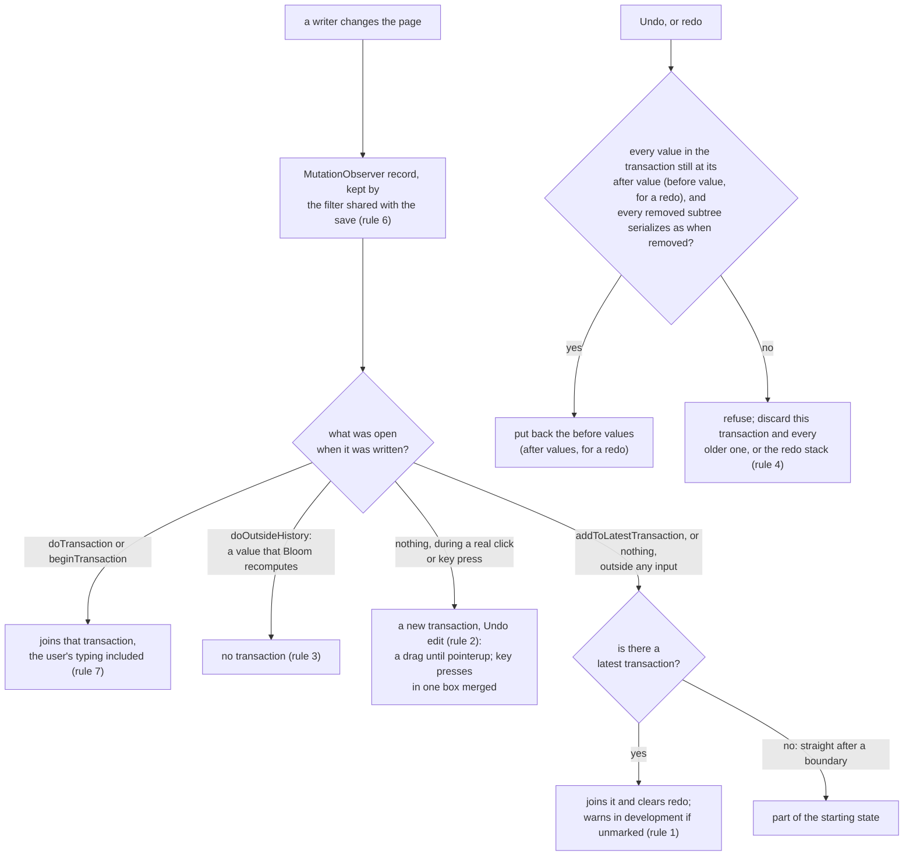
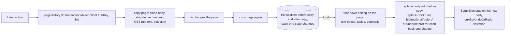
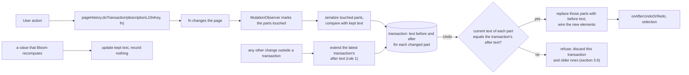
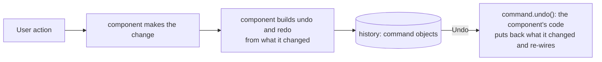
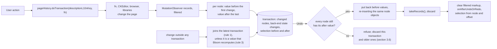
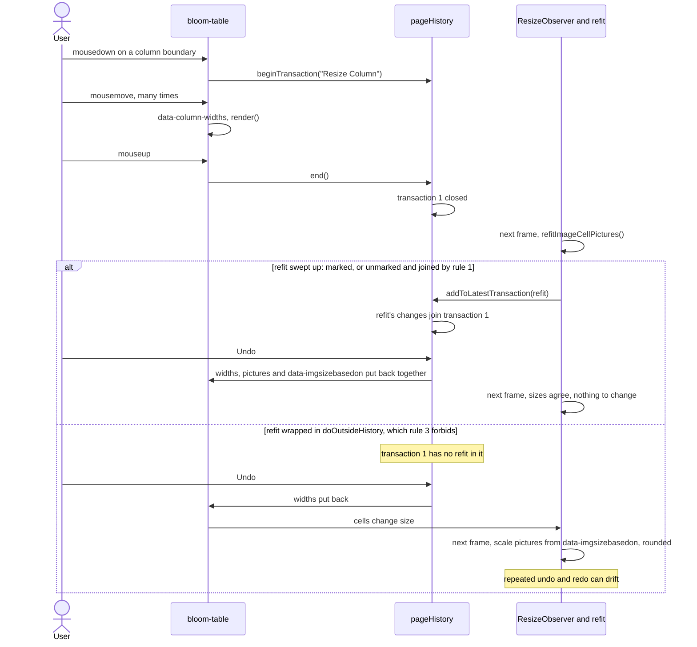
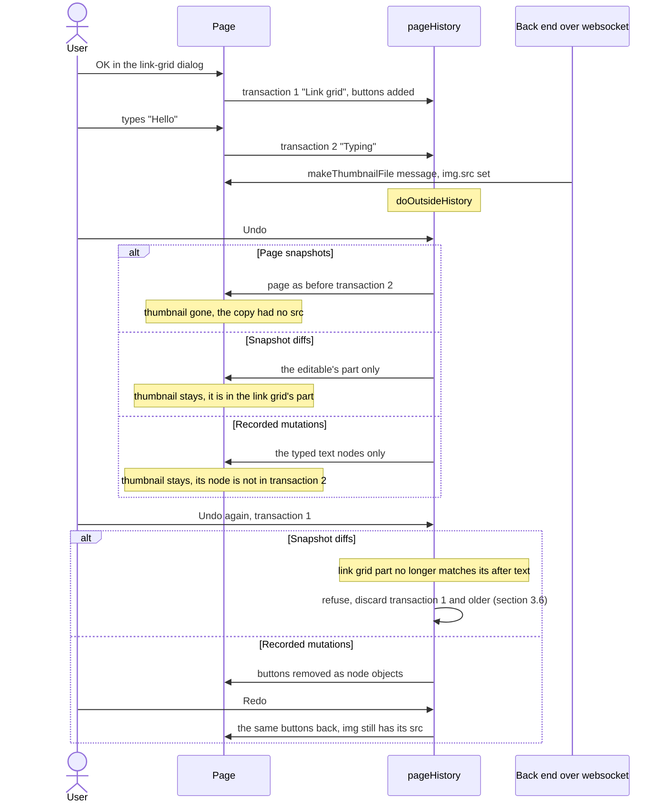
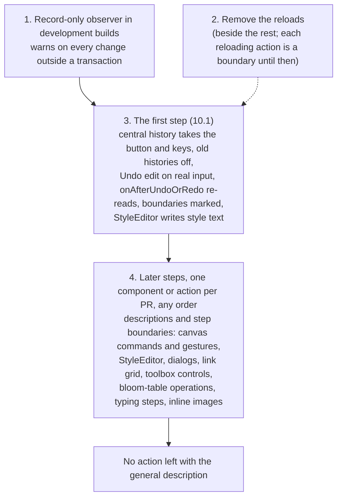

# Undo in Bloom: approaches compared

Status: analysis for discussion, 2026-10-14. Companion to [OUTLINE.md](OUTLINE.md); "§" numbers
refer to the outline unless they say "this document". Today's undo implementation was not read.

Sources read for this document: Bloom's code on `more-undo-exploration`; the inline image code on
the local branch `BL-16822-inline-7-e2e-2`; `bloom-table` 0.1.1 as installed in
`src/BloomBrowserUI/node_modules/bloom-table/dist/bloom-table.mjs`; CKEditor 4.5.1 as installed in
`src/BloomBrowserUI/lib/ckeditor/ckeditor.js`; the description of PR 8209 ("Save a page without
reloading it", BL-13502, open); the undo source of the editors in §15, read on GitHub on
2026-10-14; the results of live experiments in a running Bloom, in
[EXPERIMENTS.md](EXPERIMENTS.md) beside this file ("EXPERIMENTS §" below). Bloom paths below are
relative to `src/BloomBrowserUI/` unless they start with `src/`.

Reading order: sections 1 to 3 set up the problem, with section 3.0 stating the safety rule every
approach is held to; section 4 describes each approach, section 5 walks the hard timing cases,
sections 6 and 7 show code, section 8 compares, section 9 recommends, section 10 covers moving there
in small steps (§1 goal 8), and section 11 takes the recommended design through real Bloom actions,
one per kind of state, and gives the complete API for state the observer cannot see. Section 12 compares an earlier attempt in Bloom with the recommended design. Following §1 goal 5, section 8 scores each approach without CKEditor and
counts the cost of making CKEditor fit separately.

---

## 1. Requirements that discriminate

An approach that meets these meets the rest of §4 without much difference in effort.

- **One order across boxes and kinds of state.** One transaction can change every language's copy in a
  translation group (§4.4 item 1), and text and non-text transactions undo in the order they were made
  (§4.1). §17.2 shows that two histories over the same nodes cannot keep one order, so typing has
  to be in the same history as everything else.
- **Little or no undo code in components** (§1 goal 2).
- **Untracked changes**: swept up with the user change they follow from; only a value that Bloom
  recomputes from other content survives (§4.4 item 3, section 3.0).
- **State that is not page HTML**: CSS rules StyleEditor writes through the CSSOM (§16); toolbox
  state, book metadata and user settings that a toolbox button changes (§9); files (§2.5).
- **Features keep working after a restore** (§4.4 item 4): tables wired, inline image handles
  present, comicaljs in step with the DOM, text boxes editable.
- **Never damage a book** (goal 4): undo and redo only return the page to a state that it was in, by
  construction and not by testing (section 3.0). An undo that cannot apply cleanly is refused, never
  half applied.
- **Reactions that land after the user's change.** With Talking Book open, Bloom rewrites the
  paragraph just typed in about half a second after typing stops (EXPERIMENTS §1.3). By §4.4 item 3
  these are caused by the typing and are undone with it, so the approach has to attribute a change
  that lands half a second later to the transaction that caused it, and undo has to put back content
  those reactions rewrote.
- **Typing undoes in the steps users expect** from the editors they use every day (§3). Those steps
  may come from CKEditor or the browser; the central history has to keep them in its one order.
- **Moving an action to another kind is cheap** (goal 7), above all making a toolbox action
  undoable after the fact.
- **Arrives in small steps** (goal 8): many small PRs, Bloom shippable after each, cut by
  component, by action within a component and by feature. Redo can come later, since Bloom has no
  Redo button. A step may lose history, or show an action that is not wrapped yet with the general
  description, but never damages a book. Section 10 shows how far each approach meets this.

CKEditor is not in this list. Each approach is judged without it, and the cost of making CKEditor
fit is counted separately (section 8.2). If one approach is far better except for CKEditor, we
choose it and adapt CKEditor (goals 5 and 6).

---

## 2. The page Bloom edits

Every editor in §15 owns a model (ProseMirror's document, Lexical's `EditorState`, tldraw's store,
Excalidraw's elements) and renders the DOM from it. Their undo works on the model. Bloom owns no
model. The page iframe's DOM is the document, and many writers change it in place:

| Writer | How it changes the page | Can it say what it is doing? |
|---|---|---|
| The browser | `contenteditable` typing, deleting, IME composition in `.bloom-editable` | Fires `beforeinput` and `input` with an `inputType` ([Input Events](https://w3c.github.io/input-events/)) |
| CKEditor 4 | One inline editor per box (`attachToCkEditor`, `bookEdit/js/bloomEditing.ts:2046`; `CKEDITOR.inline` at `:2082`); formatting commands; paste filter; its own normalising and edit-time markup | Fires `beforeCommandExec`/`afterCommandExec` around commands, and `saveSnapshot`, `lockSnapshot`, `unlockSnapshot` around changes; its undo plugin listens to them ([plugin.js#L64-L77](https://github.com/ckeditor/ckeditor4/blob/major/plugins/undo/plugin.js#L64-L77), [#L172](https://github.com/ckeditor/ckeditor4/blob/major/plugins/undo/plugin.js#L172)) |
| Bloom code run by a user action | Canvas commands through `control.action(...)` (`bookEdit/toolbox/canvas/canvasControlRegistry.ts:272`, `canvasControlResolution.ts:201`, `bookEdit/js/canvasElementManager/CanvasElementContextControls.tsx:363`) or a menu row's own `onSelect` (section 3.2); the canvas keyboard provider (`bookEdit/js/canvasElementManager/CanvasElementKeyboardProvider.ts:72`); inline image gestures; dialogs' OK callbacks | Yes, by calling the central system |
| `bloom-table` | `render()` writes inline styles derived from `data-*` attributes; nearly every operation goes through `tableHistoryManager.addHistoryEntry` (`bloom-table.mjs:78`) | Through that one function, after a library change (§17.3) |
| comicaljs | Bubble spec in `data-bubble`, plus generated SVG, a generated `<canvas>` and paper.js objects; `Comical.update(container)` rebuilds them from the DOM (`node_modules/comicaljs/dist/index.js:19388-19435`) | Only Bloom calls it |
| Bloom on its own | `ResizeObserver` refits (`bookEdit/js/tableEditing.ts:336`, `:314`); `OverflowChecker.AdjustSizeOrMarkOverflowSoon` (`bookEdit/OverflowChecker/OverflowChecker.ts:392`); the markup pass that `handlePageEditing` schedules 500 ms after the last keystroke, paste or input (`mainTask`, `bookEdit/toolbox/pageEditingMarkup.ts:325`), which runs Talking Book's sentence splitting, the reader tools' highlighting (section 5.3) and `cleanUpNbsps`; the inline image aspect ratio written when an image loads (the `load` listener in `wireUpImage`, `inlineImages.ts:913-925` on the inline image branch); jobs wrapped in `wrapWithRequestPageContentDelay` (`bloomEditing.ts:1413`) | Only through code we add |
| C# | `RunJavaScript` calls such as `changeImage`; websocket messages such as `makeThumbnailFile-*` (`bookEdit/js/linkGrid.ts:105`); saving and reloading the page (section 3.3) | At the JS function it calls |
| StyleEditor | `insertRule`, `deleteRule` and `rule.style.setProperty` on `<style title="userModifiedStyles">` (`bookEdit/StyleEditor/StyleEditor.ts:619`, `:725-726`, `:1929` and many more) | Yes, but nothing watching the DOM sees these changes |

What follows for every approach:

- There is no model to compare or to transform. A generic capture works on DOM nodes or on HTML
  text.
- **Element objects carry most of the wiring.** Listeners added by `SetupElements`
  (`bloomEditing.ts:571`), CKEditor instances, `bloom-table`'s per-element state and the
  `ResizeObserver` subscriptions belong to element objects. A restore that puts back the same
  element objects keeps most of it; section 4.4 lists what it does not keep (jQuery handlers after a
  jQuery removal, qTip bubbles destroyed before a delete). A restore from HTML text creates new
  elements that have none of it, yet still carry markers such as `data-table-attached="1"` that say
  they are wired (§17.3). Both were observed in a running Bloom (EXPERIMENTS §2.2): re-inserted
  text boxes and table cells kept their CKEditor instances and tables kept working; clones parsed
  from earlier HTML kept CKEditor's classes and `data-table-attached` with no wiring behind them.
- **StyleEditor's rules are not in the HTML text**, and a `MutationObserver` does not see them,
  because a CSSOM change does not change the `<style>` element's children. The save path reads them
  separately (`userStylesheetContent`, `bloomEditing.ts:1688`).
- **Derived markup and saved view state sit among the content**: `bloom-ui` elements; CKEditor's
  classes and edit-time DOM (a filling-character text node, `data-cke-hidden-sel`, the
  `#cke_pastebin` element, bookmark spans with `data-cke-bookmark`; `lib/ckeditor/ckeditor.js:395`,
  `:396`, `:605`, `:127`); qTip attributes; comicaljs's generated SVG and
  `<canvas class="comical-generated">` (`comicaljs/dist/index.js:19541-19555`), replaced on every
  `refreshCanvasElementEditing` (`CanvasElementManager.ts:1047`); `bloom-table`'s
  `data-table-overlay` elements appended to the body and the body's `style.cursor`
  (`bloom-table.mjs:1088`, `:2685-2690`); `data-bloom-active` (§2.14); the selected inline image's
  class and handles (§17.2). Every capture has to ignore them, by the same rules the save path
  applies.
- **The capture's cleanup and the save path's cleanup must be one definition** (rule 6 of section
  3.0). If they ever disagree about one attribute, undo restores markup the save strips, or drops
  content the save keeps, and the symptom is a damaged page that nobody traces to undo. This is a
  requirement on every approach, and an approach that can call the save path's own code meets it
  more easily than one that needs the rules in another form. Section 3.7 shows how recorded
  mutations meet it.
- **The save path's read is destructive today.** `extractAndStripPageContentForSave` strips the live
  DOM and does not put it back (comment at `bloomEditing.ts:1458`); leaving the canvas page,
  `bloom-table` removed `cell--selected` and `data-btable-anchor-name` from live cells and comicaljs
  replaced its `canvas` with an `svg` (EXPERIMENTS §1.4). PR 8209 moves that cleanup onto
  a clone, through one method per tool so that cleaning the clone and cleaning a detached page
  "can't drift apart" (its description). That clone cleanup is what a text capture would call.
- **Bloom can already wire content added after load.** `SetupElements` runs on a subtree whenever a
  canvas element is added, and `wireBloomContentOfNewCells` (`tableEditing.ts:170`) is written to
  be safe to run again. These are where re-wiring after a restore starts.
- **No React component renders saved page content.** The React roots in the page frame render into
  `bloom-ui` containers the save strips (above-page controls, Talking Book's playback order buttons,
  canvas context controls, the text context menu, source bubbles); quiz and game content is written
  by plain DOM code (EXPERIMENTS §1.6, a search of `bookEdit`). So no component has a model of page
  content that a generic restore would have to update.

---

## 3. Decisions every approach needs

### 3.0 Undo only returns the page to a state that it was in

This decision comes before the others, and every approach in section 4 is judged against it. It is
what makes it possible to change Bloom's undo in small steps without risk to books (§1 goals 4
and 8).

**The rule.** Every undo and every redo leaves the page in a state it was really in before, except
for values that Bloom recomputes from other content (§2.8), which may be recomputed afterwards. A design
whose safety depends on every component author getting their undo code right, or on testing finding
every case, is rejected outright. Tests confirm the rule; they are not what makes it hold.

**What counts as corruption.** A page, after an undo or a redo, that the page was never in:

- a structure no action could produce: part of a transaction applied without the rest, or a table
  whose `data-row-heights` holds more values than the table has rows, as one did after many
  hand-made removal and re-insertion trials (case 7.8);
- content whose parts no longer fit each other: a crop set for one picture, left in place on another
  picture after the action that put the first one in is undone (the case below).

Losing history is not corruption. A refused undo leaves the page as it is, and the user can still
change it by hand.

**Why testing is not what makes it hold.** The sequences that corrupt are combinations nobody wrote
down: an action no code has wrapped yet, between two that are (below); a reaction that lands half a
second after the action that caused it (section 5.3); Bloom code that changes a node after removing
it (section 4.4); a component's own history, if one were kept, rebuilding nodes that a central
transaction holds (section 10.2). Section 2 lists eight kinds of writer, and while code moves (section 10)
the set of wrapped actions changes with every PR. A test runs the sequences someone thought of, and
an action nobody has wrapped is an action nobody has written an undo test for. So the guarantee has
to come from the mechanism: undo writes back only values it captured; every change it can see
belongs to some transaction (rules 1 and 2 below); and what it cannot see is either made visible to
it (rule 5) or makes it refuse (rule 4). The generic check of §11 and Figma's test (section 9.3) then
confirm the rule on every action they run.

#### 3.0.1 The case: an action not wrapped yet, between two that are

On one page the user does three things, then presses Undo once, and again:

- **A**, choose a picture: wrapped in `pageHistory.doTransaction`, so a transaction;
- **B**, crop it: not wrapped, because its routing point has not had its `doTransaction` yet while actions
  move one PR at a time (section 10.5), or because someone forgot it;
- **C**, type a word: wrapped, a transaction.

B is the user's action, not a change Bloom makes on its own (§4.0 kind 4), but no code opens a
transaction for it. Rules 1 and 2 below decide where its changes go. The page passes through four
states:

| State | Picture | Crop | Text |
|---|---|---|---|
| S0, before A | old | none | without the word |
| S1, after A | new | none | without the word |
| S2, after B | new | set for the new picture | without the word |
| S3, after C | new | set for the new picture | with the word |

What Undo does depends on what the system does with B's changes, and on which values B wrote. The
walk-through takes the case a check cannot catch: B wrote only values A did not write (A set the
`img`'s `src`; B wrote crop values on another node or attribute). Where B wrote a value A also wrote,
recorded mutations and snapshot diffs refuse the second undo instead (rule 4), and history is lost.
For an inline image a crop also replaces every other language's copy with a fresh clone (case 7.2),
so if A's transaction holds those copies, B is in that second case.

| B's changes are | Undo once | Undo twice |
|---|---|---|
| in a transaction of their own, opened by the real click that started the crop (rule 2, decided) | S2 | S1; a third Undo gives S0 |
| joined to A, the latest transaction when they land (rule 1) | S2 | S0 |
| in no transaction, which rules 1 and 2 prevent | S2 | the old picture with the crop set for the new one: a state that the page was never in |

B is a user action, so it starts with a real click or key press, and rule 2 gives it a transaction
of its own: Undo, Undo gives C, then B. Joining A is what rule 1 does to a change made outside any
input, such as Bloom's refit when A's picture loads, which follows from A and belongs with it. B's
own changes join A only if every one of them lands outside any input, after an `await` (rule 2
says what happens then). Both rows return the page to states that it was in; the third row is what
the rules exist to prevent.

Under each approach:

**Recorded mutations.**

- B in its own transaction (rule 2): the trusted input event that started the crop opened a
  transaction with the general description, "Undo edit" (§4.1), and the crop's records fill it. Undo,
  Undo gives S2, then S1.
- B joined to A (rule 1), as a change made outside any input would be: B's records merge into A, the
  latest transaction when they arrive. For every value B changed, A keeps the value before B's first
  change, unless A already holds an earlier one, and takes B's last value as its after value. Undo
  once: S2. Undo twice puts back A's and B's before values together: S0. Redo of A then gives S2,
  and redo of C gives S3.
- B in no transaction: its records are outside any transaction. Undo once puts back C's text node:
  S2. Undo twice checks the nodes A changed; the `img` still has A's `src`, so the check passes, A's
  before values go back, and B's crop stays.

**Snapshot diffs.**

- B in no transaction: B's change updates the kept text of the parts it touched and records nothing,
  as Excalidraw's `NEVER` does. Undo twice compares A's parts with A's after text. A crop changes the
  canvas element's part, or the editable that holds an inline image, which A changed too, so the
  check refuses more often than under recorded mutations; where B's change is in a part A did not
  change, A's parts go back and B's crop stays.
- B joined to A (rule 1): for each part B touched, A's entry keeps its before text, or, if A has no
  entry for that part, gets the kept text as its before text; either way it takes the new text as
  its after text. Undo twice: S0.
- B in its own transaction (rule 2): the parts touched during each trusted input event are serialized
  and compared when the event's task ends. Undo twice: S1.

**Page snapshots.** With rule 2, the real click that starts B takes a copy, and B is a step of its
own: Undo, Undo gives S2, then S1. A change outside any input joins the latest transaction by the
nature of copies. Were B to join A that way, C's before copy is taken after B, so undoing C gives S2;
A's before copy is from before A, so undoing A gives S0. Redo of A gives A's after copy, S1, or S2 if
the system updates A's after copy when B lands, as it does for a swept-up change (section 4.1); both
are states that the page was in. Page snapshots can leave B out of the second undo only if a
feature's values are excluded from the copies.

**Commands.** B pushes no command and has no inverse, so nothing sees it. Undo once runs C's
inverse: S2. Undo twice runs A's inverse on a page B has changed, with no check: an inverse that sets
the `src` back leaves the crop, the state that the page was never in; an inverse that writes back a whole
attribute B also changed overwrites B's change with whatever A captured. Neither rule 1 nor rule 2 is
open to commands: there is no inverse for B's changes to join, or to run. `extendLatest` (section
6.3) needs code at B's source, which is the code that does not exist yet.

Rule 1 under recorded mutations. `doTransaction`, `beginTransaction`, `addToLatestTransaction`, `doOutsideHistory`, the transactions of rule 2
and undo call `takeRecords()` when they start and when they end, so every record is filed under
whatever was open when it was written; records that arrive with nothing open, which means outside
any input, come here:

```ts
// Records that no doTransaction, beginTransaction, addToLatestTransaction or doOutsideHistory call claimed, already through the filter of section 3.7.
function noteUnclaimed(records: MutationRecord[]): void {
    const latest = undoStack.at(-1);
    if (latest) {
        mergeIntoTransaction(latest, records); // keeps each value's first before, takes its last after
        redoStack.length = 0; // a new change clears redo
    } // else straight after a boundary: the change is part of the starting state
    warnInDevelopment(records); // names each node and attribute, or child list, that changed outside any input with no marking; records carry no call stack, so it cannot name the code that wrote them
}
```

Rule 1 under snapshot diffs:

```ts
// Parts the observer marked as touched while no doTransaction, beginTransaction, addToLatestTransaction or doOutsideHistory call claimed the change.
function absorbUnclaimedParts(touched: Set<PartKey>): void {
    const latest = undoStack.at(-1);
    let changed = false;
    for (const key of touched) {
        const now = serializePart(key); // through the save path's cleanup (rule 6)
        const kept = keptText.get(key); // undefined for a part that did not exist
        if (now === kept) continue;
        changed = true;
        keptText.set(key, now);
        if (!latest) continue; // straight after a boundary: part of the starting state
        const entry = latest.parts.get(key);
        if (entry) entry.after = now;
        else latest.parts.set(key, { before: kept, after: now });
    }
    if (changed) {
        if (latest) redoStack.length = 0;
        warnInDevelopment(touched);
    }
}
```

Rule 2:

```ts
// Page frame, toolbox frame and root window, capture phase, so it runs before any handler there.
for (const type of ["pointerdown", "keydown", "click"]) {
    document.addEventListener(
        type,
        (e) => {
            if (!e.isTrusted || isUndoOrRedo(e)) return; // undo files its own changes
            if (hasOpenTransaction()) return; // rule 7: the open one takes it
            const box = e.type === "keydown" ? editableContaining(e.target) : undefined;
            const generic = box && latestIsKeyPressesIn(box) // consecutive key presses in one box
                ? reopenLatest() // merge into one step
                : openTransaction(kGeneralEditL10nKey, { keyPressesIn: box }); // "Undo edit" (§4.1)
            // A task queued now runs after this event's task and its microtasks. A task queued
            // earlier can still land inside (section 3.2). A drag stays open until pointerup.
            setTimeout(() => closeUnlessDragging(generic));
        },
        true,
    );
}
// closeTransaction drops a transaction that recorded nothing, as end() does after beginTransaction.
```

Where each recorded change goes, and the check before every undo and redo:



#### 3.0.2 The rules that follow

1. **No change goes unclaimed.** A change made outside any transaction, and not declared a value
   that Bloom recomputes (rule 3), joins the latest transaction, as `addToLatestTransaction` does (section
   6.1), and clears redo. With rule 2 in place, the changes that this rule handles are those made
   outside any input: Bloom's reactions a moment after an action, from a timer, a picture's `load`
   event or code after an `await`. Bloom makes no background changes to page content (§3,
   Asynchronous), so these finish before the next input and join the transaction of the action that
   caused them, which is the latest one. A generic transaction of their own would make Bloom's
   reactions undo steps of their own, which §4.1 forbids ("Automatic changes by Bloom never appear as
   separate undo steps"). With no transaction to join, straight after a boundary, the change is part
   of the starting state. Joining the latest transaction is always consistent: the change happened
   after every change that transaction holds, and undo takes it out first (section 3.1). Joining the
   next transaction instead would leave the change nowhere to go if the user pressed Undo before any
   next transaction existed. `addToLatestTransaction` changes nothing about where a change goes; it
   says in the code that a reviewer has thought about the change and that the joining is meant, and
   keeps the development warning quiet. While its function runs, the history knows that it is inside a
   marked call; at the end it takes the pending records with `takeRecords()` and treats them as
   accounted for.
   *Prevents:* a change left in no transaction, and the second undo of the case above that leaves
   content whose parts do not fit. *Settles:* what happens to a change Bloom makes that nobody has
   marked: it joins the action that caused it, and the development warning names what changed (the
   node and attribute, or the child list) and says that it changed outside any input with no marking.
   A `MutationObserver` record carries no call stack, so the history cannot name the code that made
   the change.
2. **Transactions on real input (decided).** When a trusted click or key press changes the page and
   no code has opened a transaction for it, the central system opens one with the general
   description, "Undo edit" (§4.1; section 3.2). So an action that nobody has wrapped is its own undo
   step from the first release, and in the case above Undo, Undo gives C, then B. Two grouping rules
   decide the steps: a drag is one transaction from pointer down to pointer up, and consecutive key
   presses in one box merge into one step. Wrapping an action later only gives it its own
   description and better step boundaries (drags, typing steps; section 3.2, case 7.7). A change
   that the action makes after its event handler has returned, such as one made after awaiting a
   call to C#, lands outside any input, and rule 1 joins it to the latest transaction, which is the
   action's own if nothing came after it. An action whose every change lands after an `await` leaves
   its own transaction empty, so that transaction is dropped and rule 1 joins the changes to the
   transaction before it, until the action is wrapped; the development warning names what changed.
   Input events in the toolbox frame and the root window change the page too, so the history
   listens in those frames as well. The Undo button and the undo and redo keys open no transaction:
   undo and redo file their own changes. Its cost: a view change that writes something the recorder
   keeps, and an action that is a boundary, need marking so they make no transaction of their own;
   a click that writes nothing the filter keeps leaves its transaction empty, and an empty
   transaction is dropped, as `beginTransaction` makes none when nothing changed before `end()` (section 6.1).
   *Prevents:* an action that no code has wrapped being undone together with the action before it.
   *Settles:* the job of each mechanism. Real input gives every user action its own step; rule 1
   puts Bloom's reactions with the action that caused them; explicit wrapping gives an action its
   own description and step boundaries. Safety rests on rules 1 and 4, not on this rule.
3. **Only values that Bloom recomputes from other content survive.** `doOutsideHistory` is for a
   value that is a function of other content, such as a link-grid thumbnail's `src`: it is the
   thumbnail of the book the button links to, and can be asked for again from that link (section
   5.2, case 7.4). Whatever state undo returns to, such a value either still fits it or is
   recomputed to fit it. Nothing else is declared to survive: each `doOutsideHistory` call is a
   point that a reviewer checks against this rule, and the development warning still names every
   change that joined the latest transaction without a marking. The table picture refit is not such a value, because
   it scales from the stored `data-imgsizebasedon`, not from the cell's size alone (section 5.1,
   §17.3); Talking Book's sentence spans are not, because new sentences get new ids (section 5.3).
   Bloom makes no other background changes to page content (§3, Asynchronous): a job that changes
   page content while the user keeps working is a bug to fix, by making it block or finish before
   the next input is handled.
   *Prevents:* a value left in place in a state it does not fit. *Settles:* which untracked changes
   survive (§4.4 item 3).
4. **The check covers what rule 1 cannot see.** Before an undo, every value the transaction holds
   must still have its after value, and every subtree the transaction removed must still serialize as
   it did when it was removed, because the observer cannot see changes to a detached node; before a
   redo, the same with before values. Otherwise the undo is refused, and that transaction and every
   older one are discarded; a refused redo discards the redo stack, whose newer transactions were
   recorded on top of the one refused. Losing history is never corruption; applying part of a
   transaction is. Under snapshot diffs the values are the parts' cleaned text. Page snapshots need
   no check, since they put back a whole copy.
   *Prevents:* applying a transaction over a change rule 1 could not see: a node changed while
   detached (Duplicate, section 4.4), a component's own undo, if one were kept, rebuilding nodes
   that a central transaction holds (section 10.2), a value declared to survive that a transaction
   also holds. *Settles:* nothing new; it is the policy of section 3.6, with removed subtrees named.
5. **Everything undo restores is visible to it.** The observer cannot see a change to the CSSOM or
   to state outside the page, and rule 1 can only absorb what is seen.
   - StyleEditor writes its rules as `<style>` text, so CSS is ordinary page DOM (case 7.5). A CSSOM
     change by code not moved yet would be invisible, and could leave CSS from after an undone
     transaction beside content from before it.
   - State outside the page comes in two cases (decided).
     - Nothing on the page depends on the state: the leveled reader level (still to check, case
       7.6), a toolbox setting, a user preference. It may stay outside the history, with no
       `clearUndoAndRedo()`. Undo never touches it and cannot damage anything, because no page
       content has to match it. Its change is then not undoable, like a view change.
     - The page refers to the state or must match it: audio files named by sentence ids, the
       metadata inside a picture file, book metadata that the page's copyright fields show, book
       settings that change page content. Undoing the page part alone would leave the two out of
       step, so the action is either undoable as a whole, with a new file for a file that the page
       names (section 11.8.5) and state held in C# recorded through `addChangeOutsidePage` (section
       11.8.4), or a boundary. State in JavaScript memory has no API yet
       (section 11.8.2), so an action that changes such state is a boundary. A boundary loses
       history; it cannot corrupt.

   *Prevents:* CSS, or state outside the page that the page depends on, from after an undone
   transaction left beside content from before it. *Settles:* whether StyleEditor writes its
   `<style>` text or supplies its rules through an API: it writes the text; and which state outside
   the page needs recording or a boundary: only state that the page refers to or must match.
6. **The filter and the save path's cleanup are one module** (section 3.7), so what undo ignores is
   exactly what the save strips, plus the short named list of what the save keeps and undo leaves
   alone, by construction rather than by keeping two lists in step. Page snapshots and snapshot
   diffs call the save path's cleanup itself. *Prevents:* undo putting back markup the save strips,
   or dropping content the save keeps, which shows up as a damaged page nobody traces to undo
   (section 2). *Settles:* question 1 of section 9.2, answered in section 3.7, as a rule.
7. **Overlap.** While a transaction is open, as an async `doTransaction` is until its `fn` settles, every
   change joins it, the user's typing included, and a `doTransaction` or `beginTransaction` that begins meanwhile joins it
   too. Two transactions are never open at once, so undo never splits interleaved changes into a
   state that did not exist. The cost, typing undone together with the async action, is to be tried
   with users. *Prevents:* interleaved transactions undone one at a time. *Settles:* what an async
   transaction holds while the user keeps working (section 3.6): everything.
8. **Undo's own reactions**, such as a markup pass after an undo or a flow-text refit, are changes
   outside any transaction: rule 1 joins them to the latest transaction and clears redo, and one
   that rule 1 cannot see is caught by the redo check (rule 4). Safe either way; the cost is redo.
   *Prevents:* a redo applied over content a reaction rewrote. *Settles:* keeping the undo and redo
   keys from scheduling the markup pass (section 5.3) keeps redo available; safety does not depend
   on it.
9. **An action that throws partway** has its changes put back at once, and the error is rethrown
   (section 3.6). *Prevents:* half an action left on the page.

#### 3.0.3 Effect on the approaches

- **Commands: rejected outright.** Safety rests on every author's inverse being complete and right,
  and nothing checks that an older inverse still applies. Changes that no command claims are
  invisible to it, so neither rule 1 nor rule 2 can apply, and with no recorded after values neither
  can rule 4.
- **Adjusting older transactions: rejected**, because it needs a model of the whole page (section
  4.5).
- **Page snapshots: safe by construction.** Undo restores a copy that existed, always; a copy taken at
  each real input gives B its own step, and a change outside any input joins the latest transaction
  by the nature of copies. Page snapshots stay behind for other reasons, none of them safety: every
  undo tears down and sets up every component's editing, typing included (section 4.1, case 7.8);
  and restoring costs a full rebuild of the page each time.
- **Snapshot diffs: safe with rules 1, 4, 5 and 6.** Rule 2 compares the parts touched during each
  real input when its task ends; rule 1 extends the latest transaction's after text for the parts
  that a change outside any input touched. Rule 5 applies because the observer decides which parts
  are touched, and it cannot see the CSSOM.
- **Recorded mutations: safe with rules 1 to 7**, and they give the guarantee of page snapshots
  without the teardown: the same node objects go back, holding values they held. With rules 1 and 2,
  no change is left in no transaction, and an unwrapped B gets its own step. They stay first
  (section 9.1).

The small steps of section 10 rest on rules 1 and 2. From the first step, an action that is not
wrapped yet is its own "Undo edit" step, and Bloom's reactions join the action that caused them, so
later steps can go one component or one action per PR without risk to the book. Section 10.6 says
what that means for the move.

### 3.1 How a change says which kind it is

None of the systems in §15 works out by itself how a change should be recorded; the code making
the change says so:

| System | Recorded | Not recorded; undo leaves it | Joined to another step |
|---|---|---|---|
| Excalidraw `CaptureUpdateAction` | `IMMEDIATELY` | `NEVER`: the store's snapshot is updated, so the next difference leaves the change out | `EVENTUALLY`: joins the *next* `IMMEDIATELY` |
| tldraw `editor.run(fn, { history })` | `record`, `record-preserveRedoStack` | `ignore` | none in `run`; the separate method `squashToMark` merges everything since a mark into one step |
| Yjs `UndoManager` | origin in `trackedOrigins` | any other origin | changes within `captureTimeout` (500 ms) merge |
| CKEditor 4 | `saveSnapshot` | none | `lockSnapshot` with `dontUpdate`: changes join the *next* snapshot; without it, unlocking updates the last snapshot, but only if the content matched that snapshot when the lock began |
| Lexical | `HISTORY_PUSH_TAG` | none | `HISTORY_MERGE_TAG` merges into the current step |
| ProseMirror, CodeMirror | default | `addToHistory: false` | grouping by time and adjacency |

Sources: [store.ts#L38-L69](https://github.com/excalidraw/excalidraw/blob/master/packages/element/src/store.ts#L38-L69)
and [#L374-L385](https://github.com/excalidraw/excalidraw/blob/master/packages/element/src/store.ts#L374-L385);
[HistoryManager.ts#L340-L344](https://github.com/tldraw/tldraw/blob/main/packages/editor/src/lib/editor/managers/HistoryManager/HistoryManager.ts#L340-L344)
and [#L268](https://github.com/tldraw/tldraw/blob/main/packages/editor/src/lib/editor/managers/HistoryManager/HistoryManager.ts#L268);
[UndoManager.js#L205-L230](https://github.com/yjs/yjs/blob/main/src/utils/UndoManager.js#L205-L230);
[plugin.js#L618-L690](https://github.com/ckeditor/ckeditor4/blob/major/plugins/undo/plugin.js#L618-L690);
[lexical-history#L315-L370](https://github.com/facebook/lexical/blob/main/packages/lexical-history/src/index.ts#L315-L370);
[prosemirror-history#L277-L296](https://github.com/ProseMirror/prosemirror-history/blob/master/src/history.ts#L277-L296);
[codemirror history.ts#L71-L72](https://github.com/codemirror/commands/blob/main/src/history.ts#L71-L72).

Bloom needs the four kinds of §4.0 and the two classes of untracked change of §4.4 item 3.
Excalidraw's `EVENTUALLY` and CKEditor 4's `dontUpdate` join a change to the *next* recorded
change, while Bloom's swept-up changes join the transaction *before* them: the picture refit lands a
frame after the column drag ends. CKEditor 4's `lockSnapshot` without `dontUpdate` is the closest
match, since it folds the changes made while locked into the last snapshot, when nothing else
changed in between.

All approaches except commands can give authors the same few calls for this (section 6.1). Goal 7
then comes down to editing one call: an action that changes the page is undoable as "Undo edit"
with no call at all (rule 2 of section 3.0), and gets its own description by being wrapped in
`doTransaction`; it becomes a boundary by calling `clearUndoAndRedo`, and a view change by writing nothing that the
filter keeps, or by the marking of rule 2. Under commands, making an action undoable means writing
its inverse.

A user action that no code has wrapped gets a transaction of its own from the real click or key
press that started it (rule 2 of section 3.0). A change made outside any transaction and wrapped in
neither `addToLatestTransaction` nor `doOutsideHistory`, which with rule 2 means a change made outside any input, joins the latest transaction
(rule 1), and in development the system warns about it. Only a value that Bloom recomputes from other content
is left in place, and its writer says so with `doOutsideHistory` (rule 3). Excalidraw's
`NEVER`, tldraw's `ignore` and Yjs's untracked origins leave any such change in place, as long as
the undone step did not touch the same property (Excalidraw), record (tldraw) or item (Yjs); where it
did, Excalidraw and tldraw overwrite the change
([history.ts#L157-L229](https://github.com/excalidraw/excalidraw/blob/master/packages/excalidraw/history.ts#L157-L229),
[Store.ts#L1108-L1140](https://github.com/tldraw/tldraw/blob/main/packages/store/src/lib/Store.ts#L1108-L1140))
and Yjs declines to restore the value. Leaving a change in place is safe only when it cannot stop
fitting the content undo puts back around it; on a Bloom page that holds for values that Bloom recomputes,
and not in general (the case in section 3.0). So the default for a change undo knows nothing about
is to join the latest transaction. The warning is the guardrail §10 asks for: a component that
changes the page outside any input, without `addToLatestTransaction` or `doOutsideHistory`, shows up
the first time a developer runs it, and until its change is wrapped its changes join the latest transaction, which costs at most coarser undo
steps. Any approach
that keeps a `MutationObserver` on the page (snapshot diffs and recorded mutations do anyway) can
detect such a change. A change that should be swept up is wrapped in `addToLatestTransaction` (section 5.1), which keeps
the warning quiet.

Which transaction a swept-up or unclaimed change joins: the latest one. Only snapshot diffs need a
way to name another, `addToTransaction` (sections 5.2 and 6.2, case 7.4). Joining the latest
transaction is always consistent, because the change happened after every change that transaction holds; undo takes it out first. In the usual case the latest
transaction is also the one that caused the change (the typing step before the markup pass, section
5.3). When the user has done something else in between, the change is undone with that later
transaction instead, a step early, which leaves the page in a state that it was in. Joining an older,
named transaction is consistent only while no newer transaction has touched the same parts;
otherwise the system joins the latest transaction.

In the experiments, every change Bloom made during editing followed from something the user had
just done: idle periods recorded nothing, and each writer seen with no input within 500 ms was
finishing or reacting to the user's previous action (EXPERIMENTS §1.2, §1.4). The link-grid
thumbnail and Talking Book's audio import were not exercised; the import is to be checked against
the rule that Bloom makes no background changes to page content (§3, Asynchronous). Unmarked reactions join the latest
transaction by rule 1; the warning above finds them so they can be marked, and the experiment's list
of writers is where marking starts.

### 3.2 Where transactions start and end

Rule 2 of section 3.0 gives every user action that changes the page a transaction of its own,
"Undo edit". Bloom already sends most user actions through a few places, so wrapping those places
gives most components their own descriptions and step boundaries:

- Canvas commands. `control.action(...)` is called in three places: menu rows built from a control
  (`canvasControlRegistry.ts:272`), resolved menu rows (`canvasControlResolution.ts:201`), and
  toolbar buttons (`CanvasElementContextControls.tsx:363`). Each control has an `l10nId` (the
  `delete` control at `canvasControlRegistry.ts:1317` has `Common.Delete`), which gives the
  transaction the localizable description §4.1 asks for at no cost. Not every command
  passes through those three:
  - Menu rows that supply their own `onSelect` never call `control.action`
    (`canvasControlRegistry.ts:269-271`, `overrides.onSelect ??`). Rows of this kind are at
    `canvasControlRegistry.ts:400`, `:437`, `:453`, `:469`, `:614`, `:628`, `:702`, `:931`, `:947`,
    `:961` and `canvasControlTextMenuItems.ts:225`, `:255`, `:286`, `:333`, `:361`. Those that
    change the page need the same wrapper; some, such as opening the Talking Book tool (`:400`), are
    view changes.
  - Controls with `toolbar.render` draw their own UI (`CanvasElementContextControls.tsx:350`) and
    wrap their own changes.
- The canvas keyboard provider (`CanvasElementKeyboardProvider.ts:72`).
- `bloom-table`: `addHistoryEntry` becomes a report of an operation's start and end to the host,
  the same way `setStructuralChromeGate` already lets the host decide things
  (`tableEditing.ts:147`).
- Drags, at the point the code knows a drag has started, such as `beginTransactionIfMoved` for
  inline images (`bookEdit/js/inlineImageInteractions.ts:2247` on the inline image branch). That
  function is shared by moving, resizing and cropping (its callers at `:1840`, `:2116`, `:2178`),
  so each caller passes its own description.
- Dialog OK callbacks, and the JS functions C# calls (`changeImage`).
- Dialogs that preview changes live on the page and revert them on Cancel, such as
  `ColorPickerDialog` (`react_components/color-picking/colorPickerDialog.tsx:304-309`). Wrapping
  only OK misses them: each previewed change, made by a real click or drag in the dialog, becomes
  an "Undo edit" step of its own (rule 2 of section 3.0), and so does Cancel's revert, so the user
  steps back through the previews. Such a dialog opens a transaction when it opens
  (`beginTransaction`), ends it on OK and cancels it on Cancel. A cancelled transaction makes nothing.
- Typing, covered per approach in section 4 and in case 7.7.

Decided, rule 2 of section 3.0: the central system opens a transaction by itself on every trusted
`pointerdown`, `keydown` and `click` in the page frame, the toolbox frame and the root window that
finds no transaction open, with the general description, and closes it at `pointerup` or when that
event's task and microtasks finish; consecutive key presses in one box merge into one step, and a
transaction that recorded nothing is dropped. An action that no code has wrapped yet then gets one
transaction of its own per click, drag or series of key presses. tldraw's tools do something similar by calling
`markHistoryStoppingPoint` as a drag starts ([history](https://tldraw.dev/sdk-features/history)).
The cost: a websocket or timer change that lands during a drag joins the drag's transaction. Neither
rule 2 nor a wrapper catches a reaction that runs from a timer after the event's task has finished,
such as the markup pass half a second after typing; that change is made outside any input, rule 1
joins it to the latest transaction, the action that caused it, and marking it at its source says
that is meant (section 5.3). Explicit calls at the places above give an action its own description
and better step boundaries, and they are few. Safety does not depend on rule 2 (section 3.0).

### 3.3 Where the history lives, and Bloom's reloads of the current page

A page switch replaces the page iframe (§16) and is a boundary (§4.0). A history object that lives
in the page frame is cleared by the switch with no code. The toolbox and the root window reach it
through the bundle exports Bloom already uses between frames (`getEditablePageBundleExports`,
`getToolboxBundleExports`). The Undo button and Ctrl+Z in any frame call it, except while focus is
in a dialog or toolbox field, which keeps its own undo (§9). Lexical found that Chromium sends a
`historyUndo` input event to the editor root when a focused field outside the editor has run out of
its own history ([LexicalEvents.ts#L1190-L1212](https://github.com/facebook/lexical/blob/main/packages/lexical/src/LexicalEvents.ts#L1190-L1212)),
so the page must cancel that event as well as handling Ctrl+Z.

**Decided: Bloom's reloads of the current page are removed.** Today every save ends by loading the
page again, because the save strips the live DOM (`src/BloomExe/Edit/EditingStateMachine.cs:16-21`,
state `SavedAndStripped`, BL-13502). The actions below save and reload the current page without
being boundaries in §4.0. They are to be changed so the page stays loaded, building on PR 8209
("Save a page without reloading it"). This is Bloom work outside the undo system and a prerequisite
for it: a history kept in the page frame does not survive a reload under any approach, and a
reload also flashes the page and loses the caret for users with or without undo.

| Action | Where | What removing the reload needs (inferred from the call site) |
|---|---|---|
| Opening the AI image editor | C# saves the page, which reloads it, then opens the overlay (`bookEdit/aiImageEditor/aiImageEditorPageCommands.ts:39-41`; `src/BloomExe/web/controllers/AiImageEditorApi.cs:305-318`). Committing does not reload (`aiImageEditorPageCommands.ts:129-131`). | Nothing beyond PR 8209, whose save leaves the page in place; to confirm on its branch |
| OK in Set Image Information | `SaveThen` (`src/BloomExe/web/controllers/CopyrightAndLicenseApi.cs:206`); the dialog is launched from the root window because that save reloads the page iframe (`canvasControlRegistry.ts:557-558`) | C# returns what it changed on the page; the front end writes it inside the transaction |
| OK in the book's Copyright and license dialog | `ChangeBookLicenseMetaData`, `SaveThen` returning the current page (`src/BloomExe/Edit/EditingModel.cs:2317-2336`) | C# returns the new values of the page's fields; the book metadata goes in the transaction through `addChangeOutsidePage` (section 11.8.4) |
| Choosing a video | `postThatMightNavigate("common/saveChangesAndRethinkPageEvent")` (`bookEdit/js/bloomVideo.ts:204`) | The front end sets up the new video element in place, as it does for other elements added after load |
| Leaving origami's Change Layout mode | the same call (`bookEdit/js/origami.ts:212`) | The front end runs the page setup the reload ran, on the changed panes |
| Changing a canvas text field's type to a read-only field | the same call (`canvasControlTextMenuItems.ts:391`) | C# returns the field's content |
| Choosing a topic | `SetTopic` calls `SavePageAndReloadIt` (`EditingModel.cs:1895-1902`) | C# returns the topic field's content; it stays a boundary (§2.4) |
| Unlocking or relocking the original copyright sentence on the credits page | `editableDivUtils.ts:285-296`; `UnlockOriginalCopyrightNotice` (`EditingModel.cs:1877`) | C# returns the sentence |
| Changing the leveled reader level (inferred) | the tool state is saved, then `EnsureLevelAttrCorrect` (`EditingModel.cs:1814-1833`) saves and reloads when the body's `data-leveledreaderlevel` no longer matches `LeveledReaderLevel`, which reads the tool state (`src/BloomExe/Book/BookInfo.cs:1473`) | The front end sets the attribute itself (case 7.6) |
| Copy Page, when the copied page is the current one | `CopyPage` (`EditingModel.cs:2377-2392`) | Nothing beyond PR 8209; to confirm |

This list comes from searching for `saveChangesAndRethinkPageEvent`, `SavePageAndReloadIt` and the
`SaveThen` callers in `EditingModel.cs` that return the current page; `SaveThen` callers elsewhere
were not all checked. Book settings and content language changes also reload, but are already
boundaries.

**Size of the prerequisite work.** PR 8209 is open and large (122 files, 7,669 lines added, 2,706
removed). By its description it keeps the reload for Change Layout, importing a video, and
unlocking and relocking the original copyright sentence, sending the page to C# first. The removal
follows it: about ten call sites, two of which should need nothing more. Estimated from the table,
not from a design: each of the others needs an endpoint that returns changed content or a
front-end update in place, from tens of lines to about a hundred on both sides together; Change
Layout and choosing a video are the largest, because the reload also ran page setup that then has
to run in place. In total one or two PRs, a fraction of 8209. A save that leaves the page loaded
must also leave the live DOM unchanged, which 8209 does by cleaning a clone; otherwise every save
is an untracked change to nodes that transactions hold.

Consequence for the approaches: the history lives in the page frame under every approach, and no
approach has to survive a reload, so keeping a history in the root window, which only text capture
could do, is not needed. Had the reloads stayed, they would have decided the approach: recorded
mutations hold node objects, which do not survive a reload, so snapshot diffs with the history
kept in the root window would have come first. Removing them keeps the ranking of section 9 and
adds one or two PRs of work before undo.

### 3.4 Files and C#

- No action deletes a file while editing. Removing a picture or a recording only changes the page;
  the file that the page no longer uses stays on disk until `CleanupUnusedSupportFiles`, the only
  C# function that deletes book files. It runs only when no history exists: between page loads,
  since the history is thrown away with each page, or in the Collection tab. So no approach
  needs to keep files itself. The AI image editor deletes `ai-image*` files only when they were
  displaced from a slot on another page and nothing in the book refers to them any more
  (`AiImageEditorApi.cs:1838-1842`, `DeleteSupersededAiImageFiles` at `:2442-2466`), so it
  removes nothing that an undo on the open page needs. The actions that delete a file today (Clear
  recording, Delete customBookStyles) are boundaries until they are changed to stop deleting.
- Re-recording audio writes over the old file; it is a boundary (§4.0) until it writes a new file.
- The C# state a page action touches is book metadata and user settings, set through API setters
  (case 7.6). A transaction that covers them calls the same setters on undo. So the history can be a
  front-end object entirely (§8), as long as those endpoints set values and never toggle or append.
- Section 11.8.5 states the rule for each of the two kinds of file (files that the page names, and
  files with fixed names that hold C#'s stored state), lists what writes over or deletes files
  today, and finds that every audio recording, not only a re-recording, writes a file that earlier
  states refer to (section 11.3). Section 11.8.4 gives the conditions under which state in C# can
  be undone.

### 3.5 One notice after a restore

Every approach that restores content has to tell components what changed under them, so they can
rebuild what is not in the DOM: comicaljs (`Comical.update`), qTip source and hint bubbles, inline
image handles and toolbar, the active tool's markup, the selected canvas element. §17.2 asks for
"one general notice". It is the same call in every generic approach (`onAfterUndoOrRedo`, section 6.1);
under commands each command does its own. The experiments showed it is needed even when the same
element object is put back: a speech bubble deleted through Bloom's Delete and re-inserted was not
drawn and could not be dragged until `refreshCanvasElementEditing` was called (EXPERIMENTS §2.2).

The notice should not set off a reaction that rewrites content. Such a rewrite is a change outside
any transaction: it joins the latest transaction and clears redo (rules 1 and 8 of section 3.0), so
it costs redo and damages nothing. Repainting highlights writes no DOM and costs nothing.

Section 11.8.3 lists every component found that keeps a copy of page content, and shows why the
notice is a safety obligation and must be handled in the same task as the restore.

### 3.6 When an action throws, or an undo cannot apply

- **An action throws partway.** Under every generic approach the transaction's before state is known
  when `fn` throws: the before copy, the kept text of the touched parts, or the per-node before
  values. The system puts it back at once and rethrows. The user's action then happens whole or not
  at all, which serves goal 4 beyond undo. Commands cannot do this, because the inverse is built
  only after the change succeeds.
- **Undo finds a value that changed since the transaction** (under snapshot diffs and recorded
  mutations), or a removed subtree that no longer serializes as it did when removed (rule 4 of
  section 3.0). Goal 4 decides the policy: refuse the undo, discard that transaction and every older
  one, and keep the newer transactions (the redo stack). Nothing on the page changes, so nothing is
  damaged. The other choices each break a goal:
  - Applying anyway, as Excalidraw does, overwrites a change the transaction did not make, or applies part
    of a transaction, which §4.1 forbids. The W3C draft skips a single step that no longer applies and
    applies the rest, which is also part of a transaction.
  - Refusing and keeping the history leaves an Undo button that does nothing on every press until
    the next boundary, while older changes stay out of reach. That breaks goal 3.

  §17.2 counts history lost without a boundary against goal 4. Losing history damages no book, so
  under this policy the question becomes how often it happens, and whether the user is told, which
  is a UX question. With rule 1 every change the observer sees joins some transaction, so the check
  fails only for what rule 1 cannot see: a node changed while detached, a value declared to survive
  that a transaction also holds, or a component's own undo, if one were kept, rebuilding nodes
  (section 10.2). The experiments found no change to a detached node apart from CKEditor's focus
  class, which the filter drops, and Duplicate's work on a group it had removed within one action
  (section 4.4).
- **A transaction stays open while the user keeps working.** `doTransaction` accepts an async `fn` and keeps
  the transaction open until it settles (section 6.1). Every change made meanwhile joins it, the
  user's typing included, so two transactions are never open at once (rule 7 of section 3.0).
  Undoing it then also undoes that typing; whether users accept that is to be tried with them (§1
  goal 7). Keeping a transaction open is not how the half-second markup pass is attributed: holding
  a typing step open for half a second would also take in any other change that lands in that time,
  and a click in that time would have to close it anyway. The pass joins the latest transaction by
  rule 1, and marks itself to say so (section 5.3).

### 3.7 Can the undo filter and the save path's cleanup be one definition?

This answers question 1 of section 9.2. The code read is PR 8209's branch
(`origin/BL-13502-save-without-reload` at `6a486afd2f`), since its cleanup of a clone is what undo
would share (section 2). Line numbers in this section are on that branch. On master the same steps
run on the live page (`bookEdit/js/bloomEditing.ts:1464-1485` on master).

**What the save path does.** `getPageHtmlForSave` clones `.bloom-page` and hands the live page and
the clone to `cleanCloneOfPageForSave` (`bookEdit/js/bloomEditing.ts:1419-1495`). C# then cleans
again in `HtmlDom.ProcessPageAfterEditing` (`src/BloomExe/Book/HtmlDom.cs:2252-2341`). The steps are
of four kinds:

1. Removing an element with its subtree, a class token, an attribute or an inline style property,
   chosen by selector or name:
   - `.bloom-ui` and `.ui-resizable-handle` elements; `data-hasqtip`; `aria-describedby` and
     `ariasecondary-describedby` when the value starts with `qtip-`; `id` inside
     `svg.comical-generated`; class tokens starting `cke_` (`bookEdit/js/editorChromeCleanup.ts:15-58`).
   - Table editing: `bloom-paint-format` and `bloom-border-brush` on the page; `[data-table-overlay]`
     elements; on `.bloom-cell`, the `--hint-*-color` style properties and the classes
     `cell--selected`, `bloom-pulse-fill`, `bloom-pulse-border`; `data-btable-anchor-name` and the
     `anchor-name` style property on elements that carry it; on `.bloom-table`, `table--selected`,
     `bloom-pointer-near`, `bloom-current-table` and `data-table-attached`
     (`bookEdit/js/tableEditing.ts:446-483`).
   - `origami-layout-mode` on `.marginBox`, and `.textBox-identifier` elements
     (`bloomEditing.ts:1376-1382`).
   - `bloom-focusedCanvasElement` and `canvas.comical-generated`
     (`bookEdit/js/canvasElementManager/CanvasElementManager.ts:2646-2656`).
   - niceScroll's `.nicescroll-rails` and `.nicescroll-cursors` elements and the `scrolling-bubble`
     class (`bookEdit/js/niceScrollCleanup.ts:39-60`).
   - The current tool's markup, for two tools: the reader tools' `page-too-many-words-or-sentences`
     class (`bookEdit/toolbox/readers/removeReaderMarkup.ts:13-22`) and the Impairment
     Visualizer's `.ui-cbOverlay` elements
     (`bookEdit/toolbox/impairmentVisualizer/impairmentVisualizer.tsx:204-208`).
   - In C#: attributes of the page div outside a fixed list, empty `<a>` elements and
     `data-cke-saved-href`, template editing markup (`HtmlDom.cs:2264`, `:2269-2340`).
2. Rewriting a value the saved page keeps in another form:
   - `src` of `video` and `video source` loses Bloom's timestamp query parameter
     (`bookEdit/js/bloomVideo.ts:346-356`); C# removes the image transparency parameter
     (`HtmlDom.cs:2265`).
   - niceScroll's `bloom-vertical-align-center-removed` and `bloom-vertical-align-bottom-removed`
     become the alignment class again; `overflow`, `overflow-x`, `overflow-y`, `outline` and `width`
     are cleared from an element only if it has an inline `overflow-y` (`niceScrollCleanup.ts:45-87`).
3. Computing a value at save time from state the clone does not have, and writing it into the clone:
   - `recordFractionOfPageOnImageSlots` measures the live page's layout and writes each image slot's
     share of the page into the clone (`bookEdit/js/imageTargetResolution.ts:330-375`).
   - `copyCkEditorDataToClone` replaces an editable's content in the clone with `getData()` from the
     live editor whenever the two differ (`bookEdit/js/editableDivUtils.ts:417-445`), then moves a
     leading bookmark out of the paragraph CKEditor wraps it in and fixes empty paragraphs
     (`:448-497`). The rules are CKEditor's serializer, which Bloom does not own, and `getData()`
     leaves out only the filling character CKEditor is tracking at that moment (`:358-365`,
     `:503-523`).
   - `prepareCloneOfPageForSave` has Comical write into the clone the SVG it draws from its live
     paper.js state, and records each canvas element's position as the current language's alternate
     (`CanvasElementManager.ts:2622-2644`), only while canvas element editing is on
     (`bloomEditing.ts:1484-1486`).
   - The Games tool, on the Play tab, puts each draggable back where the author left it, from
     positions bloom-player keeps in a module-level map (`bookEdit/toolbox/games/GameTool.tsx:1828-1830`;
     `node_modules/bloom-player/src/shared/dragActivityRuntime.ts:326-339`).
4. Restructuring by the current tool:
   - Image Description and Talking Book take the `bloom-describedImage` wrapper out of every
     `.bloom-canvas`, appending its children to the canvas
     (`bookEdit/toolbox/imageDescription/imageDescriptionUtils.ts:42-51`). Opening Image Description
     put them in the wrapper and appended the wrapper after the image description (`:16-27`), so the
     description moved ahead of the other children.
   - Talking Book turns each "|" in the text into a `bloom-audio-split-marker` span, splitting the
     text node (`bookEdit/toolbox/talkingBook/talkingBookTool.tsx:98-138`); opening the tool turned
     the spans into "|" text (`:82-93`).

Kinds 1 and 2 are declarative: each is a test of one element, class token, attribute or style
property, a few with a function of the value. Bloom already leans on this: a tool needs no
`removeToolMarkup` of its own when all its markup is `bloom-ui`, `ui-resizable-handle` or `cke_*`
(`bookEdit/toolbox/toolbox.ts:105-114`). Kinds 3 and 4 are procedural. The kind 3 steps need the live
page and the clone side by side, and three of them throw unless the clone is a copy of the whole page
(`editableDivUtils.ts:427-431`, `CanvasElementManager.ts:2627-2631`,
`imageTargetResolution.ts:347-351`). On the live page they would change what they read: writing
`getData()` back disturbs the running editors (`editableDivUtils.ts:410-412`). On a clone alone they
mean nothing: a clone has no layout and no paper.js. Kind 4 moves content: it unwraps children and
turns text into elements.

**Which direction matters.** If the recorder records a change the save removes, the cost is stale
markup put back on the live page, which the next save removes, or a refused undo when that markup
changes on a removed node (rule 4 of section 3.0). If the recorder ignores a change the save keeps,
undo loses that content. So goal 4 constrains one direction only: the recorder may ignore only what
the save removes, plus a short named list of what the save keeps but undo leaves alone:
`data-bloom-active`, which is view state (OUTLINE §16); `svg.comical-generated`, which the save
draws again (below); and, on the inline image branch, the selected image's class, not checked
against that branch's save. The recorder does not need the save's procedural steps at all, because
it records and restores the live page and the save then runs on whatever undo restored. The saved
page after an undo equals the saved page before the transaction whenever the save is a function of
the live DOM. Where the save also reads state outside the DOM, undo has to put that state back as
well.

**Rules a recorder can test on one record.** Every rule of kinds 1 and 2:

- child lists: an added or removed node matching `.bloom-ui`, `.ui-resizable-handle`,
  `[data-table-overlay]`, `canvas.comical-generated`, `.nicescroll-rails`, `.nicescroll-cursors`,
  `.ui-cbOverlay` or `.marginBox .textBox-identifier`, and any record whose target is inside one;
- class tokens: `cke_*` and the table, origami, canvas element, niceScroll and reader classes
  above, with niceScroll's `-removed` classes compared as the alignment class they stand for;
- attributes: `data-hasqtip`; `aria-describedby` and `ariasecondary-describedby` with `qtip-`
  values; `id` inside `svg.comical-generated`; `data-table-attached`; `data-btable-anchor-name`;
- style properties: `--hint-*-color` on `.bloom-cell`, `anchor-name`, and niceScroll's properties;
- values compared after a function: `video` `src` without the timestamp parameter.

CKEditor's edit-time DOM (bookmark spans with `data-cke-bookmark`, `#cke_pastebin`,
`data-cke-hidden-sel`, other `data-cke-*` attributes; section 2) belongs in the same list. The save
removes it through `getData()`, so on the clone those rules find nothing, and they cost nothing
there. The C# rules stay in C#. They only remove, so a recorder that does not know them records more
than it needs, which is the safe direction.

One rule here depends on when it is tested: niceScroll's properties are cleared only from an element
with an inline `overflow-y` (`niceScrollCleanup.ts:67-71`). The recorder tests the element as it is
when records are flushed, so an inline `width` set before niceScroll arrives is ignored along with
niceScroll's own. The save drops that width too, so the two agree, but this rule needs a test.

**What cannot be a test on one record, and what the recorder does instead.**

- Image slot fractions and canvas element alternates: the live page does not change them while
  editing, since they are written only into the clone, so there is nothing to ignore.
- Comical's SVG: the recorder ignores `svg.comical-generated` as derived. The save draws it again
  from paper.js while canvas element editing is on, and paper.js is rebuilt from `data-bubble` by
  `onAfterUndoOrRedo` (section 3.5), which every approach already needs.
- `getData()`: the save's text of an editable is CKEditor's serialization of the live DOM, so
  restoring the live DOM restores the saved text, with one exception. A recorded text value can hold
  the U+200B CKEditor was tracking when it was recorded. Put back after CKEditor has forgotten that
  node, `getData()` keeps the character and it is saved into the book, the fault in BL-16490
  (`editableDivUtils.ts:503-523`). The recorder therefore takes the tracked character out of the
  values it records and compares, asking CKEditor which node it tracks
  (`getCustomData("cke-fillingChar")`, `:523-545`). The save has no equivalent rule to share,
  because it relies on `getData()`. Of everything in this section, this is the one rule that, if
  wrong, damages a book instead of refusing an undo. Whether CKEditor 4.5.1's own undo plugin handles
  the same character was not checked.
- The Games Play tab: bloom-player's map of positions is not in the DOM. Under every approach,
  entering and leaving the Play tab are boundaries, or undo is off while playing.
- Kind 4. Opening Image Description moves every child of every `.bloom-canvas` into a wrapper;
  opening Talking Book turns marker spans into "|" text. Both change nodes that older transactions hold,
  and a test on one record cannot ignore a move, because the removal from the canvas and the
  insertion into the wrapper arrive as separate records on different targets. There are two ways
  out. The recorder can compute child lists with each `.bloom-describedImage` replaced by its
  children. That rule is declarative, and the save could use it in place of `unwrapDescribedImages`,
  but opening the tool is then a no-op for the recorder only if the wrapper keeps the children's
  order, which today it does not (`imageDescriptionUtils.ts:21-26`); changing that is goal 6 work.
  Otherwise, opening and closing these tools are boundaries when they change the page, as section
  5.4 decided for Talking Book's sentence spans. The "|" text has no declarative form; it is one
  more way opening Talking Book changes content.

**Under snapshot diffs** a part's cleaned text hides all four kinds, procedural ones included. Two
costs follow that section 4.2 does not state. Since three steps throw on anything less than the
whole page, every time a transaction closes the system clones and cleans the whole page, Comical's
SVG export and the layout measurement included, unless those two are left out of the cleanup it
calls, and then it is no longer the save's own code. A restored part arrives in saved form on a page
where the open tool expects its live form (the description wrapper, "|" text), so that tool applies
its markup again in `onAfterUndoOrRedo`.

**Sketch of one definition.** A module both sides import; the names are proposals.

```ts
// bookEdit/js/editTimeMarkup.ts: what editing adds inside .bloom-page that a save does not keep.
const kEditTimeElements = [
    ".bloom-ui", ".ui-resizable-handle", "[data-table-overlay]", "canvas.comical-generated",
    ".nicescroll-rails", ".nicescroll-cursors", ".ui-cbOverlay", ".marginBox .textBox-identifier",
    "[data-cke-bookmark]", "#cke_pastebin",
].join(", ");

export function isInsideEditTimeElement(node: Node): boolean {
    const element = node instanceof Element ? node : node.parentElement;
    return !!element?.closest(kEditTimeElements);
}

/** The value a save keeps for this attribute, or null if it keeps none. */
export function savedAttributeValue(el: Element, name: string, value: string | null): string | null {
    if (value === null) return null;
    if (name === "class") return keptClasses(el, value) || null; // token by token, renames -removed
    if (name === "style") return keptStyle(el, value) || null; // property by property
    if (name === "data-hasqtip" || name.startsWith("data-cke-")) return null;
    if (name === "data-table-attached" || name === "data-btable-anchor-name") return null;
    if (name.endsWith("describedby") && value.startsWith("qtip-")) return null;
    if (name === "id" && el.closest("svg.comical-generated")) return null;
    if (name === "src" && el.matches("video, video source"))
        return stripTransientVideoTimestampParam(value);
    return value;
}

// Save path: last step of cleanCloneOfPageForSave, after getData, Comical and the tools'
// procedural removeToolMarkup. It replaces removeEditorChromeFromClone,
// removeTableEditingMarkupFromClone, removeNiceScrollArtifacts and the declarative tool steps.
export function removeEditTimeMarkupFromClone(clone: HTMLElement): void {
    clone.querySelectorAll(kEditTimeElements).forEach((e) => e.remove());
    for (const el of [clone, ...Array.from(clone.querySelectorAll("*"))]) {
        for (const name of el.getAttributeNames()) {
            const kept = savedAttributeValue(el, name, el.getAttribute(name));
            if (kept === null) el.removeAttribute(name);
            else if (kept !== el.getAttribute(name)) el.setAttribute(name, kept);
        }
    }
}

// Undo recorder: records that fail this are dropped as they arrive. At flush, an attribute's
// first old value and last new value are compared through savedAttributeValue in the same way.
// Kept by the save, left alone by undo; named here so the list stays short and visible.
const kIgnoredByUndoOnly = { elements: "svg.comical-generated", attributes: ["data-bloom-active"] };

function recordMatters(r: MutationRecord): boolean {
    if (isInsideEditTimeElement(r.target) || isUndoOnlyIgnored(r)) return false;
    if (r.type === "attributes") {
        const el = r.target as Element;
        const name = r.attributeName!;
        return savedAttributeValue(el, name, r.oldValue) !== savedAttributeValue(el, name, el.getAttribute(name));
    }
    if (r.type === "childList")
        return [...r.addedNodes, ...r.removedNodes].some((n) => !isInsideEditTimeElement(n));
    return true; // text; CKEditor's tracked filling character is taken out separately
}
```

Undo then writes back the kept part of a value and leaves the current edit-time part as it is, so
undoing a class change does not bring back an old `cke_focus`. The module changes what a save does in
two small ways, both of which remove only editing markup: the reader and Impairment Visualizer rules
apply whether or not that tool is open, and the table and anchor rules apply on any element, not only
on tables and cells.

**Verdict.** Yes, for every rule the recorder needs as a filter. All of them are of kinds 1 and 2,
and those can be the one module above, called by the save on its clone and by the recorder on each
record. The procedural steps (kinds 3 and 4) cannot be tests of one record, and the recorder does
not need them as tests, because it restores the live page and the save runs afterwards. They leave
three obligations instead of a second copy of the cleanup: the filling character rule, which is the
recorder's alone and damages a book if wrong, so it needs a test; Comical's state through
`onAfterUndoOrRedo`, already required; and tool changes that move content (Image Description's wrapper,
Talking Book's "|", the Games Play tab) treated as boundaries, or, for the wrapper, made to keep the
children's order. Missing either of the last two refuses undos and damages nothing. The condition
under which section 9.2 would prefer snapshot diffs is not met, so the order in section 9.1 stands.
Two points move toward snapshot diffs without reversing it: snapshot diffs need no boundary when Image
Description opens, and recorded mutations carry one CKEditor rule of their own.

---

## 4. The approaches

Sections 4.1 to 4.5 describe five ways to handle the DOM part of the history: how the page's own
nodes are recorded and put back. Every one of them pairs with the same small interface,
`addChangeOutsidePage`, through which an action supplies a change to state outside the page that
the observer cannot see, such as book metadata or book settings held in C#: the value before, the value after, and either a `bidirectional`
function that sets the state from a whole value or a `doAndRedo` and an `undo` function. The
transaction keeps them, and undo calls `bidirectional(before)` or `undo(before)` (section 11.8.4). CSS rules
need no interface, because StyleEditor writes its `<style>` text (rule 5 of section 3.0, case
7.5). State in JavaScript memory has no API of its own yet (section 11.8.2). Page snapshots, snapshot diffs
and recorded DOM mutations capture only the page DOM and would fail state held in C# without
`addChangeOutsidePage`; a command can capture and restore such state itself, or use the same
interface. So every approach is a mixture of a DOM mechanism and this interface, the outline's
"Mixed" (§6) is not a separate approach here. The choice in section 9 is which mechanism records
and replays the page's nodes; whether a mixture is needed is not in question. A command can also
stand in, as an exception, for state that neither covers; none of the cases in section 7 needs
one. In this section and in section 7, every approach includes this interface. Section 11.8 gives
the complete interface for recorded mutations.

Each approach ends with the cost of making CKEditor fit it, kept apart from the rest (§1 goal 5).

### 4.1 Page snapshots

**How it works in Bloom.** Copies of the page before and after each transaction. At the start and end
of each transaction the system copies the page:
`cloneNode(true)` of the body, cleaned on the copy by the save path's own cleanup; the text of the
CSS rules (`userStylesheetContent()`); the selection as a bookmark made of
paths, since the nodes will be new after a restore (CKEditor 4 uses `createBookmarks2` for this,
[plugin.js#L823](https://github.com/ckeditor/ckeditor4/blob/major/plugins/undo/plugin.js#L823)).
Undo puts the before copy back. CKEditor 4's undo plugin does this for one box, Lexical for its
`EditorState`, redux-undo for a Redux store (`past`, `present`, `future`).



**Against the requirements.**

- One order, several boxes: yes. A copy covers the whole page.
- Swept up and unclaimed changes (rule 1 of section 3.0): yes, by the nature of copies. A change
  made between two transactions is in the next transaction's before copy and missing from the
  previous one's after copy, so undo takes it out with the previous transaction (the case in section
  3.0). Marking it updates the last transaction's after copy, so redo puts it back too.
- Values Bloom recomputes (rule 3): reverted with the rest of the page, since undo restores the page
  as it was before the transaction (§15 point 2). Redux-undo states the same limit for its filter:
  it "does not prevent the present state from being updated"
  ([README](https://github.com/omnidan/redux-undo#ignoring-actions)), so a filtered change is lost
  by the next undo. Section 3.0 allows such a value to be recomputed after the restore, so each
  feature that has one recomputes it (case 7.4). That is knowledge about one feature that the
  feature must hold.
- Reactions half a second after typing (section 5.3): in the next copy, or swept up into the last
  transaction's after copy when the markup pass is marked; undo restores the paragraph as it was
  before the typing.
- State outside the page: state held in C# through `addChangeOutsidePage`; CSS rules by reading the
  `<style>` text (rule 5).
- Features keep working: only by tearing down and setting up editing for the whole page in place,
  which Bloom does not do today (page switches reload the iframe). Every table is detached and
  attached, comicaljs restarted, every text box wired again. Asking C# to reload the iframe from the
  copy would reuse the ordinary load path, but at the cost of a page load per undo, which rules it
  out for typing.
- Never damages a book: safe by construction (section 3.0). A restore produces a state that existed,
  whatever writers did unseen, and needs no check. The risk sits in the re-wiring, which decides
  whether features keep working.
- Typing: the system copies the page once per typing step.

**What an author writes.** `pageHistory.doTransaction(descriptionL10nKey, fn)` around a discrete action,
`beginTransaction`/`end` around a drag, `addToLatestTransaction(fn)` in a reaction that should join
the transaction before it, `doOutsideHistory(fn)` around a value that Bloom recomputes, and
`onAfterUndoOrRedo` where the component keeps JS state. Most components write
nothing, because the places in section 3.2 do the wrapping.

**Cost.** Capture is small: a clone and the cleanup the save path already performs. Restore is the
expensive part: a full in-place teardown and setup of page editing that leaves no observer or
listener pointing at a discarded element. It is new code in the most fragile part of Bloom, and it
runs on every undo, typing included. Memory is no concern: a page's HTML is small next to its
pictures, which are files. Per component: close to nothing, apart from recomputing values that Bloom
recomputes after each restore. Migration: wrap the places in section 3.2. Risk: high in re-wiring;
none to the page's content, which is always a copy that existed. Page snapshots are behind for these
reasons, not for safety (section 3.0).

**Making CKEditor fit.** Turn off CKEditor's undo plugin, or drive it so it only decides typing
steps (case 7.7). Every undo destroys and recreates every CKEditor instance on the page; Bloom has
no helper that does this on a live page (inferred). CKEditor's `lockSnapshot`/`unlockSnapshot`
events mark its housekeeping, which the system sweeps into the current transaction. Cost: high, because
the recreation runs on every undo, typing included.

### 4.2 Snapshot diffs

**How it works in Bloom.** Differences between snapshots, as in Excalidraw and tldraw. The page is
divided into parts that are compared separately: each `.bloom-editable`; each canvas element, as its
subtree without its editables (which covers a link grid's buttons and their `img src`, and an
image's attributes); the child list of each `.bloom-canvas`; each `.bloom-table`; the attributes of
`.bloom-page`; and the CSS rule text. (tldraw's equivalent of a part is a
record, Excalidraw's an element.) The system keeps the last settled text of every part, as
Excalidraw's `Store` keeps `snapshot`, serialized through the save path's cleanup. A
`MutationObserver` tells it which parts were touched, so only those are serialized again. When a
transaction closes it stores, for each part that differs, the text before and after. A change
declared to survive (rule 3 of section 3.0) updates the kept text and records nothing, which is what
`NEVER` does; any other change outside a transaction extends the latest transaction's entry for each
part it touched (rule 1). Undo checks each part's current text against the transaction's after text;
where all match it replaces those parts with the before text.



**Against the requirements.**

- One order, several boxes: yes. A transaction holds as many parts as changed.
- Swept up and unclaimed changes (rule 1): yes, marked or not, by extending the latest transaction's
  after text for the parts touched (the case in section 3.0).
- Values Bloom recomputes (rule 3): survive when in a different part from the transaction undone
  (the typing is in an editable, the link-grid thumbnail in a canvas element's part). When one is in
  the same part, the check fails and the transaction is discarded (section 3.6), unless the value is
  joined to a named transaction (case 7.4). tldraw shows the cost of skipping the check: undo writes
  back the whole earlier record, apart from keys marked ephemeral, so an ignored change to the same
  record is overwritten
  ([RecordsDiff.ts#L80-L92](https://github.com/tldraw/tldraw/blob/main/packages/store/src/lib/RecordsDiff.ts#L80-L92),
  [Store.ts#L1108-L1140](https://github.com/tldraw/tldraw/blob/main/packages/store/src/lib/Store.ts#L1108-L1140)).
- Reactions half a second after typing (section 5.3): Talking Book's re-splitting of the paragraph
  changes the editable's text, and the markup pass joins the typing transaction (rule 1, and marked
  to say so); undo puts the editable's earlier text back. The overflow marker on the `flowText`
  branch is the same as Talking Book's spans.
- State outside the page: state held in C# through `addChangeOutsidePage`, kept in the transaction
  beside the parts. CSS is one part, which the observer sees change once StyleEditor writes its
  `<style>` text (rule 5).
- Features keep working: better than page snapshots, since only changed parts are replaced. An
  editable keeps its element and CKEditor instance, because its content goes back through
  `editor.loadSnapshot`, which sets the box's HTML with `setData` (the editable's `loadSnapshot`
  listener, `lib/ckeditor/ckeditor.js:349`): every node inside the box is new, and nothing under
  snapshot diffs holds those nodes. Replacing a table, a canvas element or a `.bloom-canvas` child
  list creates new elements, untouched siblings included, which then need `SetupElements` or
  `wireBloomContentOfNewCells`, with markers such as `data-table-attached` and CKEditor's classes
  left out of the text. The experiments showed what happens without that (EXPERIMENTS §2.2): a
  bubble restored from earlier HTML could not be selected or dragged, a table's "+" did nothing, and
  their text boxes had no CKEditor, so Ctrl+B gave the browser's `<b>`.
- Never damages a book: safe with rules 1, 4, 5 and 6 (section 3.0). Each part goes back to text it
  held, every change the observer sees is in some transaction, and the check refuses where a part's
  text no longer matches.
- Typing: as for page snapshots, but a typing step changes one editable.

**What an author writes.** The same as for page snapshots.

**Cost.** More central code than page snapshots: the list of parts, a way to find each part again after
earlier restores replaced its element, the comparison, the check, and a restore with re-wiring for
each kind of part. The list of parts is knowledge of Bloom's page structure that must be kept
current; a new kind of canvas element still fits "a canvas element's subtree without its
editables". Per component: as for page snapshots. Risk: moderate. Coarse parts make conflicts and
collateral re-wiring common; fine parts turn the serialization into a node-by-node tree, at which
point recorded mutations do the same job with less work.

**Making CKEditor fit.** Turn off its undo plugin or drive it (case 7.7). An editable that has a
CKEditor instance is put back through `editor.loadSnapshot`, which keeps the element and the
instance. Editables without an instance (hidden languages and the `lang="z"` prototype;
`ckeditableSelector`, `utils/shared.ts:16-19`, matches only visible content languages and
`Equation-style`) are put back by setting their HTML. CKEditor's edit-time DOM is removed by the
shared cleanup. Cost: low.

### 4.3 Commands

**How it works in Bloom.** Each action pushes an object whose `undo` and `redo` reverse exactly
what it did. VS Code's `IResourceUndoRedoElement`
([undoRedo.ts#L17-L73](https://github.com/microsoft/vscode/blob/main/src/vs/platform/undoRedo/common/undoRedo.ts#L17-L73)),
the W3C draft's manual DOM transactions, and `bloom-table`'s
`addHistoryEntry(table, description, performOperation, undoOperation)` work this way. The central
system is a stack.



**Against the requirements.**

- One order, several boxes: yes, if every change is a command, typing included. Without a text
  model, a typing command loads a copy of one box, which is page snapshots applied to one box.
- Swept up: the command must include the follow-on change. The table picture refit cannot be left
  to run again by itself (section 5.1).
- Unclaimed changes (rule 1 of section 3.0): invisible. A change that no command claims, such as one made
  by an action not wrapped yet, joins nothing, and an older command's inverse later runs over it.
- Values Bloom recomputes: survive, as long as each command touches only what it changed.
  `bloom-table`'s resize undo resets one entry of `data-column-widths` and calls `render`
  (`bloom-table.mjs:2777-2782`).
- State outside the page: yes; the command calls whatever it needs.
- Features keep working: the component decides, and can re-insert the same element, as
  `bloom-table`'s Delete Table does for a top-level table (for a nested table it resets the outer
  table's `innerHTML`, `bloom-table.mjs:302-317`, `:5936-5961`).
- An action that throws partway cannot be rolled back, since the inverse does not exist yet.
- Never damages a book: fails section 3.0, which rejects commands outright on this ground alone.
  Safety depends on every author: a missed side effect gives a partial undo.
  `deleteCanvasElement` (`bookEdit/js/canvasElementManager/CanvasElementManager.ts:3024`) also
  changes the bubble family, game targets and the cover image designation; each must be in the
  inverse. Nothing checks that an older inverse still applies, and changes that no command claims are
  invisible, so the case in section 3.0 runs A's inverse over B with no check.
- Goal 7: fails. Making an action undoable later means writing its inverse, which is the outcome
  goal 7 names.

**What an author writes.** The inverse of every change, plus re-wiring. §17.2 measured this for
inline images: about 850 of 5,300 lines.

**Cost.** The smallest central system and the largest cost per component. Migration: every
feature. Risk: high and spread across the code base, because correctness depends on each author's
completeness and a reviewer cannot check it without reading closely (§10).

**Making CKEditor fit.** Keep CKEditor's per-box history, which breaks one order (§17.2), or wrap
each of its snapshots as a command that loads one box's copy (case 7.7); a picture change across
the translation group then has to be one command over every box. Cost: moderate.

### 4.4 Recorded DOM mutations

**How it works in Bloom.** A `MutationObserver` on the `.bloom-page` element, the part of the
document a save keeps (PR 8209 gathers only that element), with `subtree`, `childList`,
`attributes`, `attributeOldValue`, `characterData` and `characterDataOldValue`
([MDN](https://developer.mozilla.org/en-US/docs/Web/API/MutationObserver/observe)) sees every change
any writer makes to nodes in the page: the browser, CKEditor, comicaljs, `bloom-table`, Bloom, C#'s
JS calls. Observing the page rather than the document leaves out CKEditor's toolbars,
`#measureTextDiv`, qTip and `bloom-table`'s overlays on the body, about a third of the records in
the experiments (EXPERIMENTS §1.2). While a transaction is open, the system keeps, for each node,
its value before the transaction's first change and after its last: each attribute's old and new
value, a text node's old and new text, an element's child list before and after. Changes that come
and go within a transaction (CKEditor's bookmark spans, a drag's hundred intermediate widths) cancel
out. Undo checks that every node still has its after value, then puts back the before values,
re-inserting **the same node objects** that were removed. This is the W3C draft's "automatic DOM
transaction" ([draft](https://dvcs.w3.org/hg/undomanager/raw-file/tip/undomanager.html)) written in
script.

Four details make it workable:

- Records arrive in a microtask after the change
  ([DOM spec](https://dom.spec.whatwg.org/#queue-a-mutation-observer-compound-microtask)).
  `takeRecords()` hands them over at once
  ([MDN](https://developer.mozilla.org/en-US/docs/Web/API/MutationObserver/takeRecords)), so the
  system calls it whenever a transaction closes and before every undo.
- Undo's own changes must not be recorded as new edits (§15, "Undo via `MutationObserver`"). Undo
  applies them, then calls `takeRecords()` and discards the result.
- A filter drops what the save path strips and what is view state: the derived markup listed in
  section 2 (`bloom-ui` subtrees, CKEditor's classes and edit-time DOM, qTip attributes, comicaljs's
  generated SVG and canvas), `data-bloom-active`,
  `bloom-inlineImage-selected` and the handles. Child lists are compared without the filtered
  nodes, and `class` and `style` are compared class by class and property by property, so a change
  to one CSS custom property does not collide with a change to another on the same element. Most
  records in the page cancel out within one call: `OverflowChecker.contentHeight` inserts a copy of
  the text box on every keystroke to measure it and removes it, and jQuery sets and removes a
  temporary `id` on the element it searches from (EXPERIMENTS §1.2). Per-node first-before and
  last-after values, and dropping nodes added and removed within a transaction, leave none of them.
- Filtered markup travels with a node that is removed: an element removed while active or selected
  comes back carrying `data-bloom-active`, the selected class or its handles. Restore clears
  filtered markup from every re-inserted subtree before `onAfterUndoOrRedo` runs.

The child list before a transaction is not in any single record. The system rebuilds it at flush time
by starting from the current child list and walking the records backwards, taking out each
record's `addedNodes` and putting back its `removedNodes` after `previousSibling`.



**Against the requirements.**

- One order, several boxes: yes. The whole page is observed.
- Swept up and unclaimed changes (rule 1 of section 3.0): yes, marked or not. Records no
  transaction claims are merged into the latest transaction (the case in section 3.0); wrapping a change in
  `addToLatestTransaction` says the joining is meant and keeps the development warning quiet.
- Values Bloom recomputes (rule 3): survive at the finest grain of any approach here. Undo leaves a
  later change to another node, another attribute, another class or another style property
  untouched (case 7.4). A value declared to survive that a transaction also holds fails the check,
  as with snapshot diffs. Rule 1 absorbs at the same grain: the aspect ratio written when an image
  loads joins the latest transaction as one style property beside the width (case 7.2).
- Reactions half a second after typing (section 5.3): Talking Book replaces the nodes of the
  paragraph just typed in, so the typing transaction holds text nodes that are detached half a
  second later. The pass joins the typing transaction by rule 1, and is marked to say so: the
  transaction then holds the paragraph's child list before and after, and undo puts the old nodes
  back with their old text. Without rule 1 and without the marking, every such typing transaction
  would fail its check. Inside that paragraph, keeping node identity gains nothing while Talking Book
  is open; the editable element and its CKEditor instance are not replaced, so nothing there needs
  re-wiring either way.
- State outside the page: CSS rules written through the CSSOM are invisible, so StyleEditor writes
  the `<style>` element's text (rule 5, case 7.5). State held in C# goes through
  `addChangeOutsidePage`; state in JavaScript memory has no API yet (section 11.8.2).
- Features keep working: best of the generic approaches, with conditions. Observed in a running
  Bloom (EXPERIMENTS §2.2), with the same node objects removed and put back by plain DOM calls:
  - Text boxes, table cells and a bubble's text kept the same CKEditor instance, `ready` while
    detached; afterwards a click focused the box, typing reached `getData()`, the toolbar showed and
    Ctrl+B gave CKEditor's `<strong>`.
  - Tables: after cells, a whole row or the whole table canvas element were removed and put back,
    `data-table-attached="1"` was still true, column drags and "+" worked. After Delete Row, putting
    back the same cells and the table's attributes (`data-row-heights`, `data-column-widths`,
    `style`, `class`) restored the layout, and the saved page had the right rows and text.
  - A bubble removed and put back by DOM calls worked fully. A bubble deleted through Bloom's Delete
    and put back was not drawn by comicaljs and could not be dragged until
    `refreshCanvasElementEditing(canvas, undefined, true, false)` was called, the call an
    `onAfterUndoOrRedo` listener makes (case 7.1); that call raised no error on the restored editables.
  - The saved page held every word typed into re-inserted elements and none of the edit-time markup.

  Checked in the code:
  - What holds. `bloom-table` keeps per-table state in `Set`s and `WeakMap`s keyed by element
    (`bloom-table.mjs:44`, `:2468`, `:2941`, `:8862`) and runs nothing on removal, so a re-inserted
    table is still wired and `data-table-attached="1"` is true of it. Bloom's `ResizeObserver` keeps
    no per-element state (`tableEditing.ts:314-343`). `Comical.update` rebuilds every bubble from
    `data-bubble` (`comicaljs/dist/index.js:19388-19435`). Native listeners stay on the element.
  - What does not. Any removal through jQuery (`.remove()`, `.html()`, `.empty()`,
    `.replaceWith()`) runs `jQuery.cleanData`, which strips every jQuery handler in the subtree,
    including those `SetupElements` adds (`node_modules/jquery/dist/jquery.js:6191-6239`). Bloom
    removes nodes through jQuery in places (`bloomEditing.ts:188`); the paths have not been audited
    one by one. `deleteCanvasElement` removes the element natively (`Comical.deleteBubbleFromFamily`
    calls `removeChild`, `comicaljs/dist/index.js:20028`), but first destroys its qTip source and
    hint bubbles (`CanvasElementManager.ts:3064`; `bookEdit/sourceBubbles/BloomSourceBubbles.tsx:47-58`),
    so a re-inserted canvas element needs them rebuilt in `onAfterUndoOrRedo`. Live `Range`s collapse when
    their nodes are removed (`bloomEditing.ts:700-703`), so the audio highlight has to repair them.
  - So: Bloom code on the paths undo restores into removes nodes natively, or `onAfterUndoOrRedo` re-adds
    jQuery handlers; re-wiring paths skip elements that are already wired (the CKEditor paragraph
    below has a case that throws).
- Never damages a book: safe with rules 1 to 7 (section 3.0). The same node objects go back holding
  values they held, every change the observer sees is in some transaction, and the check covers the
  removed subtrees the observer cannot see. The risks are listed below.
- Typing: the observer sees typing whatever CKEditor and the browser do; the system decides only
  where typing steps start and end, or takes that from CKEditor (case 7.7).

**Risks particular to this approach.**

- **Changes to detached nodes.** Once records are delivered, the observer no longer sees a removed
  subtree. Between removal and re-insertion, code that still holds a reference (a teardown, a timer,
  a library) can change the node, and undo re-inserts it in a state nobody recorded. The system
  serializes each removed subtree when it is removed and compares at re-insertion; a mismatch is a
  conflict, and the undo is refused (rule 4 of section 3.0). Observed (EXPERIMENTS §1.5): after
  Bloom's Delete of a bubble and Delete Row of a table, the only change while detached was
  CKEditor's focus class on the editable, which the filter drops; text removed by Delete was not
  changed afterwards. But Duplicate (`CanvasElementDuplication.duplicateCanvasElementFamily`)
  replaced a translation group with `innerHTML` and then made 17 changes to the removed group and
  wired a CKEditor instance onto an editable inside it. That group was added and removed within one
  action, so it is in no transaction, but it shows Bloom code that keeps working on elements it has
  thrown away.
- **Removed nodes keep their wiring alive** (CKEditor instances, observers, listeners) until the
  transaction holding them is discarded. Nothing in `bookEdit` calls CKEditor's `destroy()`, so deleted
  elements keep their instances today, with or without undo, until the page frame is replaced
  (EXPERIMENTS §1.5). Transactions holding removed nodes therefore keep nothing alive past the page's
  life that Bloom does not already keep.
- **The filter and the save path's cleanup must stay one definition** (rule 6). The filter tests single
  records rather than cleaning a clone. If the two drift apart, undo restores markup the save
  strips; the symptom is a damaged page nobody traces to undo. Section 3.7 shows that every rule
  the filter needs can be one module of declarative rules that the save applies to its clone and
  the recorder applies to each record. The exception is the recorder's own rule for CKEditor's
  tracked filling character, which damages a book if wrong and needs a test.
- **Record volume.** Measured (EXPERIMENTS §1.2): typing a 27-keystroke sentence made 775 records,
  471 in page content, with a net change of one text node; resizing a bubble for 762 ms made 1,347
  records, 600 of them `OverflowChecker`'s copies. Drags write the same few attributes once per
  pointer move, and each drag's net change is one value per attribute. Idle time made no records.
  The volume is noise that cancels within a call, so it costs processing time, not memory or
  correctness; the processing time was not measured.
- **Reactions that replace nodes.** The markup pass replaces the nodes a typing transaction holds
  (section 5.3). Rule 1 joins it to the latest transaction, so it costs nothing; after an undo, such
  a reaction clears redo (rule 8), which is why the undo and redo keys do not schedule the pass.
- **Tests.** jsdom implements `MutationObserver`, but its batching differs from Chromium's. The
  central system's tests belong in `*.browser.spec.ts`, the vitest project that runs in a real
  browser (`vitest.browser.setup.ts`).

**What an author writes.** The same as for page snapshots. Less in `onAfterUndoOrRedo`, because elements keep
their objects.

**Cost.** A larger central system than for page snapshots, but self-contained: observer, filter,
per-node before and after values, the serialization of removed subtrees, the check, applying, typing
steps, selection by node and offset. Per component: as for page snapshots. Memory: a transaction
holds the nodes it removed, which is fine for one page. Risk: concentrated in the central system and
testable with the generic check of §11.

**Making CKEditor fit.** Turn off its undo plugin or drive it (case 7.7). Left as it is, its undo
puts a box's content back with `setData` (`ckeditor.js:349`), replacing every node inside the box,
so central transactions holding those nodes fail their check (section 10.2). CKEditor 4.5.1
(`lib/ckeditor/ckeditor.js:5`) has no check for a detached editable; its per-element data is kept
on the node itself (`data-cke-expando`, `ckeditor.js:49-51`) and its listeners are on the node, so
a re-inserted editable
keeps its instance. `CKEDITOR.inline` throws on an element that already has an editor
(`ckeditor.js:319`), so paths that wire elements again, such as `addEventsToFocusableElements` via
`refreshCanvasElementEditing` (`CanvasElementManager.ts:1014-1019`, `:1068-1072`), must skip
restored editables. Its edit-time DOM goes in the filter. Observed: a re-inserted editable keeps its
instance and works when clicked (EXPERIMENTS §2.2). Not observed: focus, `CKEDITOR.currentInstance`
and CKEditor's saved selection when the editable had focus at the moment it was removed. CKEditor's
events become hints: `afterCommandExec` ends a formatting step;
`lockSnapshot`/`unlockSnapshot` mark its housekeeping as swept up. Cost: low to moderate.

### 4.5 Adjusting older transactions through later changes

**How it works elsewhere.** CodeMirror and ProseMirror record a change made with
`addToHistory: false` as a position mapping, and map older steps through it so they still apply
([history.ts#L71-L72](https://github.com/codemirror/commands/blob/main/src/history.ts#L71-L72),
[history.ts#L293-L297](https://github.com/ProseMirror/prosemirror-history/blob/master/src/history.ts#L293-L297)).
CKEditor 5 transforms an undone batch's reversed operations by every later operation
([basecommand.ts#L173-L221](https://github.com/ckeditor/ckeditor5/blob/master/packages/ckeditor5-undo/src/basecommand.ts#L173-L221)).
Yjs re-creates deleted items beside their old neighbours and declines to restore a map value that a
change from another origin has since replaced
([UndoManager.js#L457-L507](https://github.com/yjs/yjs/blob/main/src/utils/UndoManager.js#L457-L507)).
These are the only systems here in which an untracked change to the same text survives an undo of
an earlier change to that text.

**In Bloom.** This needs positions in a document model that every change is expressed in. Bloom's
writers (its own code, `bloom-table`, comicaljs, the browser's `contenteditable`, C#'s JS calls)
change the DOM directly and know of no such model, so there is nothing to map through. Slate shows
what happens without the mapping: changes made inside `withoutSaving` are applied and the saved
operations are left as they were
([with-history.ts#L70-L115](https://github.com/ianstormtaylor/slate/blob/main/packages/slate-history/src/with-history.ts#L70-L115)),
so a later undo can address the wrong node. Adopting this approach means a model for the whole page
and routing every writer through it. That is rejected on its own merits, apart from CKEditor: a
model-based text editor in CKEditor's place would supply a model for the text of each box, not for
canvas elements, tables, games or the page's structure.

**What carries over.** Two rules: from Yjs, a later independent change to the same value wins and
undo leaves it; from Excalidraw, after an undo the redo values are refreshed with what is on the
page. The first carries over only for values that Bloom recomputes (rule 3 of section 3.0), and there as
the check of snapshot diffs and recorded mutations: a transaction that also holds such a value is
refused, not applied over it. Any other later change joins the latest transaction (rule 1). The
second does not apply under the policy of section 3.6. No case code is given for this approach.

---

## 5. Untracked changes: the hard cases

### 5.1 Swept up: the picture refit after a column drag

`bloom-table` writes `data-column-widths` and calls `render` on every mouse move
(`updateColumnWidthPreview`, `bloom-table.mjs:2806`) and commits at mouse up
(`handleGlobalMouseUp`, `:2530`). The cell's new size reaches Bloom's `ResizeObserver`
(`tableEditing.ts:336`), whose callback waits a frame and refits every picture on the page
(`refitImageCellPictures`, `:314`), writing canvas element styles that are saved.



Only the first branch is right. `refitImageCellPictures` calls `adjustAfterContainerResize`
(`tableEditing.ts:320`), which scales each canvas element from the previous size stored in
`data-imgsizebasedon`, read with `parseInt`
(`bookEdit/js/canvasElementManager/CanvasElementResizeAdjustments.ts:34-50`). In the second branch
undo restores the widths but leaves the pictures where the refit put them, and the next refit
scales them back by arithmetic with rounding, so repeated undo and redo can drift. In the first
branch undo restores each picture's position together with its `data-imgsizebasedon`, a pair that
agree, and the refit that follows finds nothing to change. Rule 1 of section 3.0 gives the first
branch even with no marking; the refit is wrapped in `addToLatestTransaction` under every approach, as §4.4 item 3
lists it, to say the joining is meant and to keep the development warning quiet. The second branch is what
`doOutsideHistory` would give, and it shows why rule 3 lets only a value that is a function of
other content survive: the refit scales from the stored `data-imgsizebasedon`, not from the cell's
size alone (§17.3).

The rule for authors is §4.4 item 3 as it stands: a saved change that follows from the user's change
is swept up, whether or not it would run again by itself after a restore. Only a value that Bloom
recomputes from other content survives. `wrapWithRequestPageContentDelay` (`bloomEditing.ts:1413`)
already wraps many follow-on jobs (image sizing, pasting a canvas element). Because Bloom makes no
background changes to page content (§3, Asynchronous), these jobs and the markup pass finish before
the next input is handled, so rule 1 puts their changes in the transaction that started them.
`wrapWithRequestPageContentDelay` and `mainTask` are where that finishing is enforced.

### 5.2 A value that Bloom recomputes, so it survives: a link-grid thumbnail arriving while the user types

The user picks books in the link-grid dialog; the OK callback builds buttons with empty ``
elements and asks C# for thumbnails (`linkGrid.ts:63-113`). Each thumbnail arrives later over the
websocket and `setImgSrc` sets `src` (`linkGrid.ts:94-96`). Meanwhile the user types.

The `src` is a value that Bloom recomputes from other content: it is the thumbnail of the book the button
links to, and can be asked for again from that link (case 7.4). So it may survive (rule 3 of section
3.0), and its writer says so with `doOutsideHistory`. Unmarked, rule 1 would join it to the
latest transaction, the typing, and undoing the typing would take the thumbnail away too: coarser,
never inconsistent.



Recorded mutations need only that marking here, because the `` that received the thumbnail is
the same object before and after undo and redo, and transaction 1 holds only the link grid's child
list, not the `src`. Under snapshot diffs the link grid's own transaction can no longer be undone
once its thumbnails arrive, which is a second or two after OK, unless the thumbnail is joined to
transaction 1. That needs a separate method, `addToTransaction(transaction, fn)`, that names the
transaction that the change joins, not only the latest one (section 6.2); only snapshot diffs need it. Under page snapshots the link grid has to ask for its thumbnails again after a
restore (case 7.4), which section 3.0 allows for a value that Bloom recomputes.

### 5.3 Swept up, half a second later: the markup pass after typing

**What Bloom does.** Every keyup except the arrow keys, every `compositionend`, paste and `input` in
a text box calls `handlePageEditing` (`pageEditingMarkup.ts:171-202`), which
cancels the pending pass and schedules `mainTask` 500 ms later (`pageEditingMarkup.ts:248`,
`:320-325`). The pass runs once the user pauses, observed 515 to 530 ms after the last keystroke
(EXPERIMENTS §1.3). On the box holding the caret it runs Talking Book's `updateMarkupAsync`, whose
result is applied only if no keystroke came in the meantime (`:478-489`), then `cleanUpNbsps`
(`:493`), a reader tool's `updateMarkup` (`:513-521`) and `mergeAdjacentTextNodes` (`:540`).

- Talking Book replaces the content of the paragraph just typed in with `$(p).html(...)`
  (`audioRecording.ts:2679`). The text node the typing changed is removed; new `audio-sentence`
  spans and text nodes take its place, keeping the ids of unchanged sentences and giving new
  sentences new ids. Saved. These spans are content, not highlights: their ids name audio files.
  Talking Book's highlighting of the current sentence is separate from them and already paints
  through the CSS Custom Highlight API in the Edit tab (comments at
  `talkingBook/audioHighlightManager.ts:17-24` and `talkingBook/audioRecording.ts:3153`).
- **Decided: the reader tools stop changing the DOM.** They already paint their highlights through
  the CSS Custom Highlight API, with `::highlight()` over live ranges, which writes no DOM (comment
  at `readers/readerHighlights.ts:9-18`). What remains is `doMarkup` (`readers/readerToolsModel.ts:686`)
  setting `innerHTML` of the whole box through CKEditor (`EditableDivUtils.doCkEditorCleanup`,
  `safelyReplaceContentWithCkEditorData`), which replaces every node of the box and leaves what a
  save keeps unchanged. That rewrite is to be removed (goal 6), a small change. After it, the reader
  tools change nothing that undo sees, under any approach, and the rest of this document treats them so.
- The pass is not registered with `wrapWithRequestPageContentDelay`. Its comment (`:313-319`) says
  its changes are stripped by the save, which holds for the reader tools and not for Talking Book's
  spans.

These writes are most of what the experiments counted as Bloom's own changes landing on a value the
user had just changed: 34 of 38 with Talking Book open (EXPERIMENTS §1.4); with Leveled Reader
open, its rewrite produced 82 of 90. By §4.4 item 3 they follow from the typing and are undone with
it, so they are not conflicts in principle, and by rule 1 of section 3.0 some transaction always
takes them in.

**Attribution.** `mainTask` is scheduled by the user's keys, compositions, pastes and input, so
everything it does follows from something the user did in the box. One wrapper around its body,
`pageHistory.addToLatestTransaction(...)`, marks the whole pass under every approach. It joins the
latest transaction, which is the typing step that scheduled the pass unless the user did something
else during the pause; then it joins that later transaction, which is still consistent (section
3.1). Rule 1 of section 3.0 joins the pass the same way with no wrapper; the wrapper says the
joining is meant and keeps the development warning quiet. Transactions on real input (rule 2) do
not take it in: the pass runs from a timer after the input event's task has ended (section 3.2),
outside any input, and keeping the typing step open until the pass runs would take in other changes
too (section 3.6). Opening the tool and loading the page run the markup
by other paths: `handlePageEditing` is private to its file and called only from those input handlers
and from today's undo (`pageEditingMarkup.ts:168-235`).

The same holds for the writes that finish a drag after pointerup, such as comicaljs rewriting
`data-bubble` (5 of the 13 hits with no tool open, EXPERIMENTS §1.4): caused by the drag, so the
drag's `end()` waits for them or they are wrapped in `addToLatestTransaction`.

```mermaid
sequenceDiagram
  actor User
  participant Box as Text box
  participant Hist as pageHistory
  participant Pass as mainTask, 500 ms later
  User->>Box: types " The sun is very hot today."
  Box->>Hist: typing step, text node T changed
  Pass->>Hist: addToLatestTransaction
  Pass->>Box: Talking Book replaces the paragraph's content, T detached
  Hist->>Hist: the pass joins the typing step
  User->>Hist: Undo
  alt Snapshot diffs
    Hist->>Box: editable's text before the typing, through editor.loadSnapshot
  else Recorded mutations
    Hist->>Box: paragraph's old child nodes back, T's text set back
  end
  Note over Box: spans and ids as they were before the typing
```

**Restoring what the pass rewrote.**

- Snapshot diffs: the editable's text before the typing holds the paragraph as Talking Book left it
  at the previous pause, ids included, and `editor.loadSnapshot` puts it back.
- Recorded mutations: the transaction holds the paragraph's child list before and after, and the typed
  text node's before value. Undo re-inserts the old
  nodes and sets the text back. This needs the old nodes unchanged while detached; none were seen
  to change (EXPERIMENTS §1.5). `$(p).html()` runs `jQuery.cleanData` on them; whether anything
  attaches jQuery handlers to sentence spans was not checked. Inside the paragraph, node identity buys
  nothing here, and costs nothing either: the editable element and its CKEditor instance are not
  replaced.
- Page snapshots: the before copy.

**After an undo.** The restored paragraph already carries Talking Book's spans as they were at that
point, so nothing needs marking again. A pass that rewrites content after an undo is a change outside
any transaction: rule 1 joins it to the latest transaction and clears redo (rule 8 of section 3.0).
That costs redo, not content. Today the keyup that ends a Ctrl+Z schedules the pass like any other
key (`pageEditingMarkup.ts:171-179`). So the keys that invoke undo and redo do not schedule
`mainTask`, which keeps redo available, and the reader tools repaint their highlights in
`onAfterUndoOrRedo`.

### 5.4 Opening Talking Book after typing

Opening Talking Book splits the paragraphs of the page into sentence spans (observed on the text
page: 11 nodes added, 4 removed; EXPERIMENTS §1.3). Opening a tool is a view change, but these spans
replace the text nodes, and change the cleaned text, of paragraphs that earlier typing transactions
hold. §4.0 allows a view change only when it changes nothing an earlier transaction depends on, and
otherwise makes it a boundary. The spans cannot survive under rule 3 of section 3.0: new sentences
get new ids (section 5.3), so they are not a function of the text. Left in no transaction, they would
make every undo that reaches a rewritten paragraph fail its check under snapshot diffs and recorded
mutations alike.

Two ways to treat it, each safe and each cheap to change later (goal 7):

1. Left to rule 1: the pass joins the latest transaction. Undoing that transaction also removes the
   new spans, and the paragraph stays without them until the user types there or reopens the tool,
   because the undo and redo keys do not schedule the markup pass (section 5.3). Talking Book records
   by sentence, so it cannot record that paragraph until then. Older transactions stay undoable.
2. A boundary when the pass changes content: `clearUndoAndRedo()` after it. Undo is disabled after opening the
   tool, and the history before it is lost.

Decided as a starting point: option 2, a boundary when the pass changes content (OUTLINE §4.0). The
choice is about what the user sees; neither damages the book.

---

## 6. Central API sketches

### 6.1 What authors call (page snapshots, snapshot diffs, recorded mutations)

The three generic approaches can share one API; they differ inside it.

```ts
/** One per page load, in the page frame (section 3.3). */
interface PageHistory {
    /**
     * Runs fn as one undoable transaction. An async fn keeps the transaction open until it settles,
     * and every change made meanwhile joins it, the user's typing included (section 3.0, rule 7).
     * If fn throws, its changes are put back at once and the error is rethrown (section 3.6).
     * fn gets the transaction, through which it records changes to state held in C#
     * (Transaction, section 11.8.1). Called while another transaction is open, it nests inside
     * it and makes no undo step of its own (section 11.8.1, "Transactions inside transactions").
     */
    doTransaction<T>(
        descriptionL10nKey: string,
        fn: (transaction: Transaction) => T | Promise<T>,
    ): Promise<T>;
    /**
     * For drags, sliders and dialogs that preview live. If nothing changed by end(), no transaction
     * is made (§17.2). cancel() puts back what changed since beginTransaction and makes no transaction.
     * Only the returned object can end it; see section 11.8.1 for a transaction that is never ended.
     * Called while another transaction is open, it nests inside it, as doTransaction does.
     */
    beginTransaction(descriptionL10nKey: string): Transaction & { end(): void; cancel(): void };
    /**
     * Bloom's own change, joined to the latest transaction, where an unmarked change made outside any
     * input goes anyway (section 3.0, rule 1). The call says that a reviewer has thought about the
     * change and that the joining is meant, and keeps the development warning quiet. While fn runs,
     * the history knows that it is inside a marked call; at the end it takes the pending records with
     * takeRecords() and treats them as accounted for. fn gets the transaction that is the latest at
     * that moment, through which it can also record a change to state held in C# (Transaction,
     * section 11.8.1). The transaction is available only inside fn, so no code can keep it and add
     * to it after newer transactions exist. With no latest transaction (straight after a boundary
     * or a page load), fn still runs and gets a transaction that records nothing.
     */
    addToLatestTransaction<T>(fn: (transaction: Transaction) => T): T;
    /**
     * Bloom's own change, not recorded: undo leaves it in place. Only for a value that Bloom
     * recomputes from other content, such as data-duration or a link-grid thumbnail (rule 3).
     */
    doOutsideHistory<T>(fn: () => T): T;
    /** A boundary (§4.0). */
    clearUndoAndRedo(): void;
    /**
     * After undo or redo, with the roots of what was put back. Returns an unsubscribe. A listener
     * that rewrites content makes a change outside any transaction, which clears redo (rule 8).
     */
    onAfterUndoOrRedo(listener: (roots: Element[]) => void): () => void;
    undo(): Promise<void>;
    redo(): Promise<void>;
    readonly undoDescriptionL10nKey: string | undefined; // for "Undo Delete" (§4.1)
    readonly redoDescriptionL10nKey: string | undefined;
}
// descriptionL10nKey is the l10n key of the action's description, whose English is in the English
// XLF. The Undo button shows "Undo <description>".
```

A real click or key press that changes the page while no transaction is open opens one with the
general description, so a user action that is not wrapped yet is its own step (section 3.0, rule 2).
A change outside any transaction and wrapped in neither `addToLatestTransaction` nor
`doOutsideHistory`, which then means a change made outside any input, joins the latest transaction
and clears redo, and in development the system warns about it, naming what changed (section 3.0,
rule 1). Straight after a boundary there is no transaction to join,
and the change is part of the starting state.

Section 11.8.1 extends this API for recorded mutations: state held in C#, `onBeforeUndoOrRedo` and
the order of one undo. Section 11.8.5 gives the rule for files.

### 6.2 Inside, per approach

Shared by all three:

```ts
async function doTransaction<T>(descriptionL10nKey: string, fn: () => T | Promise<T>): Promise<T> {
    const transaction = openTransaction(descriptionL10nKey);
    try {
        const result = await fn();
        closeTransaction(transaction);
        return result;
    } catch (e) {
        rollBack(transaction); // the before state is already known (section 3.6)
        throw e;
    }
}
```

Page snapshots:

```ts
interface PageCopy {
    bodyHtml: string;
    cssText: string;
    selection: PathBookmark; // paths, because restored nodes are new objects
}
interface SnapshotTransaction {
    descriptionL10nKey: string;
    before: PageCopy;
    after: PageCopy;
}

function copyPage(): PageCopy {
    const body = document.body.cloneNode(true) as HTMLElement;
    cleanCloneForSave(body); // the save path's own cleanup of a clone (PR 8209), not a second copy
    return {
        bodyHtml: body.innerHTML,
        cssText: userStylesheetContent(), // bloomEditing.ts:1688
        selection: makePathBookmark(),
    };
}
```

Snapshot diffs:

```ts
// "editable:<id>", "canvasElement:<id>", "bloomCanvas:<id>", "table:<id>", "page", "css"
type PartKey = string;
interface DiffTransaction {
    descriptionL10nKey: string;
    parts: Map<PartKey, { before: string; after: string }>;
    selectionBefore: PathBookmark;
    selectionAfter: PathBookmark;
}
const keptText = new Map<PartKey, string>(); // like Excalidraw's Store.snapshot

// Only snapshot diffs need these, for case 7.4; page snapshots and recorded mutations do not.
interface PageHistory {
    /** The transaction open now, or the latest one closed. */
    readonly latestTransaction: TransactionHandle | undefined;
    /**
     * Bloom's own change, joined to the named transaction, or to the latest transaction if a newer
     * one has touched the same parts (section 3.1).
     */
    addToTransaction<T>(transaction: TransactionHandle, fn: () => T): T;
}
```

Recorded mutations:

```ts
interface NodeChange {
    attributes?: Map<string, { before: string | null; after: string | null }>; // class, style split
    text?: { before: string; after: string };
    children?: { before: Node[]; after: Node[] }; // filtered nodes left out
}
interface MutationTransaction {
    descriptionL10nKey: string;
    nodes: Map<Node, NodeChange>;
    removedAsText: Map<Node, string>; // each removed subtree, serialized when it was removed
    selectionBefore: StaticRange; // node and offset stay valid, because nodes are kept
    selectionAfter: StaticRange;
}

const observer = new MutationObserver((records) => noteRecords(records));
observer.observe(document.querySelector(".bloom-page")!, {
    subtree: true,
    childList: true,
    characterData: true,
    characterDataOldValue: true,
    attributes: true,
    attributeOldValue: true,
});

function undoTransaction(transaction: MutationTransaction): void {
    noteRecords(observer.takeRecords()); // nothing left pending
    // the check, rule 4 of section 3.0
    if (findNodeNotAtAfterValue(transaction) || findRemovedNodeChangedSince(transaction)) {
        discardTransactionAndOlder(transaction); // section 3.6; destroys wiring only these transactions hold
        return;
    }
    applyBeforeValues(transaction); // re-inserts the same node objects
    clearFilteredMarkup(reinsertedRoots(transaction)); // data-bloom-active, selected class, handles
    observer.takeRecords(); // undo's own changes are not new edits
    notifyRestored(rootsOf(transaction));
    // a listener that rewrote content made a change outside any transaction: it joins the latest
    // transaction, clears redo and warns in development (rules 1 and 8; sections 3.5, 5.3)
    noteRecords(observer.takeRecords());
    restoreSelection(transaction.selectionBefore);
}
```

### 6.3 Commands

```ts
interface UndoElement {
    // after VS Code's IResourceUndoRedoElement
    descriptionL10nKey: string;
    undo(): void | Promise<void>;
    redo(): void | Promise<void>;
}
interface CommandHistory {
    push(element: UndoElement): void;
    /** Adds a follow-on change, such as the table picture refit, to the latest command. */
    extendLatest(undo: () => void, redo: () => void): void;
    undo(): Promise<void>;
    redo(): Promise<void>;
    clearUndoAndRedo(): void;
}
```

---

## 7. The cases

Each case opens with what Bloom does today, then shows what a component author writes under each
approach. Every approach shows the same places in the code: the functions or call sites that
change the page, written out in full, then the code that runs after an undo or redo, or once.
Where two or more approaches need identical code, it appears once, headed with all their names.
Every approach includes `addChangeOutsidePage` for state held in C# (section 4). Adjusting older transactions has
no case code (section 4.5). Section 11 works through more actions under recorded mutations alone.

### 7.1 Deleting a canvas element that has an audio recording

**Today.** The Delete command (`canvasControlRegistry.ts:1317`, action at `:1326`) and the Delete
key (`CanvasElementKeyboardProvider.ts:72`) call `deleteCurrentCanvasElement`
(`CanvasElementManager.ts:3345`), which calls `deleteCanvasElement`:

```ts
// bookEdit/js/canvasElementManager/CanvasElementManager.ts:3049-3083, abridged
const containerElement = textOverPicDiv.parentElement;
BloomSourceBubbles.removeSourceBubbles(textOverPicDiv); // qTip bubbles, derived
Comical.deleteBubbleFromFamily(textOverPicDiv, containerElement); // removes it, updates the family
this.refreshCanvasElementEditing(containerElement, undefined, false, false);
this.setActiveElement(undefined); // view state
this.removeDetachedTargets(); // the deleted element's game targets
if (page) normalizeCoverImageDesignation(page);
```

The audio is in `audio-sentence` spans whose ids name files in the book's audio folder. Deleting
leaves the files on disk until `CleanupUnusedSupportFiles` runs when no history exists (section 3.4), so the
compound action is the element, its bubble family's `data-bubble`, its game targets, the cover
image designation, and comicaljs's JS state. One transaction.

The places to change are the Delete key and the menu rows built from a control
(`canvasControlRegistry.ts:269-273`, where `control.action` is called at `:272`). The same wrapper
goes around the two other calls of `control.action` (`canvasControlResolution.ts:201`,
`CanvasElementContextControls.tsx:363`) and around the menu rows that supply their own `onSelect`
(section 3.2). A control's `l10nId` is the l10n key of the transaction's description.

**Page snapshots.**

```ts
// CanvasElementKeyboardProvider.ts:72
if (event.key === "Delete" || event.key === "Backspace") {
    void pageHistory.doTransaction(kDeleteL10nKey, () => this.actions.deleteCurrentCanvasElement());
    event.preventDefault();
    return;
}

// canvasControlRegistry.ts:269-273, once for every menu command
onSelect:
    overrides.onSelect ??
    (async (rowCtx) =>
        pageHistory.doTransaction(control.l10nId, () => control.action(rowCtx, runtime))),

// CanvasElementManager, after an undo or redo
// Nothing: undo replaces the whole body, and restorePage (case 7.8) sets up every canvas
// element again through SetupElements, as on page load.
```

Every undo replaces the whole body, so every canvas element, comicaljs and every text box start
again. Selecting the restored element (§2.7) needs a path to it, because it is a new object.

**Snapshot diffs.**

```ts
// CanvasElementKeyboardProvider.ts:72
if (event.key === "Delete" || event.key === "Backspace") {
    void pageHistory.doTransaction(kDeleteL10nKey, () => this.actions.deleteCurrentCanvasElement());
    event.preventDefault();
    return;
}

// canvasControlRegistry.ts:269-273, once for every menu command
onSelect:
    overrides.onSelect ??
    (async (rowCtx) =>
        pageHistory.doTransaction(control.l10nId, () => control.action(rowCtx, runtime))),

// CanvasElementManager, after an undo or redo
pageHistory.onAfterUndoOrRedo((roots) => {
    // The .bloom-canvas children were rebuilt from text, so untouched sibling canvas
    // elements are new objects too.
    roots.forEach((r) => SetupElements(r)); // bloomEditing.ts:571
});
```

Changed parts: the `.bloom-canvas`'s child list, the family members' attributes, the targets. Only
the changed parts come back, but undo rebuilds the `.bloom-canvas`'s children from text, so the
untouched sibling canvas elements are also new objects and need `SetupElements` again. Without it,
the experiments' clone of a bubble could not be selected or dragged and its text had no CKEditor
(EXPERIMENTS §2.2).

**Commands.**

```ts
// CanvasElementKeyboardProvider.ts:72
if (event.key === "Delete" || event.key === "Backspace") {
    const el = this.actions.getActiveCanvasElement()!;
    const parent = el.parentElement!;
    const next = el.nextSibling;
    const page = el.closest(".bloom-page") as HTMLElement;
    const familyBefore = captureBubbleFamilySpecs(parent); // every member's data-bubble
    const targetsBefore = captureTargetsOf(el); // what removeDetachedTargets will take out
    const coverBefore = captureCoverImageDesignation(page);
    this.actions.deleteCurrentCanvasElement();
    commandHistory.push({
        descriptionL10nKey: kDeleteL10nKey,
        undo: () => {
            parent.insertBefore(el, next);
            restoreBubbleFamilySpecs(parent, familyBefore);
            restoreTargets(targetsBefore);
            restoreCoverImageDesignation(page, coverBefore);
            Comical.update(parent);
            rebuildSourceBubbles(el); // new: deleteCanvasElement destroyed them
            theOneCanvasElementManager.setActiveElement(el);
        },
        redo: () => theOneCanvasElementManager.deleteCanvasElement(el),
    });
    event.preventDefault();
    return;
}

// canvasControlRegistry.ts:269-273, once for every menu command
// No shared wrapper: each command needs its own inverse, written like the one above.
// The Delete command's action (:1326) needs this same code.

// CanvasElementManager, after an undo or redo
// Nothing: each command's undo re-wires what it put back.
```

Every helper here is new code that has to track `deleteCanvasElement` as it changes.

**Recorded mutations.**

```ts
// CanvasElementKeyboardProvider.ts:72
if (event.key === "Delete" || event.key === "Backspace") {
    void pageHistory.doTransaction(kDeleteL10nKey, () => this.actions.deleteCurrentCanvasElement());
    event.preventDefault();
    return;
}

// canvasControlRegistry.ts:269-273, once for every menu command
onSelect:
    overrides.onSelect ??
    (async (rowCtx) =>
        pageHistory.doTransaction(control.l10nId, () => control.action(rowCtx, runtime))),

// CanvasElementManager, after an undo or redo
pageHistory.onAfterUndoOrRedo((roots) => {
    const canvases = new Set(roots.map((r) => r.closest(".bloom-canvas")).filter((c) => c));
    // the call that made a bubble deleted through Delete and put back draw and drag again
    // (EXPERIMENTS §2.2, T5b)
    canvases.forEach((c) =>
        this.refreshCanvasElementEditing(c as HTMLElement, undefined, true, false),
    );
    // deleteCanvasElement destroyed the qTip source and hint bubbles before removing (:3064)
    roots.forEach((r) => rebuildSourceBubbles(r)); // new
});
```

On undo the removed element object goes back before its old next sibling, the family's
`data-bubble` values and the targets come back, and the element's editables keep their native and
jQuery listeners, because `Comical.deleteBubbleFromFamily` removed the element with `removeChild`
rather than through jQuery. Observed: the re-inserted bubble kept its CKEditor instance, and after
`refreshCanvasElementEditing` comicaljs drew it and it could be dragged and its tail moved
(EXPERIMENTS §2.2). Rebuilding the qTip bubbles was not tried. The system selects the thing changed
(§2.7) because it holds the element itself; the element's `data-bloom-active`, which it carried
when removed, is cleared first.

### 7.2 Resizing an inline image by dragging a corner

**Today** (inline image branch). `startResize` (`inlineImageInteractions.ts:2080`) records the
start; each pointer move sets `--inline-image-width` on the dragged copy's wrapper
(`continueResize`, `:2129`); `beginTransactionIfMoved` (`:2247`), shared by moving, resizing and
cropping, decides the gesture has started. `onPointerEnd` (`:2294`) calls `commitInlineImageChange`
(`:2318`, `:2381`), which writes `data-inline-image-offset-basedon` on every inline image in the
editable (`:2387-2389`, `recordInlineImageOffsetBasedOn` at `inlineImages.ts:179`), then calls
`syncInlineImagesFromEditable` (`inlineImages.ts:471`): every other language's copy is replaced by a
fresh clone, hidden languages and the `lang="z"` prototype included. It then calls
`OverflowChecker.AdjustSizeOrMarkOverflowSoon` (`:2395`). Separately, the `load` listener in
`wireUpImage` (`inlineImages.ts:913-925`) writes `--inline-image-aspect-ratio` into the same `style`
attribute through `setAspectRatioFromNaturalSize` (`:950`) whenever an image loads;
`refreshInlineImageAspectRatio` (`:933`) does the same after a crop.

**Page snapshots, snapshot diffs and recorded mutations.**

```ts
// inlineImageInteractions.ts:2247, beginTransactionIfMoved, gains the description's l10n key as its
// first parameter, from its caller: the move at :1840, the resize at :2116, the crop at :2178
function beginTransactionIfMoved(descriptionL10nKey: string, state, absDeltaX, absDeltaY): boolean {
    // ... once the threshold is passed:
    state.transaction = pageHistory.beginTransaction(descriptionL10nKey);
}

// inlineImageInteractions.ts:2318, onPointerEnd
commitInlineImageChange(state.wrapper, state.editable);
state.transaction?.end();

// inline images, after an undo or redo
// The listener in case 7.8, which puts the handles back on the selected wrapper.
```

What undo does differs:

- Page snapshots: every copy comes back with the rest of the page. The aspect ratio written by an
  image load after the transaction closed is reverted on undo; it is written again when the restored
  images load.
- Snapshot diffs: changed parts are every editable of the translation group. Undo puts each back
  as described in section 4.2: the editables stay, while the wrappers inside are new and need
  handles again. An aspect ratio written after the transaction closed is in the same editable's
  text; rule 1 of section 3.0 joins it to the latest transaction by extending that editable's after
  text, so the check still passes.
- Recorded mutations: the per-move writes cancel out to one property's before and after value on
  the dragged wrapper, plus each image's offset basis; the other languages' editables each have a
  child list change (old copy out, clone in), and undo puts the old copy objects back. An aspect
  ratio written after the transaction closed joins the latest transaction by rule 1, as one style
  property beside the width, since `style` is compared property by property. Handles and the
  selected class are filtered.

**Commands.**

```ts
// inlineImageInteractions.ts:2247 and :2318: the command captures every copy's style and
// every image's offset basis before and after
const wrappers = () => getEditables(group).flatMap((ed) => getInlineImagesInEditable(ed));
const read = () =>
    wrappers().map((w) => [w.getAttribute("style"), w.getAttribute(kInlineImageOffsetBasedOnAttr)]);
const before = read();
// ... the drag, commitInlineImageChange ...
const after = read();
const write = (values: typeof before) =>
    wrappers().forEach((w, i) => {
        w.setAttribute("style", values[i][0]!);
        w.setAttribute(kInlineImageOffsetBasedOnAttr, values[i][1]!);
    });
commandHistory.push({
    descriptionL10nKey: kResizeInlineImageL10nKey,
    undo: () => write(before),
    redo: () => write(after),
});

// inline images, after an undo or redo
// Nothing: the command's undo re-adds the handles.
```

Writing back the whole `style` attribute overwrites an aspect ratio set since, which is the problem
§17.2 reports the authors working around by hand.

### 7.3 Dragging a table column boundary, then the picture refit

**Today.** `handleMouseDown` (`bloom-table.mjs:2494`) calls `startResize` (`:2684`);
`handleGlobalMouseMove` (`:2509`) calls `updateColumnWidthPreview` (`:2806`), which writes
`data-column-widths` and calls `render`; `handleGlobalMouseUp` (`:2530`) calls
`commitResizeOperation` (`:2750`), which builds `performOperation` and `undoOperation` closures for
`tableHistoryManager.addHistoryEntry` (`:78`). In Bloom, the `ResizeObserver` (`tableEditing.ts:336`)
calls `refitImageCellPictures` (`:314`), which does the refit in a `requestAnimationFrame` callback
(`:317`), a frame later. Section 5.1 has the timing.

**Page snapshots, snapshot diffs and recorded mutations.**

```ts
// bloom-table.mjs: report the drag instead of keeping a history (goal 6).
// A host hook, installed by Bloom once, like setStructuralChromeGate:
export function setOperationReporter(r: { begin(label: string): { end(): void } }): void;
// startResize (bloom-table.mjs:2684)
this.dragState.operation = reporter.begin("Resize Column");
// handleGlobalMouseUp (bloom-table.mjs:2530)
this.dragState.operation?.end();

// tableEditing.ts:147, installHostHooks
setOperationReporter({
    begin: (label) => pageHistory.beginTransaction(tableL10nKey(label)),
});

// tableEditing.ts:314, refitImageCellPictures: the refit a frame later joins the drag's transaction
function refitImageCellPictures(): void {
    if (refitIsPending) return;
    refitIsPending = true;
    requestAnimationFrame(() =>
        pageHistory.addToLatestTransaction(() => {
            refitIsPending = false;
            // ... the existing body: adjustAfterContainerResize, then refitBackgroundImage
            // for each picture in a cell
        }),
    );
}
```

The wrapper goes inside the frame callback, where the refit writes; wrapping the call to
`refitImageCellPictures` would cover only the scheduling. What the transaction holds differs:

- Page snapshots: a copy of the page from before the drag and one from after the refit. Undo
  rebuilds the page (case 7.8).
- Snapshot diffs: the table part's text from before and after, and that of any other part the
  refit changed. The table comes back from text and is attached again (case 7.8).
- Recorded mutations: `data-column-widths`, the cells' rendered `style` values, and the refit's
  writes to canvas element styles and `data-imgsizebasedon`. The same table object comes back,
  still wired.

A refit set off by something that is not a transaction, such as a window resize (a view change), also
joins the latest transaction. Undoing that transaction then restores the pictures together with their
`data-imgsizebasedon`, a pair that agree, and the next refit scales from that pair to the current
size.

**Commands.**

```ts
// bloom-table.mjs:78, addHistoryEntry: push the existing closures to the central history
// instead of its own stack
host.pushUndoElement({
    description,
    undo: () => undoOperation(table),
    redo: () => {
        performOperation();
        render(table);
    },
});

// tableEditing.ts:147, installHostHooks
setUndoHost({
    pushUndoElement: (command) =>
        commandHistory.push({
            descriptionL10nKey: tableL10nKey(command.description),
            undo: command.undo,
            redo: command.redo,
        }),
});

// tableEditing.ts:314, refitImageCellPictures: the refit is outside the command, so it is
// captured as well and added to the latest command
function refitImageCellPictures(): void {
    if (refitIsPending) return;
    refitIsPending = true;
    requestAnimationFrame(() => {
        refitIsPending = false;
        // new: every canvas element's style and data-imgsizebasedon on the page, since
        // adjustAfterContainerResize refits every bloom-canvas (§17.3)
        const before = capturePictureSizes();
        // ... the existing body ...
        const after = capturePictureSizes();
        commandHistory.extendLatest(
            () => restorePictureSizes(before),
            () => restorePictureSizes(after),
        );
    });
}
```

The library already has closures, but the refit falls outside them, and it cannot be left to run
again by itself, for the reason in section 5.1.

### 7.4 A link-grid thumbnail arriving while the user types

**Today.** `linkGrid.ts:94-105`:

```ts
const setImgSrc = (evt: IBloomWebSocketEvent) => {
    img.setAttribute("src", evt.message as string);
};
WebSocketManager.notifyReady(messageContext, () => {
    postJson("editView/addImageFromUrl", { desiredFileNameWithoutExtension, url: link.book.thumbnail });
});
WebSocketManager.once(messageContext, setImgSrc);
```

The OK callback that builds the buttons runs in the page frame and becomes a transaction with
`pageHistory.doTransaction` under every approach. The question is what happens to `src` afterwards. The
`notifyReady` call stays as it is under every approach and is left out below.

**Page snapshots.**

```ts
// linkGrid.ts:94-105, set up in the OK callback, unchanged
const setImgSrc = (evt: IBloomWebSocketEvent) => {
    img.setAttribute("src", evt.message as string);
};
WebSocketManager.once(messageContext, setImgSrc);

// linkGrid.ts, after an undo or redo
// Undoing any transaction made before the thumbnail arrived restores a copy without it,
// so ask for it again.
pageHistory.onAfterUndoOrRedo(() =>
    document.querySelectorAll<HTMLElement>(".bloom-link-grid").forEach((grid) =>
        requestMissingThumbnails(grid), // new: buttons whose img has no src
    ),
);
```

Undo reverts the `src` with the rest of the page. Section 3.0 allows that for a value that Bloom
recomputes, as long as Bloom does recompute it, which takes this repair code, and only the link grid
can write it.

**Snapshot diffs.**

```ts
// linkGrid.ts:94-105, set up in the OK callback, which runs inside pageHistory.run.
// Join the thumbnail to the link grid's own transaction, or that transaction can't be undone later.
// latestTransaction and addToTransaction exist only under snapshot diffs (section 6.2).
const linkGridTransaction = pageHistory.latestTransaction!;
const setImgSrc = (evt: IBloomWebSocketEvent) => {
    pageHistory.addToTransaction(linkGridTransaction, () =>
        img.setAttribute("src", evt.message as string),
    );
};
WebSocketManager.once(messageContext, setImgSrc);

// linkGrid.ts, after an undo or redo
// Nothing.
```

The `src` change lands in the link grid's part. Left unmarked, rule 1 of section 3.0 joins it to
the latest transaction, usually the typing, so undoing the typing takes the thumbnail away. Wrapped in
`doOutsideHistory`, it updates the kept text, but undoing the link grid's own transaction later
meets a conflict (section 5.2). Joining it to the link grid's transaction keeps that transaction
undoable and leaves the typing's alone.

**Commands.**

```ts
// linkGrid.ts:94-105, set up in the OK callback, unchanged
const setImgSrc = (evt: IBloomWebSocketEvent) => {
    img.setAttribute("src", evt.message as string);
};
WebSocketManager.once(messageContext, setImgSrc);

// linkGrid.ts, after an undo or redo
// The OK command's redo creates new  elements, so it must ask for thumbnails again:
redo: () => {
    applyLinkGridChoice(after); // new: builds the buttons from the dialog's result
    requestMissingThumbnails(grid);
},
```

No code for the thumbnail itself, but extra work in the OK command's redo.

**Recorded mutations.**

```ts
// linkGrid.ts:94-105, set up in the OK callback.
// The src is a value that Bloom recomputes from the link, so it may survive (section 3.0, rule 3).
const setImgSrc = (evt: IBloomWebSocketEvent) => {
    pageHistory.doOutsideHistory(() => img.setAttribute("src", evt.message as string));
};
WebSocketManager.once(messageContext, setImgSrc);

// linkGrid.ts, after an undo or redo
// Nothing. Undo of typing does not touch the ; undo and redo of the link grid
// remove and re-insert the same buttons, whose  keeps its src.
```

The thumbnail survives with one marking, which says it is a value that Bloom recomputes. Unmarked, rule 1
would join it to the typing transaction, and undoing the typing would take it away: coarser, never
inconsistent.

### 7.5 A StyleEditor change

**Today.** Each control of the format dialog changes a CSS rule object; for example
`StyleEditor.ts:1923`:

```ts
public changeFont(fontname: string) {
    if (this.ignoreControlChanges) {
        return;
    }
    const rule = this.getStyleRule(false);
    if (rule != null) {
        rule.style.setProperty("font-family", fontname, "important");
        this.cleanupAfterStyleChange();
    }
}
```

`GetRuleForStyle` (`:572`) finds the rule, adding it with `insertRule` (`:619`) if needed. Saving
reads every rule through `userStylesheetContent` (`bloomEditing.ts:1688`). Neither the page's HTML
text nor a `MutationObserver` sees these changes. The dialog applies each change live and has no
Cancel; provisionally each change is a transaction (§3). Each change method gets the same wrapper as
`changeFont` below; a small private helper in StyleEditor can hold the `ignoreControlChanges` check
and the `doTransaction` for all of them.

Decided under every approach (rule 5 of section 3.0): StyleEditor writes the `<style>` element's
text after every rule write, so the CSS is ordinary page DOM that the observer sees (the end of this
case shows how). The alternative, keeping the rules in the CSSOM and handing them to the history
as state in JavaScript memory, would need an API for such state, which the design leaves out until
a real case needs one (sections 11.8.2, 11.8.6).

Restoring the rules sets the `<style>` element's text, which re-parses it. One helper finds that
element:

```ts
const userStyleElement = () =>
    document.querySelector<HTMLStyleElement>('style[title="userModifiedStyles"]')!;
```

Replacing the rules replaces the `CSSStyleRule` objects; `GetRuleForStyle` looks rules up afresh on
every call, so no code holds an old one (inferred: `toolbox/talkingBook/audioHighlightManager.ts:37`
says it shares StyleEditor's lookup).

**Page snapshots.**

```ts
// StyleEditor.ts:1923, and the same in every change method
public changeFont(fontname: string) {
    if (this.ignoreControlChanges) {
        return;
    }
    void pageHistory.doTransaction(kFontL10nKey, () => {
        const rule = this.getStyleRule(false);
        if (rule != null) {
            rule.style.setProperty("font-family", fontname, "important");
            this.cleanupAfterStyleChange();
        }
    });
}

// Once, in the central code: the page copy also holds the CSS text (section 6.2)
copy.cssText = userStylesheetContent(); // in copyPage
userStyleElement().textContent = copy.cssText; // in restorePage
```

**Snapshot diffs.**

```ts
// StyleEditor.ts:1923, and the same in every change method
public changeFont(fontname: string) {
    if (this.ignoreControlChanges) {
        return;
    }
    void pageHistory.doTransaction(kFontL10nKey, () => {
        const rule = this.getStyleRule(false);
        if (rule != null) {
            rule.style.setProperty("font-family", fontname, "important");
            this.cleanupAfterStyleChange();
        }
    });
}

// Once, in the central code: the CSS text is one more part
part.before = userStylesheetContent(); // kept text, as for every part
userStyleElement().textContent = part.before; // on undo
```

Once StyleEditor writes its `<style>` text (below), the observer marks the CSS part touched when the
text changes, so a write by code not moved yet lands in the "Undo edit" transaction of the click that
made it (rule 2), or, outside any input, joins the latest transaction (rule 1), like any other change.

**Commands.**

```ts
// StyleEditor.ts:1923, and the same in every change method
public changeFont(fontname: string) {
    if (this.ignoreControlChanges) {
        return;
    }
    const rule = this.getStyleRule(false);
    if (rule != null) {
        const selector = rule.selectorText;
        const before = rule.style.cssText;
        rule.style.setProperty("font-family", fontname, "important");
        const after = rule.style.cssText;
        commandHistory.push({
            descriptionL10nKey: kFontL10nKey,
            undo: () => (findRule(selector).style.cssText = before),
            redo: () => (findRule(selector).style.cssText = after),
        });
        this.cleanupAfterStyleChange();
    }
}

// Once
// Nothing: each change method carries its own inverse.
```

StyleEditor records the rule's text keyed by selector, because the rule object may have been
replaced by the time of undo. `findRule` is new.

**Recorded mutations.**

```ts
// StyleEditor.ts:1923, and the same in every change method
public changeFont(fontname: string) {
    if (this.ignoreControlChanges) {
        return;
    }
    void pageHistory.doTransaction(kFontL10nKey, () => {
        const rule = this.getStyleRule(false);
        if (rule != null) {
            rule.style.setProperty("font-family", fontname, "important");
            this.cleanupAfterStyleChange();
        }
    });
}

// Once, in StyleEditor: the observer can't see the CSSOM, so StyleEditor writes the
// <style> text after every rule write (below; section 3.0, rule 5).
```

StyleEditor changes (goal 6) so the `<style>` element's text always holds the rules. Rules are
written in many places: `setProperty` calls throughout the change methods, `insertRule` in
`GetRuleForStyle` (`:619`), `createStyleDefnIfUndefined` (`StyleEditor.ts:88-114`) and
`ReplaceExistingStyle` (`:720-727`). So the text is synced after every rule write, most simply by
routing every write through one method:

```ts
// StyleEditor: the only way any code changes a user-modified rule
private writeRule(change: () => void): void {
    change();
    const el = this.FindExistingUserModifiedStyleSheet()!.ownerNode as HTMLStyleElement;
    el.textContent = userStylesheetContent(); // the CSS becomes page content the observer sees
}
```

The CSS is then ordinary page DOM for undo, for HTML copies and for tests, which answers part of
§6's question about the page DOM as the single source of truth. The `<style>` element is in the head, outside `.bloom-page`, so the observer watches
it with a second `observe` call. A rule write that bypasses `writeRule` is a CSSOM write the
observer cannot see, so every `insertRule`, `deleteRule` and rule `setProperty` call on the
user-modified rules goes inside it.

### 7.6 A toolbox control that changes state outside the page: the leveled reader level

**Today.** `changeLevel` (`bookEdit/toolbox/readers/leveledReader/LeveledReaderToolControls.tsx:544`)
calls `incrementLevel` or `decrementLevel` (`readerToolsModel.ts:258`), which call `setLevelNumber`
(`:266`). That changes four things in three places:

- `levelNumber` in the toolbox frame's JS;
- the book's metadata, through `saveState` (`:1582`) posting `editView/saveToolboxSetting`, handled
  by `EditingModel.SaveToolboxSettings` (`src/BloomExe/Edit/EditingModel.cs:1799`) and
  `ToolboxView.SaveToolboxSettings` (`src/BloomExe/Edit/ToolboxView.cs:143`);
- the user's default level, through `readers/io/defaultLevel`, handled by `HandleDefaultLevel`
  (`src/BloomExe/web/ReadersApi.cs:305`), which sets `Settings.Default.CurrentLevel`;
- the page's reader highlights, repainted (section 5.3).

`EditingModel.SaveToolboxSettings` then calls `EnsureLevelAttrCorrect` (`:1814`), which saves and
reloads the page when the body's `data-leveledreaderlevel` no longer matches the new level
(inferred, section 3.3). Removing that reload is part of the prerequisite work of section 3.3.

Whether this is undoable or a view change is open (§9).

**Page snapshots, snapshot diffs and recorded mutations.** No code. Nothing on the page shows the
level, so the button may stay outside the history (rule 5 of section 3.0), with no
`clearUndoAndRedo()`, and its change is not undoable, like a view change. This is still to check:
`EnsureLevelAttrCorrect` reloads the page when the body's `data-leveledreaderlevel` does not match
the level, which suggests that the page does depend on it. If it does, changing the level clears
the history, through the reload today and through a call to `clearUndoAndRedo()` once the reload is
removed.

Wrapping `changeLevel` in `doTransaction` would not make the button undoable: the level lives in the toolbox
frame's JS and in C#, and the highlights that it repaints are markup that no approach records.
Making it undoable needs an API for state in JavaScript memory, which the design leaves out until a
real case needs one (section 11.8.2). For this button, goal 7, which asks that making a toolbox
action undoable after the fact be cheap, rests on that API. Whoever adds it needs to know that
`setLevelNumber` returns early when Synphony is not loaded, so an undo that set the level before
then would apply half of itself.

**Commands.**

```ts
// LeveledReaderToolControls.tsx:544
function changeLevel(increment: boolean): void {
    const before = model.levelNumber;
    increment ? model.incrementLevel() : model.decrementLevel();
    const after = model.levelNumber;
    commandHistory.push({
        descriptionL10nKey: kChangeLevelL10nKey,
        undo: () => model.setLevelNumber(before),
        redo: () => model.setLevelNumber(after),
    });
    forceUpdate();
}

// Once, when the tool loads (toolbox frame)
// Nothing: the command carries its own inverse.
```

Under commands the button can be undoable with no new API, because the command carries its own
inverse; the other approaches need an API for state in JavaScript memory first. Commands cost more
on the actions that are not setters.

### 7.7 Typing in a CKEditor text box

**Today.** `attachToCkEditor` (`bloomEditing.ts:2046`) creates an inline editor per box
(`CKEDITOR.inline`, `:2082`). The browser inserts typed characters into the `contenteditable`;
CKEditor runs formatting commands and filters pastes. CKEditor 4's undo plugin closes a typing step
every 25 keystrokes (`strokesLimit`), when the kind of input changes, and around commands, and keeps
20 steps per box ([plugin.js#L64-L77](https://github.com/ckeditor/ckeditor4/blob/major/plugins/undo/plugin.js#L64-L77),
[#L237-L297](https://github.com/ckeditor/ckeditor4/blob/major/plugins/undo/plugin.js#L237-L297)).
Its undo puts a box's content back with `setData` (the editable's `loadSnapshot` listener,
`lib/ckeditor/ckeditor.js:349`), which replaces every node inside the box and keeps the box element.

Typing steps follow what users expect from the editors they use every day (§3). This case is about
how each approach keeps those steps in its one order; it does not choose the steps. While CKEditor
stays, the steps can be left to it. Three ways to treat its undo plugin, the same under every
approach:

1. Keep it: two histories over the same nodes, which cannot keep one order (§17.2).
2. Drive it: patch our copy of the plugin (goal 6) so that each point where it would save a
   snapshot closes the central history's typing step instead, and its undo and redo commands call
   the central history. CKEditor then decides the steps, and the central system captures the
   content, since a CKEditor snapshot covers one box.
3. Turn it off: remove the plugin, and the central system groups typing itself. Then the steps are
   ours to decide, and §3 says to find out what Chrome, Microsoft Word and Google Docs do first.

Without CKEditor, the browser's own history cannot share the one order, because script changes put
it out of step with the content (§7), so the central system would group typing as in option 3.

The keys are taken the same way under every approach that has one history, which is all four
except commands with option 1. In a plain `contenteditable`, Ctrl+Z gives a cancelable
`beforeinput` with `historyUndo`, and Ctrl+Y and Ctrl+Shift+Z one with `historyRedo`; cancelling it
leaves the text unchanged (EXPERIMENTS §3.2). In a CKEditor box Ctrl+Z fires no `beforeinput` at
all, because CKEditor takes the key in its `keydown` handler, stops it and runs its own `undo`
command, even with a `beforeinput` listener installed; Ctrl+Y and Ctrl+Shift+Z reached CKEditor and
ran nothing (EXPERIMENTS §3.2). So, while CKEditor stays, the page also takes the keys in the
capture phase of `keydown`, before CKEditor's handler on the editable, or our copy of CKEditor loses
its undo keystrokes (option 2 can instead route its `undo` and `redo` commands to the central
history). That handler is a cost of CKEditor, counted in section 8.2.

**Page snapshots, snapshot diffs, commands and recorded mutations: the keys.**

```ts
// page frame, once
document.addEventListener(
    "beforeinput",
    (e) => {
        if (e.inputType === "historyUndo" || e.inputType === "historyRedo") {
            e.preventDefault(); // as Lexical does
            void (e.inputType === "historyUndo" ? pageHistory.undo() : pageHistory.redo());
        }
    },
    true,
);

// page frame, once, while CKEditor stays; capture phase runs before CKEditor's handler
// on the editable
document.addEventListener(
    "keydown",
    (e) => {
        if (!(e.ctrlKey || e.metaKey) || e.altKey) return;
        const key = e.key.toLowerCase();
        const isUndo = key === "z" && !e.shiftKey;
        const isRedo = key === "y" || (key === "z" && e.shiftKey);
        if (!isUndo && !isRedo) return;
        e.preventDefault();
        e.stopPropagation();
        void (isUndo ? pageHistory.undo() : pageHistory.redo());
    },
    true,
);
```

Under commands, `pageHistory` here is the command history.

Both handlers assume the key press reaches the page, and it does: with real key presses, Ctrl+Z,
Ctrl+Y and Ctrl+Shift+Z reach the JavaScript of the focused frame as a trusted `keydown`, and C#
takes none of them (EXPERIMENTS §4). When the toolbox, page list or top bar has focus, that frame
gets the key, so each forwards it to the page's history. Ctrl+Z pressed while an IME composition
was open reached CKEditor's `undo`; what the central history does then is not decided, except that
a typing step never closes inside a composition (below).

**Page snapshots, snapshot diffs and recorded mutations: where a typing step closes.**

```ts
// attachToCkEditor (bloomEditing.ts:2046), for each editor, with option 2; the patched plugin
// closes the central typing step where it would have saved a snapshot
ckedit.on("lockSnapshot", () => typingSteps.beginHousekeeping()); // swept up
ckedit.on("unlockSnapshot", () => typingSteps.endHousekeeping());
```

What undo of a typing step does differs:

- Page snapshots: each step closes with a copy of the page; undo replaces the body, so the editor
  the user is typing in is destroyed and recreated, and the caret comes back from a path bookmark.
- Snapshot diffs: a typing step changes one editable; undo puts its text back through
  `editor.loadSnapshot`, keeping the element and the editor.
- Recorded mutations: the observer records each keystroke as text node changes and cancels them out
  to one before and after per node. During IME composition the `beforeinput` events with
  `insertCompositionText` cannot be cancelled ([Input Events](https://w3c.github.io/input-events/)),
  so a step must not close in the middle of a composition. The selection before and after is kept as
  node and offset, which stay valid because nodes are kept. With Talking Book open, the markup pass
  replaces the nodes the selection after a typing step points into (section 5.3), so when a swept-up
  change joins a transaction, the transaction's selection after is taken again along with its after
  values. The pass puts the caret back itself (`restoreSelectionAfterMarkup`,
  `pageEditingMarkup.ts:528`), so the selection at that moment is the right one.

**Commands: where a typing step closes.** Option 1, or option 2 written as commands, which is a
page snapshot of one box:

```ts
// attachToCkEditor (bloomEditing.ts:2046), for each editor
ckedit.on("saveSnapshot", () => {
    const before = lastHtml.get(ckedit);
    const after = ckedit.getSnapshot();
    if (before === after) return;
    lastHtml.set(ckedit, after);
    commandHistory.push({
        descriptionL10nKey: kTypingL10nKey,
        undo: () => ckedit.loadSnapshot(before),
        redo: () => ckedit.loadSnapshot(after),
    });
});
```

The plugin also closes steps by calling its `UndoManager.save` directly, without the `saveSnapshot`
event, so this listener alone misses some. A picture change across the translation group has to be
a command over every box (§17.2).

### 7.8 Restoring content so features keep working

**Today.** `attachSingleTable` (`tableEditing.ts:346`) skips a table that has
`data-table-attached`; `wireBloomContentOfNewCells` (`:170`) wires only editables without a
`contenteditable` attribute. A table restored from text carries both, so it is skipped and its cells
get no CKEditor (§17.3). On page load, `SetupElements` (`bloomEditing.ts:571`) calls
`SetupTableEditing` (`bloomEditing.ts:583`, `tableEditing.ts:359`), which runs `attachSingleTable` on
every `.bloom-table`. On the inline image branch, `selectInlineImage`
(`inlineImageInteractions.ts:601`) adds `bloom-inlineImage-selected` to the saved wrapper and handle
elements inside the editable (`addHandles`, `:2419`).

**Page snapshots.**

```ts
// tableEditing.ts, after an undo or redo
// Nothing: before replacing the body, restorePage (below) ran TeardownTableEditing and
// destroyed every CKEditor; after it, SetupElements calls SetupTableEditing, as on page load.
// Every table is a new object, parsed from text without the markers, so it is attached again.

// inline images, after an undo or redo
pageHistory.onAfterUndoOrRedo(() => {
    const selected = document.querySelector<HTMLElement>(".bloom-inlineImage-selected");
    if (selected) selectInlineImage(selected); // inlineImageInteractions.ts:601
});
```

The central code that runs on every undo, a full teardown and setup of page editing:

```ts
function restorePage(copy: PageCopy): void {
    TeardownTableEditing(document.body); // tableEditing.ts:443
    destroyCkEditorsIn(document.body); // new: Bloom has no such helper for a live page (inferred)
    theOneCanvasElementManager.turnOffCanvasElementEditing();
    document.body.innerHTML = copy.bodyHtml; // made without edit-time markers, like a saved page
    userStyleElement().textContent = copy.cssText;
    SetupElements(document.body); // bloomEditing.ts:571, as on page load
    notifyRestored([document.body]); // inline images re-select, the active tool repaints
}
```

**Snapshot diffs.**

```ts
// tableEditing.ts, after an undo or redo
pageHistory.onAfterUndoOrRedo((roots) => {
    // roots are the parts replaced from text. Before replacing them, the central code ran
    // detachTable on each old table in them. Each table in them is a new object, parsed from
    // text without data-table-attached or contenteditable.
    const tablesIn = (r: Element) =>
        r.matches(".bloom-table") ? [r] : [...r.querySelectorAll(".bloom-table")];
    roots.flatMap(tablesIn).forEach((table: HTMLElement) => {
        AttachNewTable(table); // tableEditing.ts:393
        wireBloomContentOfNewCells(table); // tableEditing.ts:170, not exported today
    });
});

// inline images, after an undo or redo
pageHistory.onAfterUndoOrRedo(() => {
    const selected = document.querySelector<HTMLElement>(".bloom-inlineImage-selected");
    if (selected) selectInlineImage(selected); // inlineImageInteractions.ts:601
});
```

Re-wiring is needed for each kind of part a restore can replace. The experiments' table clone,
which carried `data-table-attached="1"`, was not attached: a column drag still worked, because the
library finds the table from the event, but "+" added no row and no cell had CKEditor
(EXPERIMENTS §2.2). So the serialization leaves the marker out.

**Commands.**

```ts
// tableEditing.ts, after an undo or redo
// Nothing here: each command re-wires what it put back. bloom-table's Delete Table
// re-inserts the same element (top-level tables only); inline image commands re-add
// their handles.
```

Re-wiring is each component's own responsibility.

**Recorded mutations.**

```ts
// tableEditing.ts, after an undo or redo
// Nothing to wire: the same table object comes back, its state still in bloom-table's
// WeakMaps, its cells' CKEditor instances intact.

// inline images, after an undo or redo
pageHistory.onAfterUndoOrRedo(() => {
    const selected = document.querySelector<HTMLElement>(".bloom-inlineImage-selected");
    if (selected) selectInlineImage(selected); // inlineImageInteractions.ts:601
});
```

A deleted table comes back as the same object, so `data-table-attached="1"` is true of it and
`bloom-table`'s state for it is still in its `WeakMap`s; there is nothing to wire. Its cells'
editables keep their CKEditor instances (section 4.4). Observed for a table canvas element, a row
removed by DOM calls, and a row removed by Delete Row with the table's attributes put back
(EXPERIMENTS §2.2). Once, after many trials on one table, `data-row-heights` held 5 values for 8
cells, more row heights than rows, and "+" then failed inside `TableHistoryManager`
(`snapshotCellSettings`); the trial that caused it was not found, and a clean repeat on a fresh
table did not produce it (section 9.2). Only selection-dependent UI is put back. Handles and the
selected class are filtered, and restore clears them from re-inserted nodes, so the listener above
re-selects only a wrapper that still carries the class, one undo did not remove. For a re-inserted
wrapper, the thing changed is selected from the transaction's selection (§2.7), not from the class.

---

## 8. Comparison

### 8.1 Scored without CKEditor

| Requirement | Page snapshots | Snapshot diffs | Commands | Recorded mutations | Adjusting older transactions |
|---|---|---|---|---|---|
| Safe by construction (section 3.0) | Yes: undo restores a copy that existed | Yes, with rules 1, 4, 5 and 6 | No: safety rests on every author's inverse; unclaimed changes are invisible and nothing checks that an older inverse still applies | Yes, with rules 1 to 7 | Needs a model of the whole page, which Bloom lacks |
| One order, several boxes | Yes | Yes | Yes, if every change is a command, typing included | Yes | Needs a model of the whole page |
| Author code (goal 2) | Wrap at the places in 3.2 | Same | Inverse of every change | Same as page snapshots | n/a |
| Make an action undoable later (goal 7) | One call | One call | Write its inverse | One call | n/a |
| Swept up, and changes that no transaction claims (rule 1) | By the nature of copies; marking updates the last after copy | Extend the latest transaction's after text | In each command; unclaimed changes are invisible | Merge records into the latest transaction | n/a |
| Values Bloom recomputes (rule 3) | Reverted, then recomputed by the feature (case 7.4) | Survive in another part; in the same part, joined to a named transaction (case 7.4) | Survive, if each command touches only its own | Survive, if another node, attribute, class or style property | Yes |
| Markup pass half a second after typing (5.3) | Joined to the latest transaction; one wrapper in `mainTask` says so | Same | Per author | Same | Yes |
| Opening Talking Book after typing (5.4) | Spans reverted by the next undo | Joined to the latest transaction, or a boundary (decided) | Per author | Same as snapshot diffs | Yes |
| One cleanup shared with the save path (rule 6) | Calls it on the copy | Calls it on each part | n/a | One module of declarative rules, called by the save on its clone and by the recorder on each record (3.7) | n/a |
| StyleEditor's CSS rules (rule 5) | `<style>` text in the copy | One part, seen through the `<style>` text | In the command | `<style>` text, observed | n/a |
| Toolbox, book, user state (rule 5) | Interface, for state that the page refers to or must match; other state may stay outside the history | Same | In the command | Same as page snapshots | n/a |
| Features work after restore | Full teardown and setup each undo | Text boxes through `loadSnapshot`; canvas elements, tables and siblings re-wired, since clones were observed unwired (EXPERIMENTS §2.2) | Each component | Same objects back, observed working for CKEditor and tables; comicaljs needs `refreshCanvasElementEditing`; qTips and jQuery handlers via `onAfterUndoOrRedo` | n/a |
| All-or-nothing when an action throws (3.6) | Yes | Yes | No | Yes | n/a |
| Arrives in small steps (goal 8, section 10) | No: from the first step, every undo tears down and sets up the editing of the whole page | Partly: the first step needs re-wiring for every kind of part, and a comparison of the touched parts at every real input | Partly: the smallest steps, but a generic transaction has no inverse, so rule 2 cannot apply and an action not wrapped yet is invisible; nothing checks that an older inverse still applies | Yes: the first step covers every action with nothing to re-wire; an action not wrapped yet is its own "Undo edit" step (rule 2); later steps improve descriptions and step boundaries | n/a |
| Central system | Small capture, large restore | Medium to large | Small | Medium | n/a |
| Main risk | Re-wiring on every undo | Choosing parts; re-wiring canvas elements and tables | Completeness of each command | Bloom code that changes nodes it has removed (Duplicate, section 4.4), which the check refuses; the recorder's own rule for CKEditor's filling character (3.7) | A model every writer must use |

Bloom's reloads of the current page have no row: they are removed before undo is built (section
3.3), so no approach has to survive one. Had they stayed, they would have put snapshot diffs first
(section 3.3). Record volume has no row either: it was measured, and it cancels out within each
call (section 4.4). "Never damages a book" is the first row, as section 3.0 defines it.

### 8.2 Cost of making CKEditor fit

| | Page snapshots | Snapshot diffs | Commands | Recorded mutations |
|---|---|---|---|---|
| Its undo plugin | Off, or driven so it decides typing steps (case 7.7) | Same | Kept per box, which breaks one order, or wrapped as commands that load one box | Same as page snapshots |
| Restoring an editable that has an instance | Every instance on the page destroyed and recreated each undo; a new teardown helper | `editor.loadSnapshot`, which calls `setData` (`ckeditor.js:349`): element and instance kept, nodes inside new | `loadSnapshot` in each command | Element re-inserted with its instance; re-wiring paths must skip it (`CKEDITOR.inline` throws, `ckeditor.js:319`) |
| Its edit-time DOM | Removed by the shared cleanup | Same | n/a | In the filter |
| Undo and redo keys | CKEditor takes Ctrl+Z in `keydown` and fires no `beforeinput` (EXPERIMENTS §3.2): a capture-phase `keydown` handler in the page, or its undo keystrokes removed, or with option 2 its `undo` and `redo` commands routed to the central history (case 7.7) | Same | Same, unless its per-box history is kept | Same |
| Needs a running Bloom | Nothing beyond the teardown | Nothing | Nothing | Observed: a re-inserted editable keeps its instance and works when clicked. Still to see: focus, `CKEDITOR.currentInstance` and the saved selection when it had focus as it was removed |
| Overall | High | Low | Moderate | Low to moderate |

Adjusting older transactions has no row here: it is rejected on its own merits (section 4.5).

---

## 9. Recommendation

### 9.1 Finalists

**First: recorded DOM mutations, plus `addChangeOutsidePage` for state held in C#. Second: snapshot
diffs, with the same interface.** The order assumes Bloom's reloads of the current page are removed
before undo is built (section 3.3), so no approach has to survive one. Had they stayed, snapshot
diffs with the history kept in the root window would have come first, because recorded mutations
hold node objects that do not survive a reload; removing them keeps this order and adds one or two
PRs.

Recorded mutations lead for these reasons, scored without CKEditor:

- They are safe with rules 1 to 7 of section 3.0, and give the guarantee page snapshots give by
  construction without page snapshots' teardown: the same node objects go back, holding values they
  held; a real click or key press that finds no transaction open opens one (rule 2), and a change
  made outside any input joins the latest one (rule 1). Snapshot diffs are safe too, with
  rules 1, 4, 5 and 6; commands are not, and are rejected outright.
- Restored elements are the same objects, and the experiments confirmed what that buys: re-inserted
  text boxes, table cells, rows and whole tables kept CKEditor and `bloom-table` working with
  nothing re-run, and the saved page was right (section 4.4). Clones parsed from earlier HTML, which
  is how snapshot diffs restore a part, came back carrying markers that say they are wired, and
  were not: no CKEditor, a bubble that could not be selected or dragged, a table whose "+" did
  nothing (EXPERIMENTS §2.2). Re-wiring is the cost that dominates page snapshots and snapshot
  diffs, the problem §17.3 ranks first, and two thirds of the inline image undo code (§17.2).
- A value that Bloom recomputes survives at the grain of one attribute, class or style property, with
  only the `doOutsideHistory` marking: the link-grid thumbnail through undo and redo of the
  link grid itself (case 7.4), where snapshot diffs need the thumbnail joined to a named transaction
  and page snapshots need the link grid to ask for it again.
- Authors write the same one call as under page snapshots, at the places in section 3.2 (canvas
  commands, the canvas keyboard provider, gestures, dialog OK callbacks, `bloom-table`'s
  `addHistoryEntry`), so goals 2 and 7 hold: an action that changes the page is undoable with no
  call (rule 2), and giving it its own description and step boundaries later is adding that call.
- One shared cleanup: the save's removal rules become one module that the save applies to its clone
  and the recorder applies to each record (section 3.7).
- Actions become all-or-nothing: if an action throws partway, its changes are put back at once
  (section 3.6). Snapshot diffs give the same.
- They arrive in small steps (goal 8, section 10). The first step makes every action that changes
  the page undoable, with nothing to re-wire, because the same nodes go back: an action that is not
  wrapped yet is its own "Undo edit" step (rule 2), and Bloom's reactions outside any input join the
  action that caused them (rule 1). Later steps, one component or one action per PR, only improve
  descriptions and step boundaries, and every step is safe for the book (sections 10.4, 10.6).
- Record volume is noise that cancels out within each call (section 4.4).

Where the lead stops: inside a paragraph typed in with Talking Book open. Talking Book's
re-splitting replaces the paragraph's nodes half a second after typing (section 5.3), so node
identity buys nothing there; the editable element and its CKEditor instance are not replaced, so
neither finalist has anything to re-wire there either. Both finalists join the pass to the typing
transaction by rule 1, with the same one wrapper in `mainTask` to say so. So inside text boxes the
two are level; on canvas
elements, tables and inline images recorded mutations are well ahead, and that is where §17.2 and
§17.3 found the cost.

The experiments' high count of Bloom's changes landing on what the user had just changed with
Talking Book open (34 of 38) counts against neither finalist. By §4.4 item 3 those changes follow
from the user's change and are swept up with it; no independent change touched a value the user had
just changed (section 3.1). Rule 1 joins them to the typing transaction whether or not the markup
pass is marked; the count shows where the development warning will point first.

What still counts against recorded mutations:

- The filter. The save's declarative rules can be one module that the save and the recorder both
  call, and the save's procedural steps are not needed as a filter (section 3.7). What remains is
  one rule of the recorder's own, for CKEditor's tracked filling character, which damages a book if
  wrong; and opening Image Description, which moves every picture's children into a wrapper, is a
  boundary unless the wrapper is made to keep their order.
- Bloom code that keeps changing nodes it has removed, as Duplicate does (section 4.4), breaks the
  assumption that removed nodes wait unchanged. The check on removed subtrees turns that into a
  refused undo, not a damaged page.

**Second: snapshot diffs.** The author API is the same, the content is always restored from text
known to have existed, it shares the save path's cleanup directly, and it never sees a rewrite that
leaves the cleaned text unchanged, such as a tool restructuring the page while open (section 3.7).
It is safe with rules 1, 4, 5 and 6 (section 3.0). It costs re-wiring for every replaced canvas
element, table and `.bloom-canvas` child list, untouched siblings included; a list of parts kept in
step with Bloom's page structure; a clone and cleanup of the whole page every time a transaction
closes, because parts of the cleanup throw on less; and an open tool applying its markup again after
a restore (section 3.7).

Rejected outright for safety: commands as the main mechanism. Safety rests on every author's
inverse, changes that no command claims are invisible, and nothing checks that an older inverse still
applies (section 3.0). They also fail goals 2 and 7 and cannot roll back an action that throws; they
are kept only as an exception for state no other part covers. Rejected on other merits, apart from
CKEditor: adjusting older transactions (needs a model of the whole page that every writer uses).
Behind, though safe by construction: page snapshots, because every undo tears down and sets up the
page, typing included, from the first step of the move (section 10.1);
restoring costs a rebuild of the page each time; and each value that Bloom recomputes needs its feature
to recompute it after every restore (case 7.4).

Either finalist can begin with the same author API (section 6.1). Because components see only that
API, switching from one finalist to the other after a spike costs nothing outside the central
system.

Flow text is the same for every approach: §4.4 item 2 puts the work on the flow pass, which has to
pull text back after a restore of the page. Nothing yet shows that it does (§17.1 item 1), so that
remains a requirement on the `flowText` branch, not a property of any approach here.

Prerequisite for either finalist: removing Bloom's reloads of the current page, after PR 8209
(section 3.3). About ten call sites, one or two PRs; Change Layout and choosing a video are the
largest.

### 9.2 Questions that decide between them

Most important first:

1. **Can the filter and the save path's cleanup be one definition?** Answered in section 3.7: yes,
   for every rule a filter needs. The save's removals and value rewrites become one module that the
   save applies to its clone and the recorder applies to each record. The procedural steps
   (`getData()`, Comical's SVG, image slot fractions, the tools that unwrap or turn "|" into spans,
   the Games Play tab) cannot be tests of one record, and the recorder does not need them as tests,
   because it restores the live page and the save runs afterwards. Snapshot diffs are not the
   safer choice on this count, and the order in section 9.1 stands. Left from it, under recorded
   mutations:
   - a rule for CKEditor's tracked filling character in recorded text, the recorder's own, with a
     test, since a mistake there saves a stray U+200B into the book (BL-16490);
   - opening and closing Image Description as boundaries, or its wrapper changed to keep the order
     of each picture's children (goal 6); the Games Play tab is a boundary under either finalist;
   - moving the save's declarative steps into the shared module, as a follow-on to PR 8209.
2. **Opening Talking Book after typing** (section 5.4): decided as a starting point, a boundary
   when it changes content. The same under both finalists, and cheap to change later.
3. **The reader tools' rewrite of the box** (section 5.3): decided, it is removed (goal 6). The
   reader tools then change nothing that undo sees, under either finalist.
4. **Does a real Ctrl+Z reach the page, or does C# take it first?** Answered (EXPERIMENTS §4): C#
   does not take it. A real Ctrl+Z, Ctrl+Y or Ctrl+Shift+Z reaches the JavaScript of whichever frame
   has focus (page, toolbox, page list, top bar) as a trusted `keydown`; nothing in `src/BloomExe`
   handles `AcceleratorKeyPressed`. So the key handlers of case 7.7 live in the page frame, and each
   other frame forwards the keys to the page's history.
5. **Duplicate wires CKEditor onto a translation group it has already removed** (section 4.4): fix
   it (goal 6) or leave it? It is in no transaction today, but it leaks a CKEditor instance and is the
   kind of change to removed nodes that recorded mutations must catch and refuse.
6. **The table that ended with more row heights than rows** (case 7.8): find the cause before
   `bloom-table`'s own history is switched off (section 10.1), since that work changes the same
   code paths. It came
   after many removal and re-insertion trials and did not come back on a fresh table.

Decided here rather than left open: undo and redo only return the page to a state that it was in, and a
design that could corrupt is rejected outright (section 3.0); Bloom's reloads of the current page
are removed (section 3.3, the developer's decision); the conflict policy and rollback on a throw
(sections 3.6, 3.0 rules 4 and 9); when a real click or key press changes the page and no code has
opened a transaction for it, Bloom opens one with the general description, "Undo edit", so an
action that nobody has wrapped is its own undo step from the first release, a drag from pointer down
to pointer up and consecutive key presses in one box merged, and wrapping it later only gives it its
own description and better step boundaries (rule 2; under snapshot diffs this needs a comparison of
the touched parts at every such event); a change made outside any input, such as Bloom's reaction a
moment after an action, joins the latest transaction, the action that caused it, clears redo and
warns in development (rule 1); only a value that Bloom recomputes from other content survives (rule
3); a swept-up change joins the latest transaction unless a named older one is still consistent
(section 3.1); while a transaction is open every change joins it, the user's typing included (rule
7); StyleEditor writes its `<style>` text through one method (rule 5, case 7.5); state outside the
page that nothing on the page depends on may stay outside the history, and an action that changes
state that the page refers to or must match is undoable only when that state is held in C# and
recorded through `addChangeOutsidePage`, and is a boundary otherwise (rule 5); the first step of the move ships the central history with
nothing wrapped and the old histories switched off, and later steps only improve descriptions and
step boundaries (section 10.1); the filter and the save path's cleanup are
one module (rule 6, section 3.7); a dialog that previews live opens its transaction when it opens
(section 3.2); the table picture refit and the markup pass after typing are swept up (sections 5.1,
5.3); a rewrite by `onAfterUndoOrRedo` listeners clears redo, and the undo and redo keys do not schedule
the markup pass, which keeps redo available (rule 8, sections 3.5, 5.3); recorded mutations observe
`.bloom-page`, not the whole document (section 4.4).

Also open, and the same for both:

7. Decided: Bloom makes no background changes to page content (§3, Asynchronous). A follow-on job
   (`wrapWithRequestPageContentDelay`, the markup pass in `mainTask`) finishes before the next input
   is handled, so its changes land in the transaction that started it (section 5.1). Still to check
   against this: Talking Book's audio import, and every job registered with
   `wrapWithRequestPageContentDelay`.

Behaviour to try with users, not a design question: typing done while an async transaction is open
joins it and is undone with it (rule 7).

The CKEditor parts of these questions are costs, not deciding questions; they are in section 8.2.

### 9.3 What to do first

In order:

1. **A record-only observer in development builds**, warning on every change made outside a
   transaction and naming what changed: the node and attribute, or the child list. Users see no
   change. Its list of changes made without a marking shows where marking is still needed, and it is
   also step 1 of section 10.3. The recorder of EXPERIMENTS §1 was a first
   version of it.
2. **The reloads** (section 3.3). On PR 8209's branch, list which reloads remain, confirm that
   opening the AI image editor and Copy Page need nothing more, and write down what each of the
   others needs to update the page in place. A reading task that sizes the prerequisite work, whose
   removal runs beside the other steps (step 2 of section 10.3).
3. **A recorder with undo** in the page frame: per-node before and after values, the filter written
   as the shared cleanup module of section 3.7, rule 1, rule 2 with its grouping of drags and key
   presses, the check, the check on removed subtrees, undo and redo on a key, and the markup pass
   wrapped in `addToLatestTransaction`. The experiments re-inserted nodes by hand; this tests the system itself, and
   becomes the recorder of the first step, step 3 of section 10.3. On a page
   with a table, a canvas element with a bubble and an inline image, with no tool open, then with
   Talking Book, then with Leveled Reader: type, pause past the markup pass, undo, redo; delete each
   element, undo, then type in the restored boxes, resize the table, drag the bubble, resize the
   picture. Then Figma's test: undo many times, redo them all, and the page must not change
   ([blog](https://www.figma.com/blog/how-figmas-multiplayer-technology-works/)). Then the case of
   section 3.0: an action left unwrapped on purpose between two wrapped ones; Undo twice must give
   the page as it was after the first, since rule 2 gives the unwrapped action its own step, and a
   third Undo the page as it was before the first. Then the same with the unwrapped action's changes
   made after an `await`, outside any input, where Undo twice must give the page as it was before
   the first (rule 1). Count refused undos: with rules 1 and 2, a refusal means a change that the
   observer could not see, so each one is traced.
4. **Making CKEditor fit** (section 8.2): with real key presses, the capture-phase `keydown` handler
   of case 7.7 takes Ctrl+Z ahead of CKEditor (question 4 found that the key reaches the page); an
   IME keyboard does not split steps; the caret lands where §2.7 says; an editable that had focus
   when it was removed keeps focus and selection after it is re-inserted.
5. **Duplicate and the table state** (questions 5 and 6): trace both, Duplicate wiring CKEditor onto
   a translation group it had removed, and the table that ended with more row heights than rows.
6. **The generic check of §11 as a test helper**: clean a copy of the page with the save path's
   cleanup, do, undo, compare; redo, compare. Both finalists need this helper, so it is not wasted
   whichever wins.

These lead to the first step of section 10.1.

### 9.4 For the CKEditor decision

Information for that decision, not a factor in choosing the approach (§1 goal 5):

- Recorded mutations, and any approach that treats the live DOM as the document, rule out replacing
  CKEditor with an editor that owns its own model and renders the DOM from it (ProseMirror, Lexical,
  CKEditor 5). Undo would change the DOM beneath that editor, its model and the page would
  disagree, and its next render would win. Plain `contenteditable` with Bloom's own code fits, and
  so does CKEditor 4, at the low to moderate cost of section 8.2: its undo plugin turned off or
  driven, and the keys taken in the capture phase of `keydown`.
- So retiring CKEditor first would change the conclusion only if the replacement owns a model. A
  replacement that does not would make the recommended design simpler: the CKEditor costs in section
  8.2 go away, and typing steps become the central system's to decide (§3).
- CKEditor 4 takes Ctrl+Z, Ctrl+Y and Ctrl+Shift+Z in its own `keydown` handler and fires no
  `beforeinput` (EXPERIMENTS §3.2). While it stays, the page needs a capture-phase `keydown` handler
  or a patched copy (case 7.7). A plain `contenteditable` fires cancelable `historyUndo` and
  `historyRedo`, which the page cancels as Lexical does, with no `keydown` code.
- CKEditor 4 instances survive removal and re-insertion of their element, `ready` throughout, and
  Bloom never destroys them (EXPERIMENTS §1.5, §2.2). That is what recorded mutations need. A
  replacement would need the same: wiring that stays with the element while it is detached.

## 10. Moving there in steps

Can the central history arrive in steps, with Bloom shippable after every step? Decided: the first
step makes every action that changes the page undoable at once, with nothing wrapped, and later
steps only improve descriptions and step boundaries. The approaches differ in what that first step
costs.

### 10.1 The first step

The first step ships the central history for every action at once:

- **No component wraps anything.** Bloom opens a transaction on every real click or key press that
  changes the page while no transaction is open, with the general description, "Undo edit" (rule 2
  of section 3.0). A drag is one transaction from pointer down to pointer up; consecutive key
  presses in one box merge into one step. Bloom's reactions outside any input join the action that
  caused them (rule 1).
- **The old histories are switched off**: CKEditor's undo plugin, `bloom-table`'s own history and
  the reader tools' undo (section 11.8.3); origami's Change Layout mode stays a boundary (section
  11.6). The
  Undo button, Ctrl+Z, Ctrl+Y and Ctrl+Shift+Z go to the central history alone, through the page's
  capture-phase `keydown` handler (section 8.2), with the other frames forwarding the keys
  (question 4 of section 9.2). The title of PR 8387's commit on master says it puts one stack behind
  the Undo button and Ctrl+Y. That code was not read (see the header), so how much of this it
  already covers is not known here.
- **Components that keep their own copy of page content re-read it in `onAfterUndoOrRedo`**, or abandon
  the work that would write from it in `onBeforeUndoOrRedo` (section 11.8.3).
- **Known boundaries are marked**: the API wrapper's list and the `clearUndoAndRedo()` calls of section
  11.8.7, and the marking of rule 2 for actions that are boundaries.
- **StyleEditor writes its rules as `<style>` text** (rule 5, case 7.5).
- With these come the shared cleanup module (rule 6, section 3.7), the check (rule 4), and undo and
  redo keys that do not schedule the markup pass (section 5.3).

Removing the reloads (section 3.3) is a few PRs that can run beside the rest. Under recorded
mutations, an action that still reloads the page is a boundary until its reload is gone. Under the
other approaches the history could survive the reload, so the order is free.

From this step on, every action that changes the page is undoable or a boundary. An action that is
not wrapped yet shows the general description, and its steps are those of the two grouping rules;
an action whose every change lands after an `await` is undone together with the action before it
(rule 2). Neither damages a book.

**Later steps** only improve descriptions and step boundaries, one component or one action per PR:
a `pageHistory.doTransaction` at a routing point (section 3.2) gives an action its own description;
`beginTransaction` makes a drag, or a dialog that previews live, one step; CKEditor's commands, such
as Bold, become steps of their own (case 7.7); a paste becomes one transaction from CKEditor's
`paste` event to `afterPaste` (section 11.1); `bloom-table` reports each operation, so that each is
one step with its own name (§17.3); inline images. The work is the same under page snapshots,
snapshot diffs and recorded mutations, because they share one author API (section 6.1).

### 10.2 What differs

The first step covers every action at once, so under each approach it carries the cost of the
whole mechanism on every kind of content. It also switches the old histories off, because keeping
one of them beside the central history would let each leave the other pointing at elements that
are gone. The table shows both.

| | The first step | If a component's own history were kept: a central undo, seen by that history | If a component's own history were kept: that history's undo, seen by the central transactions | An action not wrapped yet |
|---|---|---|---|---|
| Page snapshots | Whole-page restore with teardown and setup of every component's editing on every undo (case 7.8) | Breaks all of them: the body is replaced, so CKEditor instances and `bloom-table`'s state refer to elements that are gone | Harmless: transactions are text | Its own step, from a copy taken at the real input (rule 2); a change outside any input joins the latest transaction by the nature of copies (section 3.0) |
| Snapshot diffs | Re-wiring for every kind of part a restore can replace (case 7.8), and a comparison of the touched parts at every real input | Breaks it inside every replaced part. Undoing a canvas element change rebuilds the `.bloom-canvas` children from text (case 7.1), so every text box in every canvas element there loses its CKEditor history | Harmless: parts are compared as text | Its own step (rule 2); a change outside any input extends the latest transaction's after text (rule 1) |
| Commands | Not possible: a generic transaction has no inverse, so rule 2 cannot apply. One command at a time | Harmless: each command touches only what it changed | Unchecked: an older command's inverse can apply to content another component has changed since | Unseen: an older command's inverse later runs over it, unchecked (section 3.0) |
| Recorded mutations | The recorder with undo and the rules of section 3.0 | Harmless: the same nodes go back, and CKEditor instances and `bloom-table`'s state stay with them (EXPERIMENTS §2) | Breaks only the central transactions that hold nodes inside what that undo rebuilt (below) | Its own step (rule 2); a change outside any input joins the latest transaction (rule 1), and the development warning names what changed (10.6) |

Under recorded mutations, a central transaction holds references to nodes. Two of today's histories
undo by rebuilding content from HTML:

- CKEditor 4's `loadSnapshot` handler calls `setData` with the saved HTML
  (`lib/ckeditor/ckeditor.js`), replacing every node inside that one text box. The box element
  itself stays.
- `bloom-table`'s `TableHistoryManager` keeps snapshots of the table's `innerHTML` (§17.3), with the
  same effect inside the table. Its Delete Table re-inserts the same element and has no such
  problem.

So a CKEditor undo would affect only central transactions that hold nodes inside that box, and a
table undo only those inside that table, and the check (rule 4 of section 3.0) would refuse the
stale undo: lost history, not damage. Switching the old histories off in the first step avoids even
that, and leaves no order to keep between components.

### 10.3 Recorded mutations, step by step



1. **A record-only observer in development builds**, warning on every change made outside a
   transaction and naming what changed. Users see no change. The experiment in EXPERIMENTS §1 was
   a first version of this.
2. **Remove the reloads**, beside the other steps.
3. **The first step** (10.1). From this step on, rules 1 and 2 of section 3.0 are in force: a real
   click or key press that changes the page with no transaction open opens one, and every change
   made outside any input joins the latest transaction.
4. **Later steps**, one component or one action per PR, in any order: canvas commands, the canvas
   keyboard provider and gestures; StyleEditor's change methods (case 7.5); dialogs, with
   `beginTransaction` for those that preview live; the link grid; toolbox controls; `bloom-table`
   reporting its operations (§17.3); typing steps and CKEditor's commands (case 7.7); inline
   images. Each gives actions their own descriptions and step boundaries, and changes nothing
   about safety.

The later steps can come in any order, because none of them changes where a change goes or what
undo checks; they change only how the history describes and groups changes (section 10.6).

### 10.4 Effect on the ranking

Recorded mutations do best. Their first step is the recorder and the rules of section 3.0, and it
needs nothing re-wired, because the same nodes go back with their CKEditor instances and
`bloom-table` state (EXPERIMENTS §2).

Page snapshots carry the teardown and setup of the whole page's editing at every undo from the
first step. Snapshot diffs carry re-wiring for every kind of part from the first step, because an
"Undo edit" transaction can replace any part, plus a comparison of the touched parts at every real
input. Commands cannot take the first step at all: a generic transaction has no inverse, so an
action not wrapped yet is invisible to them, nothing checks that an older inverse still applies,
and that risk to the book (§1 goal 4) lasts beyond the move. That is one more reason commands are
rejected outright (section 3.0).

### 10.5 Other lines to cut the steps along

§1 goal 8 asks for steps cut along more lines than components.

- **One action at a time.** After the first step, an action gets its own description and step
  boundaries when its routing point gets a `pageHistory.doTransaction`, so a component can move one action
  per PR: canvas element Delete before drag, for example. Until then the action is an "Undo edit"
  step (rule 2 of section 3.0). Under commands an action moves when its inverse is written, which
  is also one at a time.
- **Redo later.** Bloom has no Redo button, so redo can ship after undo, or Ctrl+Y can stay unbound
  at first. Under page snapshots, snapshot diffs and recorded mutations redo is the same mechanism
  run the other way (after values instead of before values, with the same check), so leaving it out
  saves little code, but it saves testing and the rules that exist only for redo: keeping redo when
  an undo is refused, and a change only to the selection not clearing redo. Under commands every
  action needs its own redo, so there leaving it out saves the most.
- **New undoable actions.** An action with no undo today that changes the page is undoable from the
  first step, as an "Undo edit" step. An action that changes state outside the page that the page
  refers to or must match becomes undoable in the PR that records that state through
  `addChangeOutsidePage`, when C# holds it, or in the PR that adds an API for state in JavaScript
  memory (rule 5, section 11.8.2); until then it is a boundary. A change to state that nothing on
  the page depends on may stay outside the history; when that state is in JavaScript memory, it
  becomes undoable only once that API exists.

### 10.6 An action not wrapped yet, between two that are

After the first step, while actions are wrapped one at a time (10.5), the user can do A, then B,
then C, where A and C are wrapped in `pageHistory.doTransaction` and B is not wrapped yet, and then press Undo
once or twice. Section 3.0 works through that case under every approach. What it means for the
move:

- **B is its own undo step.** The real click or key press that started B opened an "Undo edit"
  transaction (rule 2), so Undo, Undo gives C, then B, and the page goes back to states that it was
  in. Changes that B makes after an `await` land outside any input and join the latest transaction,
  which is B's own if nothing came after it (rule 1).
- **Every step of the move is safe for the book.** PRs can wrap components and actions in any order.
- **Wrapping an action changes its description and step boundaries, and nothing about safety.** The
  PR that wraps B gives it its own description and, for a drag or for typing, the steps that its
  routing point knows best.
- **In development, the history lists what is left.** The warning of rule 1 names every change made
  outside any input that joined the latest transaction without a marking: the node and attribute,
  or the child list. A `MutationObserver` record carries no call stack, so finding the code that
  made the change is the developer's job. A reaction of Bloom's needs `addToLatestTransaction`, or
  `doOutsideHistory` if it writes a value that Bloom recomputes from other content (rule 3); a user action whose changes all land after an `await`
  needs a `doTransaction`. Each "Undo edit" transaction names the action that is still to wrap
  (10.7).
- **Under commands** the move has no such floor: B is invisible, and A's inverse later runs over it
  unchecked. That is one of the reasons section 3.0 rejects commands outright.

### 10.7 Finding what is left to wrap

The later steps of 10.3 find their work in a log that the history writes in development builds.
It holds two kinds of entry:

1. **A real click or key press that changed the page with no code wrapping it.** Rule 2 gave it its
   own "Undo edit" transaction. The history knows the event's type and target element (the button,
   the menu item, the box), so the entry names them, and the target usually leads straight to the
   handler that needs a `doTransaction`.
2. **A change made outside any input with neither `addToLatestTransaction` nor
   `doOutsideHistory`.** This is the warning of rule 1. It names what changed, the node and
   attribute or the child list, but not the code that changed it, because a `MutationObserver`
   record carries no call stack.

The e2e suite collects the log from each Playwright run, and the run reports the actions that
still get the general description and the changes outside any input that nobody has marked. That
list is the to-do list for the later steps. Once an action is wrapped, a test can assert that it
gets its own description, so it cannot slip back.

- **It sees only what runs.** An action that no test exercises never appears, so the list measures
  how much of Bloom is wrapped only as far as the tests reach.
- **A generic transaction is reported, not failed.** The first step wraps nothing on purpose, and a
  generic transaction is correct and safe (rule 2), so it does not fail a test.
- **An unmarked change outside any input can fail a test** once the known reactions of Bloom's are
  marked: each new one is code that changes the page outside an input that nobody has looked at.

Safety does not depend on the log. Rules 1 and 2 make every change undoable correctly whether or not
it is wrapped; the log improves only descriptions and step boundaries.

---

## 11. Recorded mutations on real Bloom actions

This section takes the design section 9.1 recommends, recorded DOM mutations, through the actions
users take every day, one worked example per kind of state, and then gives the complete API for
state the observer cannot see (section 11.8). Each example says what the user does; what Bloom does
today, from the code on this branch; which state changes and where it lives; what the observer
records; what the author writes; what undo and redo do; and what the action needs that the
observer cannot provide. Where an example has already been worked in section 7, it points there.
The inline image code is not on this branch, so inline images appear only through case 7.2.

The rules of section 3.0 apply throughout. "Rule 1" is that a change that no transaction claimed,
which means one made outside any input, joins the latest transaction; "rule 2" is that a real click
or key press that changes the page with no transaction open opens one, "Undo edit"; "rule 3" is
that only values that Bloom recomputes may survive (`doOutsideHistory`); "rule 4" is the check
before every undo and redo; "rule 5" is that everything undo restores is visible to it, and that
an action that changes state outside the page that the page refers to or must match records that
state through `addChangeOutsidePage` or is a boundary. The code in this section is written against the API of
section 11.8.1, which extends section 6.1.

### 11.1 Normal editing: typing, Bold, paste

**What the user does.** Types a sentence in a text box, pauses, selects a word and presses Ctrl+B,
then pastes a paragraph copied from Word.

**What Bloom does today.**

- Typing. The browser inserts characters into the `contenteditable`; each box has a CKEditor 4
  inline editor (`attachToCkEditor`, `bookEdit/js/bloomEditing.ts:2046`; `CKEDITOR.inline` at
  `:2082`). Bloom's own code writes during typing:
  - Shift+Enter inserts a `bloom-linebreak` span (`bookEdit/bloomField/BloomField.ts:270-273`);
    after Enter, new paragraphs lose the no-indent class (`:274-292`).
  - Emptying a box that copies from another language sets `data-user-deleted="true"`
    (`BloomField.ts:253-260`).
  - 100 ms after each keyup or paste, `OverflowChecker` (`bookEdit/OverflowChecker/OverflowChecker.ts:77-115`)
    sets `padding-bottom` on `bloom-padForOverflow` boxes (`:486-499`), resizes the canvas element
    holding the box (`adjustSizeOfContainingCanvasElementToMatchContent`, `:510-515`), and adds or
    removes the `overflow` class (`:538-575`). The save's cleanup does not remove `overflow` (section
    3.7), so it is saved.
  - 500 ms after the last keystroke, the markup pass (section 5.3).
- Bold. CKEditor's `basicstyles` toolbar group (`lib/ckeditor/config.js:48`) wraps the selection in
  `<strong>` (comment at `bloomEditing.ts:2189-2190`), inserting and removing bookmark spans as it
  works (section 2).
- Paste with Ctrl+V inside a box. `pasteHandler` leaves it to the browser and CKEditor
  (`bloomEditing.ts:1836-1842`). CKEditor's `pasteFilter` keeps only a few elements
  (`config.js:119-120`). BloomField's `paste` listener rewrites the HTML (`BloomField.ts:299-356`):
  bold and italic markup, empty spans, line break spans, and, in a box recorded by sentence, every
  pasted `audio-sentence` span gets a new id while C# is asked to copy its audio file under that
  id (`copyAudioFilesWithNewIdsDuringPasting`, `:567-583`, the `post` at `:579`, handled at
  `src/BloomExe/Edit/AudioRecording.cs:968-982`). `afterPaste` removes a helper paragraph
  (`:358-362`). The paste schedules the markup pass (`bookEdit/toolbox/pageEditingMarkup.ts:167-168`,
  `:200-203`).
- Paste with the top bar's Paste button goes through C# to `pasteClipboard`, which runs `pasteImpl`
  inside `wrapWithRequestPageContentDelay` (`bloomEditing.ts:1806-1811`, `:1873-1978`). It reads
  the clipboard asynchronously, then inserts the text with CKEditor's `insertText`.

**State and where it lives.** Page DOM: text nodes, `<p>`, `<strong>`, `<span class="bloom-linebreak">`,
`data-user-deleted`, `overflow`, inline `padding-bottom`, a canvas element's `style`, the ids of
pasted `audio-sentence` spans. Files on disk: one audio file per pasted span recorded by sentence,
under a new name. JS memory: CKEditor's selection and its own undo history (case 7.7), and the
Ranges that Talking Book and the reader tools paint highlights over (section 5.3). Nothing in C#.

**What the observer records.** For the typing step, each changed text node's text before and after;
for Enter and Shift+Enter, the paragraph's child list before and after; for Bold, the paragraph's
child list (the text node split, the new `<strong>`) and the split text nodes' text. CKEditor's
bookmark spans, `cke_` classes and filling character are filtered (section 3.7); a bookmark added
and removed within one step leaves nothing. `OverflowChecker`'s writes and the markup pass arrive
in later tasks, with no transaction open, and join the latest transaction, the typing step (rule 1).

**What the author writes.**

```ts
// attachToCkEditor (bloomEditing.ts:2046): each CKEditor command is a step of its own (case 7.7,
// option 2). afterCommandExec already has a listener at :2153; the step boundary goes there.
ckedit.on("beforeCommandExec", (evt) => typingSteps.closeStep());
ckedit.on("afterCommandExec", (evt) => typingSteps.closeStep(commandL10nKey(evt.data.name)));

// BloomField.WireToCKEditor (BloomField.ts:299, :358): a Ctrl+V paste is one transaction from
// CKEditor's paste event to afterPaste, so the audio ids it rewrites and the helper paragraph it
// removes are in the same transaction as the pasted text.
let pasteTransaction: (Transaction & { end(): void; cancel(): void }) | undefined;
ckeditor.on("paste", (event) => {
    pasteTransaction = pageHistory.beginTransaction(kPasteL10nKey);
    // ... the existing rewriting of event.data.dataValue ...
});
ckeditor.on("afterPaste", () => {
    $(".removeMe").remove();
    this.EnsureCaretNotInsideLineBreakSpan();
    pasteTransaction?.end();
    pasteTransaction = undefined;
});

// bloomEditing.ts:1806, the top bar's Paste button: async, so the transaction stays open while the
// clipboard is read (rule 7).
export const pasteClipboard = (imageAvailable: boolean) => {
    void pageHistory.doTransaction(kPasteL10nKey, () =>
        wrapWithRequestPageContentDelay(() => pasteImpl(imageAvailable), "pasteImpl"),
    );
};

// OverflowChecker.ts:89, and the same around the body of the 1000 ms timer at :397: Bloom's
// reaction to the typing, swept up with it.
setTimeout(
    () => pageHistory.addToLatestTransaction(() => { /* ... the existing body ... */ }),
    100,
);
```

The markup pass gets the one wrapper of section 5.3. The `post` to `audio/copyAudioFile` needs
nothing: it writes a new file under a new name, which no earlier state refers to.

**Undo and redo.**

1. Undo of the typing step: every text node changed goes back to its text before the step, and
   the paragraph's child list goes back to the nodes it held, which brings back the nodes the
   markup pass replaced (section 5.3). The `overflow` class, padding and canvas element height go
   back with them, so they fit the restored text. The caret goes back to where it was before the
   step (§2.7).
2. Undo of Bold: the paragraph's child list goes back to the old text node objects, with their old
   text; the `<strong>` element leaves the page and stays in the transaction. Redo re-inserts that
   same `<strong>` and its text node.
3. Undo of the paste: the pasted nodes leave, the helper paragraph that `afterPaste` removed was
   added and removed within the transaction and leaves nothing. The copied audio files stay on
   disk; no state the history can reach refers to them until a redo puts the spans back.
4. `onAfterUndoOrRedo`: the reader tools and Talking Book repaint their highlights, whose Ranges pointed
   into nodes the undo replaced (sections 5.3, 11.8.3).

**What the observer cannot provide.** CKEditor's tracked filling character, which the recorder
takes out of the values it records (section 3.7); CKEditor's own history, turned off or driven
(case 7.7); the highlight Ranges, repainted in `onAfterUndoOrRedo`.

### 11.2 Inserting or replacing a picture

**What the user does.** Clicks the Change image button on a picture, picks a picture in the image
chooser and clicks OK. Later, copies a picture in another program and presses Ctrl+V on the page.

**What Bloom does today: the image chooser.**

1. The button (`bookEdit/js/bloomImages.ts:708-735`, added at `:787-789`) and the canvas menu's
   "Choose image from your computer..." (`bookEdit/toolbox/canvas/canvasControlRegistry.ts:488-503`)
   call `doImageCommand(img, "change")` (`bloomImages.ts:343-411`). Apart from GIFs, that opens
   the image chooser in the root window (`:407-409`, `bookEdit/workspaceRoot.ts:347`,
   `react_components/image-gallery/ImageGalleryDialog.tsx:301-308`).
2. On OK the dialog posts `imageGallery/imageGalleryResult`, then calls `changeImageByElement` with
   the reply (`ImageGalleryDialog.tsx:128-173`, the post at `:143-146`, the call at `:148-154`),
   all inside a page content delay (`:130`, `:171`).
3. C# (`src/BloomExe/web/controllers/ImageGalleryApi.cs:148-309`) calls
   `PageEditingModel.ChangePicture` with an empty prior `src` (`:240-245`), so the picture is never
   treated as the same file (`src/BloomExe/Edit/PageEditingModel.cs:88-101`) and is saved under a
   name no file has yet (`GetUnusedFilename`, `src/BloomExe/ImageProcessing/ImageUtils.cs:1214-1286`).
   It writes copyright, creator and license into that new file (`ImageGalleryApi.cs:251-286`). C#
   keeps no state about the change and does not touch its in-memory book.
4. `changeImageByElement` (`bloomEditing.ts:483-499`) calls `changeImageInfo` (`:510-555`), which
   sets the `img`'s `src` (with a transparency parameter), `data-copyright`, `data-creator` and
   `data-license`, and the cover image designation; then `updateCanvasElementForChangedImage`
   (`bookEdit/js/canvasElementManager/CanvasElementManager.ts:1933-1967`) clears the crop and
   transform on the `img` and refits the canvas element. For a canvas element that is not a
   background, the refit waits for the picture to load, under a page content delay
   (`waitForImageAndAdjustContainerAspectRatio`, `:1883-1924`), and then writes the element's
   width, height, left and top. The function also calls today's image undo, which this document
   does not read. No save, no reload (comment at `bookEdit/aiImageEditor/aiImageEditorPageCommands.ts:37`).

**What Bloom does today: pasting a picture.** Ctrl+V outside a text box, or the Paste button, goes
to C# (`editView/paste`, `bloomEditing.ts:1846-1850`), which checks the clipboard and calls
`pasteClipboard(true)`; `pasteImageFromClipboard` posts `editView/pasteImage` with
`imageId: "makeNewCanvasElement"` (`bookEdit/js/canvasElementManager/CanvasElementClipboard.ts:182-212`).
The image menu's "Paste image" instead writes a temporary `id` on the `img` and posts the same
endpoint with that id (`bloomImages.ts:352-370`). C# saves the clipboard picture through the same
`ChangePicture` (`src/BloomExe/Edit/EditingModel.cs:2113-2145`) and calls the page back with
`RunJavascriptFireAndForget` of `changeImage` (`EditingModel.cs:2150-2165`). `changeImage`
(`bloomEditing.ts:449-476`) finds the element by the temporary id, changes it as above and removes
the id (`:470`); for `makeNewCanvasElement` it goes to `finishPasteImageFromClipboard`
(`CanvasElementClipboard.ts:253-468`), which replaces a placeholder or the selected element's
picture, or adds a canvas element inside a page content delay (`:340-467`). One case writes into
an existing file: when the clipboard picture's original path is the book's own file, no new file
is written but its metadata is rewritten in place (`PageEditingModel.cs:49`, `ImageUtils.cs:801-811`;
inferred, the clipboard's original path was not checked).

**State and where it lives.** Page DOM: the `img`'s `src` and three `data-` attributes, its inline
crop and transform, the canvas element's geometry, the cover image designation; for a pasted new
element, a new canvas element. Files on disk: a new picture file, metadata inside it. JS memory: the
current tool is told of the new picture (`notifyToolOfChangedImage`, `bloomEditing.ts:443-446`);
a `load` listener waits on the `img` (`CanvasElementManager.ts:1922`). Nothing in C#.

**What the observer records.** The `img`'s attributes and its style property by property, the
canvas element's style properties, the page's cover designation, before and after; for a new
element, the `.bloom-canvas`'s child list. The refit that lands when the picture loads arrives in a
later task and joins the latest transaction (rule 1).

**What the author writes.**

```ts
// ImageGalleryDialog.tsx:148, in the root window. The C# call is not page state, so the
// transaction covers only the page change, after the reply.
const result = await postJsonAsync("imageGallery/imageGalleryResult", request);
await pageHistory().doTransaction(kChangeImageL10nKey, () =>
    changeImageByElement(props.img, { ...result, undoable: "true" }),
);

// bloomEditing.ts:449, changeImage, which C# calls when a paste finishes
export function changeImage(imageInfo: IImageInfo) {
    if (imageInfo.undoable !== "true") {
        // C# wrote over a file that an earlier state uses (section 11.8.5): a boundary.
        pageHistory.clearUndoAndRedo();
    }
    void pageHistory.doTransaction(kPasteImageL10nKey, () => {
        // ... the existing body, without today's image undo calls ...
    });
}

// bloomImages.ts:352-370, the image menu's Paste image: no temporary id on the page. The
// element waits in a map, and C# passes the request's key back.
const pendingImageTargets = new Map<string, HTMLElement>();
const key = createValidXhtmlUniqueId();
pendingImageTargets.set(key, img);
postJson("editView/pasteImage", { imageId: key, imageSrc, imageIsGif, pageBackgroundColor });
// changeImage then uses pendingImageTargets.get(imageInfo.imageId) instead of getElementById.

// CanvasElementManager.ts:1896, the refit after the picture loads: Bloom's reaction to the
// picture change, swept up with it
const resumeAdjustment = (timeoutHandler: number) => {
    // ...
    pageHistory.addToLatestTransaction(() =>
        this.adjustContainerAspectRatio(canvasElement, false, timeoutHandler),
    );
};

// CanvasElementManager, after an undo or redo
pageHistory.onBeforeUndoOrRedo(() => this.abandonPendingImageAdjustments()); // new; see below
pageHistory.onAfterUndoOrRedo((restored) => {
    restored.roots
        .flatMap((r) => Array.from(r.querySelectorAll<HTMLImageElement>("img")))
        .forEach((img) => notifyToolOfChangedImage(img)); // bloomEditing.ts:443
});
```

The temporary id matters because today it is written before the paste's transaction opens. It would
land in the "Undo edit" transaction of the menu click (rule 2) and be removed inside the paste's, so
undoing the paste alone would put the temporary id back on the page and into the book. `ChangePicture` already
reports whether its change can be undone (`ImageInfoForJavascript.undoable`,
`PageEditingModel.cs:29`, `:38`, `:72`); every caller sets it to "true" today. C# sets it to false
in the one case it rewrites an existing file. That `clearUndoAndRedo()` comes after C# has rewritten the file,
so while the paste request is in flight an Undo could put back a page whose `data-copyright`,
`data-creator` and `data-license` disagree with the metadata now inside the file. Having C# write a
new file in that case too, as it does in every other, closes that gap and needs no `clearUndoAndRedo()`.
Until then this paste route is a boundary. C#'s refusal to write over an existing media file
(section 11.8.5) would reject its rewrite, since `editView/pasteImage` is not on
`kRequestsThatEndTheHistory`, so the route is changed to write a new file before the refusal ships.

`abandonPendingImageAdjustments` is new. A refit waiting for a load captured the canvas element
and the new picture; if Undo runs before the load, the listener would later fit the element to
the picture undo took away (`CanvasElementManager.ts:1922`; the same for background pictures,
`CanvasElementBackgroundImageManager.ts:656-673`). Abandoning it is safe: the transaction already
holds the element's geometry from before the picture change.

**Undo and redo.** Undo puts back the old `src`, the three `data-` attributes, the crop, transform
and geometry, as values on the same element objects. The old picture file is still on disk, because
no action deletes a file while editing and `CleanupUnusedSupportFiles` runs only when no history
exists (section 3.4, 11.8.5). Undo and redo never touch the disk. Redo puts back the new values; the
new file is still on disk. For a pasted new canvas element, undo takes the element out of the
`.bloom-canvas` and redo re-inserts the same object; comicaljs is rebuilt in `onAfterUndoOrRedo` (section
11.8.3).

**What the observer cannot provide.** The files, kept by the rule of section 11.8.5; the pending
load listener, abandoned in `onBeforeUndoOrRedo`; the tool's view of the picture, refreshed in
`onAfterUndoOrRedo`.

### 11.3 Adding audio

**What the user does.** With Talking Book open, records a sentence, then the whole text box, then
records the sentence again.

**What Bloom does today.** Paths below are in `bookEdit/toolbox/talkingBook/` unless they say
otherwise.

- Recording a sentence.
  1. Mouse-down on Record calls `startRecordCurrentAsync` (`TalkingBookToolControls.tsx:339`,
     `audioRecording.ts:1319-1389`). It first calls `clearAudioSplit`, which removes
     `bloom-postAudioSplit` and `data-audioRecordingEndTimes` from the box (`:1328`, `:4809-4814`).
     The file is named by the id of the current `audio-sentence` span; a span without one gets a
     new id written into the page at once (`getCurrentAudioId`, `:1466-1478`). It posts
     `audio/startRecord?id=` (`:1361`).
  2. C# (`src/BloomExe/Edit/AudioRecording.cs:540-613`) sets the target to `audio/<id>.wav` and
     moves any existing `<id>.wav` and `<id>.mp3` to `.bak` files (`PrepareBackupFile`,
     `:625-665`, called at `:587-608`).
  3. Mouse-up posts `audio/endRecord` (`audioRecording.ts:1480-1508`). C# replies at once
     (`AudioRecording.cs:398`) and writes the file about two seconds later, when the recorder
     stops: it trims the wav into `audio/<id>.wav`, encodes `audio/<id>.mp3`, deletes the `.bak`
     files and the wav (`Recorder_Stopped`, `:465-522`). A press shorter than half a second puts the
     backups back (`:723-804`).
  4. The front end sets `recordingmd5` on every `audio-sentence` in the box (`audioRecording.ts:1529-1530`,
     `recordable.ts:144-150`) and points the player at the new file (`:1533`). When the player
     reports a duration, `durationChanged` writes `data-duration` on the sentence (`:1542-1550`);
     this also happens when the user merely moves to a sentence (`:1293-1300`).
- Recording a text box. The file is named by the editable's id (`:1555-1581`).
  `updateMarkupForTextBox` unwraps the sentence spans, puts `audio-sentence` on the editable and
  sets `data-audiorecordingmode="TextBox"` (`:1519`, `:3829-3861`). The per-sentence files are not
  deleted; they stay until a book cleanup (`src/BloomExe/Book/BookStorage.cs:1404-1509`).
- A canvas element's text is recorded through the same code; only the choice of box differs
  (`:3671-3690`, `:1027-1029`).
- Other audio actions: Import copies the chosen file over `audio/<id>.mp3` with no backup
  (`:5009-5061`; `src/BloomExe/web/controllers/FileIOApi.cs:264-303`); Clear deletes `<id>.wav` and
  `<id>.mp3` at once (`audioRecording.ts:2261-2342`, `AudioRecording.cs:914-937`); opening the Adjust
  Timings dialog splits the box into sentence spans even if the user then cancels
  (`AdjustTimingsDialog.tsx:190-219`, `audioRecording.ts:4709-4756`), its OK writes
  `data-audiorecordingendtimes` and `bloom-postAudioSplit` (`AdjustTimingsDialog.tsx:390-399`), and
  forced alignment writes and keeps `audio/<divId>_timings.txt`
  (`src/BloomExe/web/controllers/AudioSegmentationApi.cs:519-527`).
- Whether a sentence has a recording is decided by whether its file exists: every check asks C#,
  which looks at the disk (`AudioRecording.cs:183-232`, `:863-877`). C# holds the recorder, the
  current paths and the backup paths (`:41-83`), and no record of which files exist.

**State and where it lives.** Files on disk: `audio/<id>.mp3`, named by an id in the page. Page DOM:
the span or editable `id`, `recordingmd5`, `data-duration`, `data-audiorecordingmode`, the sentence
spans, `data-audiorecordingendtimes`, `bloom-postAudioSplit`. C#: the recorder and paths, needed
only while a recording is being made. JS memory in the toolbox frame: the current element and id,
the recording mode, cached button states, and the other caches of section 11.8.3.

**Why every recording is a boundary under today's file names.** The file name is the sentence's
id, and that id is already in the page before the recording, since Talking Book gives sentences
ids when it marks them up (section 5.4). So a recording writes a file that earlier states refer
to. Undoing a first recording would put back the attributes but leave `audio/<id>.mp3`, and the
sentence would still have a recording, because Bloom decides that from the file: the page with its
files would be in a state that it was never in. Undoing a re-recording would leave the new audio under
the old attributes. The only recording whose file no earlier state refers to is one whose id was
minted in the same action (`audioRecording.ts:1473-1474`). So recording, Import and Clear are
boundaries, not only re-recording (§4.0 names only re-recording):

```ts
// Nothing in startRecordCurrentAsync (:1319), importRecordingAsync (:5009) or
// clearRecordingAsync (:2261): the API wrapper calls clearUndoAndRedo() as audio/startRecord, the Import's
// fileIO/copyFile into the audio folder, and audio/deleteSegment go out (section 11.8.7).

// durationChanged (:1542): the duration of the file named by the id, so a value Bloom
// recomputes from other content (rule 3)
pageHistory().doOutsideHistory(() => sentence.setAttribute("data-duration", duration));

// showAdjustTimingsDialog (:1819): the dialog changes the page when it opens and writes on OK.
const transaction = pageHistory().beginTransaction(kAdjustTimingsL10nKey);
// ... OK calls transaction.end(); Cancel calls transaction.cancel(), which also takes out the sentence
// spans the dialog added when it opened, which today's Cancel leaves in place.
```

The clear comes as the request goes out, before C# moves the old file, so there is no moment when
Undo could reach a state whose file has already been replaced. Whether `_timings.txt` is read back after the dialog closes was not checked;
if it is, Adjust Timings is a boundary too.

**What making recording undoable later would take.** Each recording writes a file under a name no
earlier state uses: the front end gives the span (or, in text box mode, the editable) a new id
inside the transaction, and C# writes `audio/<new id>.mp3`. The id change is page DOM, recorded like
any attribute; undo puts back the old id, which names the old file, still on disk because nothing
deleted it. Clear then takes the reference out of the page (the id or the class) instead of
deleting the file. C# stops backing up and deleting on re-record, and Import copies to the new
name. Talking Book re-reads its current element and id in `onAfterUndoOrRedo` (section 11.8.3). Pasting
and duplicating already copy audio to new ids (`BloomField.ts:567-583`,
`bookEdit/js/canvasElementManager/CanvasElementDuplication.ts:338-398`), which is the same rule.
Section 11.8.5 records an option, not decided, that would make re-recording and Import undoable
without changing file names: the action lists the files that it will write over, and the history
moves them aside first.

### 11.4 Setting styles

**What the user does.** Opens the format dialog on a text box and changes the font, then the size,
then the line spacing.

**What Bloom does today.** `runFormatDialog` (`bookEdit/StyleEditor/StyleEditor.ts:2457-2484`)
remembers the box (`boxBeingEdited`, `:2479`). Opening it can write: `GetStyleNameForElement` adds
the style class to a box that lacks one, or renames an old one (`:230-257`). Each control's method,
`changeFont` (`:1923`), `changeSize` (`:2038-2069`), `changeLineheight` (`:2071-2085`) and the
rest, finds the rule for the style through `getStyleRule` (`:2342-2362`) and `GetRuleForStyle`
(`:572-622`), which adds a rule with `insertRule` if needed (`:619`), in
`<style title="userModifiedStyles">` in the page's head (`:521-537`). It sets the property with
`rule.style.setProperty(..., "important")`. Then `cleanupAfterStyleChange` (`:2364-2403`) refits
every visible element with that style on the page (`OverflowChecker.AdjustSizeAndMarkSelfOverflow`,
`ensureFieldFitsOnCustomPage` in `bookEdit/toolbox/canvas/derivedFieldFitting.ts:28`), and
`SetupThingsSensitiveToStyleChanges` writes each translation group's inline `font-size` from the
computed style (`bloomEditing.ts:409-424`). The save reads the rules through the CSSOM
(`userStylesheetContent`, `bloomEditing.ts:1688-1696`). StyleEditor is the only code in
`bookEdit` that writes CSS rules (a search for `insertRule`, `deleteRule` and rule `setProperty`).

**State and where it lives.** CSS rules in the head's `<style>` element, CSSOM only today. Page DOM:
the refitted elements' sizes, `overflow` classes, the groups' inline `font-size`. JS memory:
StyleEditor's `boxBeingEdited` and the dialog's controls. C# receives the rules with each save and
copies them into the book's stylesheet; other pages see them when next built (§16).

**What the observer records.** Once StyleEditor writes its `<style>` text (case 7.5, rule 5), the
element's text node, before and after, through a second `observe` call on the `<style>` element,
which is outside `.bloom-page`; and the refit's writes in the page, in the same transaction because
`cleanupAfterStyleChange` runs inside the change method.

**What the author writes.** The `doTransaction` around each change method and the single `writeRule` method
of case 7.5. Nothing for the refit. The class that opening the dialog adds is written by the click
that opens it, with no wrapper, so it lands in an "Undo edit" transaction of its own (rule 2). That
is safe; a read that writes is goal 6 work, best fixed by adding the class when the box is created.

**Undo and redo.** Undo sets the `<style>` element's text back, the browser parses it again, and
the next `GetRuleForStyle` finds the new rule objects (case 7.5). The refitted sizes and the inline
font sizes go back in the same step, so they fit the restored rules. `onAfterUndoOrRedo`: if the format
dialog is still open, it reads its controls again (`getFormatValues`). Ctrl+Z while focus is in the
dialog undoes in the dialog's field, not the page (§9).

**What the observer cannot provide.** A CSSOM write that bypasses `writeRule` (rule 5). Nothing
else.

### 11.5 The book settings dialog

**What the user does.** Opens Book and Page Settings, changes the page's background colour, then
the book's theme, and clicks OK.

**What Bloom does today.**

- The dialog (`bookEdit/bookAndPageSettings/BookAndPageSettingsDialog.tsx`, opened by
  `showBookSettingsDialog`, `:512-529`) reads the book's settings from C# (`GET book/settings`,
  `:174-178`, `src/BloomExe/web/controllers/BookSettingsApi.cs:117-166`): publish settings and
  appearance settings, which C# keeps in `BookInfo` and writes to `meta.json` and `appearance.json`
  (`src/BloomExe/Book/BookInfo.cs:411-428`).
- Page settings are CSS custom properties in the current `.bloom-page`'s `style` attribute
  (`--page-background-color` and the page number colours,
  `bookEdit/bookAndPageSettings/PageSettingsConfigrPages.tsx:201-284`,
  applied at `:357-375`); a background change also rewrites the `src` of pictures on the page for
  transparency (`:212`, `bookEdit/js/bloomImages.ts:595-612`). The dialog previews them live: it
  takes a copy of the page's attributes when it opens (`BookAndPageSettingsDialog.tsx:272-282`,
  `utils/ElementAttributeSnapshot.ts`) and puts the copy back on Cancel (`:328-338`). That copy is
  of the page element's attributes only, so Cancel leaves the pictures' `src` changes in place
  (inferred from the code, not tried). Book settings are not previewed.
- "Delete customBookStyles" deletes that file at once, before OK (`:313-318`,
  `BookSettingsApi.cs:89-102`).
- OK applies the page settings to the page (`:351-353`) and, only if book settings changed, posts
  `book/settings` (`:355-359`). C# (`BookSettingsApi.cs:167-257`) loads the new settings, changes
  the content languages if asked (`EditingModel.ContentLanguagesSelectionChanged`,
  `src/BloomExe/Edit/EditingModel.cs:940-962`), updates the appearance settings, writes
  `appearance.css` (`src/BloomExe/Book/BookStorage.cs:2953-2957`), writes a cover colour into the
  book's HTML (`src/BloomExe/Book/Book.cs:3613-3622`), and then saves the whole book and reloads the
  page (`BookSettingsApi.cs:252-254`, `EditingModel.cs:1864-1870`).

**State and where it lives.** Page DOM: the page's custom properties, the pictures' `src`. C#:
`BookInfo`'s settings, the book's HTML for every page (languages, cover colour). Files: `meta.json`,
`appearance.json`, `appearance.css`, `customBookStyles.css`. JS memory: the dialog's React state.

**How the design treats it.** The page part is ordinary page DOM; the book part is a boundary
(§4.0), with undo a nice-to-have (§4.2).

```ts
// BookAndPageSettingsDialog.tsx:272, when the dialog opens (in place of the attribute copy)
const transaction = pageHistory().beginTransaction(kPageSettingsL10nKey);

// Cancel (:328)
transaction.cancel(); // puts back everything the preview changed, the pictures' src included

// "Delete customBookStyles" (:313): nothing here. The file is deleted at once, and the API
// wrapper calls clearUndoAndRedo() as book/settings/deleteCustomBookStyles goes out (section 11.8.7).

// OK (:340)
if (bookSettingsChanged) {
    // C# saves the whole book and reloads the page. The API wrapper calls clearUndoAndRedo() as
    // book/settings goes out, which ends this transaction with the rest of the history.
    postJson("book/settings", settings);
} else {
    transaction.end(); // only the page's own properties changed: one undoable transaction
}
```

`clearUndoAndRedo()` during an open transaction ends it with the rest of the history (section 11.8.1); its page
changes stay on the page and belong to no transaction, which is right, since there is no history
left for them to belong to. With only page settings changed, undo puts back the page's
`style` and the pictures' `src`, and nothing else is involved.

**What making book settings undoable later would take.**

1. The reload removed (section 3.3): C# returns the page content its change affects (the
   visibility of language boxes, the cover colour), and the front end writes it inside the
   transaction.
2. The settings recorded as back-end state through `addChangeOutsidePage` (section 11.8.4): the dialog already holds the value
   before (the `GET` when it opened) and after (what OK posts). `POST book/settings` takes the whole
   settings object, so applying the old object sets the old settings (inferred from
   `BookSettingsApi.cs:175-221`).
3. The files: `meta.json`, `appearance.json`, `appearance.css` and `customBookStyles.css` have
   fixed names and hold C#'s stored state (section 11.8.5). `appearance.css` is written from the
   settings each time, so applying the old settings writes the old file; `customBookStyles.css`
   would have to become part of the settings value, which C# writes the file from, instead of a
   file that Delete customBookStyles deletes at once.
4. The content-language change rewrites every page in C#'s copy of the book; applying the old
   languages through the same endpoint rewrites them back (inferred, not traced).

With all four, the change is a transaction like any other, and the history before it survives,
which answers §4.2's question for this design: transactions before it hold page nodes and values,
and the settings transaction holds its own.

### 11.6 Page size, orientation and page layout

**What the user does.** Chooses A5 Landscape in the top bar's layout menu; later, on one page,
chooses Choose Different Layout in the page list.

**What Bloom does today.**

- Page size and orientation: the top bar posts `editView/topBar/layoutChoiceChange`
  (`bookEdit/topbar/layoutChoicesDropdown.tsx:503-519`). `EditingModel.SetLayout`
  (`src/BloomExe/Edit/EditingModel.cs:899-935`), inside `SaveThen`, rewrites the class of every
  `.bloom-page` in C#'s copy of the book (`src/BloomExe/Book/SizeAndOrientation.cs:222-225`,
  `:371-388`). If the orientation changed it calls `BringBookUpToDate` (`EditingModel.cs:914-918`),
  which updates support files, deletes every unreferenced image, audio and video file
  (`CleanupUnusedSupportFiles`, `Book.cs:1172`), saves and refreshes the book. Then it reloads the
  page.
- Page layout: the page list's context menu opens the page chooser
  (`bookEdit/pageThumbnailList/pageThumbnailList.tsx:517`, `src/BloomExe/Edit/EditingView.cs:1571-1577`),
  which posts `changeLayout` (`pageChooser/PageChooserDialog.tsx:569-580`). C#
  (`src/BloomExe/web/controllers/AddOrChangePageApi.cs:80-110`) replaces the page's content from
  the template (`Book.UpdatePageToTemplateAndUpdateLineage`, `Book.cs:2954-2967`), or every
  similar page in the book, then saves and reloads the page. A different mechanism from page size;
  it does not touch the size classes or delete files.
- Origami's Change Layout mode edits the page in place, keeps its own history of copies of the
  `.marginBox` (`bookEdit/js/origami.ts:277-326`), and reloads the page when the user leaves the
  mode (`:210-213`).

**State and where it lives.** C#: every page's classes, or the page's content from a template.
Files: support files, and the files cleanup deletes. Page DOM: replaced by the reload.

**How the design treats it.** All three are boundaries (§4.0). For the first two the API wrapper
calls `clearUndoAndRedo()` as `editView/topBar/layoutChoiceChange` and `changeLayout` go out (section 11.8.7).
Origami's mode sends nothing to C# when it starts, so origami calls it:

```ts
// origami.ts:186, entering Change Layout mode, while origami keeps its own history
pageHistory.clearUndoAndRedo();
```

Page size cannot be undoable without more than the reload removed: an orientation change runs
`CleanupUnusedSupportFiles`, which deletes files that earlier transactions refer to and may run only
when no history exists (section 11.8.5), so the change stays a boundary unless that cleanup moves out
of it. Origami's own history replaces the `.marginBox` with
copies, so the node objects that earlier transactions hold leave the page; it stays a boundary until
origami's history moves to the central one (section 10).

### 11.7 Other kinds of state, briefly

- **Adding a canvas element.** The drop is handled in the toolbox frame (`ondragend`,
  `bookEdit/toolbox/canvas/CanvasElementItem.tsx:62-116`), which calls the page's
  `addCanvasElement` (`:96`), may add a style rule (`createStyleDefnIfUndefined`, `:109`) and adds
  classes (`:115`). One `pageHistory().doTransaction` around the whole body, from the toolbox frame, puts the
  new element and the `<style>` text in one transaction. Undo takes the element object out; redo
  puts it back; comicaljs is rebuilt in `onAfterUndoOrRedo` (section 11.8.3).
- **Moving a canvas element.** The drag starts when the pointer has moved more than three pixels
  (`bookEdit/js/canvasElementManager/CanvasElementPointerInteractions.ts:583-590`, `startMoving`)
  and ends in `onBubbleDragMouseUp` (`:703`). `beginTransaction` goes at the first, `end()` at the
  second. The position is written once per animation frame (`:651-700`); the transaction keeps the
  first value and the last. comicaljs's rewrite of `data-bubble` after the drag is swept up
  (section 5.3).
- **Deleting a canvas element**: case 7.1.
- **A table operation.** `bloom-table` runs each operation's `performOperation` synchronously
  inside `addHistoryEntry` (`node_modules/bloom-table/dist/bloom-table.mjs:78-120`); Add Row is at
  `:6987-7010`. With the reporter of case 7.3, the operation is a `doTransaction` around `performOperation`.
  Undo takes the new row's node objects out; redo puts the same objects back, their cells still
  wired (case 7.8). The picture refit is swept up (section 5.1).
- **A book-level field edited on the page.** Typing in the cover title is typing (section 11.1).
  C# copies the page's `data-book` values into the data-div and every other page only on a full save
  (`src/BloomExe/Book/BookData.cs:415-489`, `:1312-1336`), and chooses a full save by comparing the
  page's values with a copy taken when the page was navigated to (`NeedToDoFullSave`,
  `EditingModel.cs:2094-2102`; `SaveStateForFullSaveDecision`, `:1515-1525`, called from
  `StartNavigationToEditPage`, `EditingView.cs:458-462`). Today every save reloads the page, so
  the copy is taken again. Once saves leave the page loaded (section 3.3), that copy must be taken
  at each save. Otherwise "type a title, save, undo, save" compares the restored title with the copy
  from load, finds no change, skips the full save, and the data-div and the other pages keep the
  title the user undid (inferred from the code; PR 8209's branch was not checked for this).
- **The book's Copyright and license dialog.** C# writes the data-div, every page's copyright
  fields, `meta.json` and the license image file, then saves and reloads
  (`EditingModel.cs:2317-2351`, `src/BloomExe/Book/BookCopyrightAndLicense.cs:172-310`). A boundary
  until the reload is removed. Then it is back-end state (section 11.8.4): before is what the
  dialog reads when it opens, after is what OK posts, and applying the old value through the same
  endpoint writes the old fields and draws the old license image, a file derived from the license.
- **Set Image Information.** OK rewrites the metadata inside the picture file, in place
  (`EditingView.cs:631-650`, `ImageUtils.SaveImageMetadataIfNeeded`; on failure the file is stripped
  and rewritten, `ImageUtils.cs:1126-1149`), sets the `img`'s attributes in C#'s copy of the page
  and reloads it (`EditingModel.cs:1419-1446`). The file is one that earlier states refer to, so OK
  is a boundary, with or without the reload, until it writes the metadata into a new file whose
  name the page then takes (section 11.8.5).
- **A toolbox control whose state lives outside the page**: the leveled reader level, case 7.6. Its
  state is a JS model in the toolbox frame whose setter posts the new value to C#. It stays outside
  the history, because state in JavaScript memory has no API yet (section 11.8.2); whether the
  page depends on it is still to check.
- **A recomputed value**: the link-grid thumbnail, case 7.4 and section 5.2.

### 11.8 The API for what the observer cannot see

#### 11.8.1 The sketch

This extends section 6.1. Additions: the `Transaction` that `doTransaction` passes to its function
and `beginTransaction` returns, with `addChangeOutsidePage` for state outside the page that the
observer cannot see, such as state in C#; `onBeforeUndoOrRedo`; `onAfterUndoOrRedo`
says which way it went and must be handled synchronously; `clearUndoAndRedo()` ends an
open transaction; and, outside the interface, an interceptor in the API wrapper that calls
`clearUndoAndRedo()` for requests that change book state (section 11.8.7).

```ts
/** One per page load, in the page frame (section 3.3). Other frames call pageHistory(). */
interface PageHistory {
    /**
     * One transaction (section 6.1). fn gets the transaction, to record changes outside the page.
     * Inside an open transaction it nests (see "Transactions inside transactions" below).
     */
    doTransaction<T>(
        descriptionL10nKey: string,
        fn: (transaction: Transaction) => T | Promise<T>,
    ): Promise<T>;
    /**
     * Drags, sliders, dialogs that preview live (section 6.1). The caller keeps the returned
     * object and later calls its end() or cancel(), so only the code that began a transaction can
     * end it; a late end() or cancel() on a transaction that has already ended does nothing.
     * A transaction that is never ended would take in every later change. So code that begins one
     * at pointer down also ends it on pointercancel and when the window loses focus, not only on
     * pointer up; a dialog ends or cancels its own when it closes, however it closes; and the
     * history ends any open transaction when the page unloads. Inside an open transaction it nests.
     */
    beginTransaction(descriptionL10nKey: string): Transaction & { end(): void; cancel(): void };
    /**
     * Bloom's own change, joined to the latest transaction (section 6.1, rule 1). fn gets that
     * transaction, available only inside fn; with none, one that records nothing.
     */
    addToLatestTransaction<T>(fn: (transaction: Transaction) => T): T;
    /** Bloom's own change, not recorded; only for a value that Bloom recomputes (section 6.1, rule 3). */
    doOutsideHistory<T>(fn: () => T): T;

    /**
     * A boundary (§4.0). Drops every transaction and the redo stack. A transaction open at
     * the time ends with them: its changes stay on the page and belong to no transaction, its
     * end() or cancel() does nothing, and its addChangeOutsidePage calls bidirectional(after) or
     * doAndRedo(after) but records nothing.
     */
    clearUndoAndRedo(): void;

    // State in JS memory: no registration API yet; Transaction.addChangeOutsidePage only where
    // every write to that state goes through actions that record their changes (section 11.8.2).
    // State held in C#, and other state outside the page that the observer cannot see:
    // Transaction.addChangeOutsidePage, below.
    // Files on disk: no API (section 11.8.5). A picture, audio or video file that the page names
    // changes by C# writing a new file whose name goes in the page; a file with a fixed name, such
    // as meta.json, is state held in C#.

    /**
     * Before the check of every undo and redo. A component ends or abandons work in progress
     * that would write to the page later: playback, a load listener, a pending refit. Any change
     * a listener makes joins the latest transaction (rule 1) before the check runs.
     */
    onBeforeUndoOrRedo(cancelPendingWrites: () => void): () => void;
    /**
     * After an undo or redo has put back page content and back-end state, in the same task.
     * Listeners run synchronously and must not await before re-reading: a component's own
     * MutationObserver would otherwise act on the restore first (section 11.8.3).
     */
    onAfterUndoOrRedo(listener: (restored: RestoredContent) => void): () => void;

    undo(): Promise<void>;
    redo(): Promise<void>;
    readonly undoDescriptionL10nKey: string | undefined;
    readonly redoDescriptionL10nKey: string | undefined;
}

/**
 * One transaction, as doTransaction and addToLatestTransaction pass it to fn and beginTransaction
 * returns it. Only code that holds a transaction can record a change outside the page in it.
 */
interface Transaction {
    /**
     * State outside the page that the observer cannot see: state held in C#, a book file that
     * any process writes, and so on. Copies change.before and change.after with
     * structuredClone, makes the change by calling bidirectional(after) or doAndRedo(after), and
     * records it in this transaction. Undo calls bidirectional(before) or undo(before); redo
     * calls bidirectional(after) or doAndRedo(after). The change's functions are the only code
     * that sets the state: the action does not make the change separately. If this transaction
     * was ended by clearUndoAndRedo, it still calls bidirectional(after) or doAndRedo(after) and
     * records nothing, since a boundary is not the caller's mistake. If it closed normally (its
     * doTransaction's fn returned, or end() or cancel() was called), it throws: code that kept a
     * transaction and used it later would otherwise add a change to an older transaction.
     */
    addChangeOutsidePage<T>(change: ChangeOutsidePage<T>): Promise<void>;
}

/**
 * One change to state outside the page, from `before` to `after`, such as book settings or book
 * metadata in C#. The history never looks inside the values. It has either `bidirectional`, or
 * `doAndRedo` and `undo`; the type refuses all three, and `undo` without `doAndRedo`.
 *
 * Every function sets the state and resolves when the state has the value. All or nothing: on
 * failure the state keeps the value it had. None reloads the page or writes over a file that the
 * page names (section 11.8.5). The transaction keeps the functions, so their code must live at
 * least as long as the page's history.
 */
type ChangeOutsidePage<T> = {
    /**
     * The author knows both values; the history never asks C# or anything else for them. It
     * copies both with structuredClone when the change is added and passes the copies to the
     * functions, so a function never sees an object that other code changed later.
     */
    before: T;
    after: T;
} & (
    | {
          /**
           * Sets the state to a whole value. The history calls bidirectional(after) to make the
           * change and again on redo, and bidirectional(before) on undo. The common case: use it
           * whenever the state can be set from a whole value.
           */
          bidirectional(value: T): Promise<void>;
          doAndRedo?: never;
          undo?: never;
      }
    | {
          /**
           * For state where undoing is a different operation from doing. The history calls
           * doAndRedo(after) to make the change and again on redo, so the code that redo runs is
           * the code that the action runs, and redo cannot break without the action breaking.
           * It must reproduce the same state on redo, the same ids included, and be safe to run
           * again.
           */
          doAndRedo(after: T): Promise<void>;
          /**
           * The history calls undo(before) on undo. It must put back exactly the state from
           * before, and be safe to run again, because a failed undo may be retried.
           */
          undo(before: T): Promise<void>;
          bidirectional?: never;
      }
);

interface RestoredContent {
    roots: Element[]; // the elements whose attributes, text or children were put back
    direction: "undo" | "redo";
}

/** In the toolbox frame and the root window: the current page's history. */
function pageHistory(): PageHistory {
    return getEditablePageBundleExports()!.pageHistory;
}
```

**Transactions inside transactions.** A `doTransaction` or `beginTransaction` that starts while
another transaction is open nests inside it, and says nothing to make that happen. That is what
lets a helper wrap itself: `changeImageByElement` can run in its own `doTransaction`, so that it is
one undo step when called alone, and still work when a paste that has its own transaction calls
it. If nesting had to be declared, or were forbidden, the helper would need to know who calls it.

An inner transaction is a point inside the outer one that the history can roll back to. Databases
call this a savepoint (SQL's `SAVEPOINT` and `ROLLBACK TO SAVEPOINT`); Django's `atomic()` blocks
nest the same way, with no declaration.

- **The inner one finishes normally** (its `fn` returns, or `end()`): its changes stay in the outer
  transaction, and nothing else happens.
- **The inner one fails** (its `fn` throws, or `cancel()`): only the changes made since it began are
  put back: the page changes, by reversing the `MutationObserver` records since that point, newest
  first, from the old values that the records carry; and the changes outside the page made since
  then, newest first. The outer transaction carries on, so rule 9 (an action that throws is rolled
  back) holds for the helper without losing the work before it. An inner `fn` that throws rethrows
  as usual, and the outer code may catch it or let it end the outer transaction too.
- **Only the outermost transaction makes an undo step**, with its own description. An inner
  description is not used, with one exception: the "Undo edit" transaction that Bloom opens on a
  real click or key press (rule 2) is a stand-in, so the first `doTransaction` or
  `beginTransaction` inside it gives it its description, and the step reads, say, "Undo Delete".
- **An inner transaction must end before the outer one.** Ending the outer one while an inner one
  is still open (an inner `beginTransaction` not yet ended, or an inner async `fn` still running)
  is a bug in the code that began them, and it throws in development.
- **A transaction that has closed accepts nothing more.** `addChangeOutsidePage` on it throws,
  whether it closed as an inner one or an outermost one; see `Transaction` above. Only a transaction
  that `clearUndoAndRedo()` ended still makes the change and records nothing.

Order of one undo (redo is the same with after values):

```mermaid
sequenceDiagram
  actor User
  participant H as pageHistory (page frame)
  participant C as components
  participant CS as C#
  User->>H: Undo
  H->>C: onBeforeUndoOrRedo functions
  H->>H: takeRecords(); their changes join the latest transaction (rule 1)
  H->>H: check page values against after values (rule 4)
  alt the check fails
    H->>H: refuse; discard this transaction and older ones
  else the transaction holds back-end state
    H->>H: block input, as for any blocking operation (§3)
    H->>CS: bidirectional(before) or undo(before) for each back-end state change
    alt C# fails
      H->>CS: bidirectional(after) or doAndRedo(after) for the changes already set back
      H->>H: refuse; page unchanged
    end
  end
  H->>H: put back page values, the same node objects; takeRecords(), discard
  H->>C: onAfterUndoOrRedo listeners, same task
  H->>H: takeRecords(); a listener's rewrite joins the latest transaction, clears redo (rules 1, 8)
  H->>H: selection
```

Back-end state goes first so that a failure in C# refuses the undo before the page has changed.
`onAfterUndoOrRedo` goes last, when the page and the back-end state are back.

#### 11.8.2 JS memory: no API yet

A value that lives in JavaScript, in the page frame or the toolbox frame, such as a tool's model or
a toolbox control's setting, has no API of its own in the history. Nothing in the design needs one: the leveled
reader level may stay outside the history (case 7.6), and StyleEditor writes its rules as `<style>`
text, so they are page DOM (section 11.8.6). The first PR that has a real case adds an API, designed
around that case. `addChangeOutsidePage` (section 11.8.4) could serve such a value only where every
write to it goes through actions that record their changes; that is a rule for the author, and
nothing enforces it yet. Until then rule 5 covers such state:

- **Nothing on the page depends on it.** It stays outside the history, with no
  `clearUndoAndRedo()`. Undo never touches it and cannot damage anything, because no page content
  has to match it. Its change is not undoable, like a view change.
- **The page refers to it or must match it.** The action that changes it is a boundary, unless
  every write to it goes through actions that record their changes with `addChangeOutsidePage`.

**The leveled reader level is still to check.** Nothing on the page shows the level, but
`EnsureLevelAttrCorrect` reloads the page when the body's `data-leveledreaderlevel` does not match
it (case 7.6), which suggests that the page does depend on it. If it does, changing the level
clears the history.

**Why registration suits state in JavaScript.** The API that comes later should register each state
once, with a `capture` function that returns its value and a `restore` function that sets it, never
toggling it. The history can read such a value cheaply at any time, and two rules depend on that:

- When a transaction opens, and again before every undo and redo, the history captures every
  registered state. A value that differs from the after value that the history last recorded for it
  was changed without going through the API; that difference joins the latest transaction, as a DOM
  change that the observer saw would (rule 1).
- Before an undo, the check confirms that each state that the transaction holds still has its after
  value, and before a redo its before value (rule 4).

A form with one call per change, which passes the value before, the value after and the functions
that set them, as `addChangeOutsidePage` does, would miss a write that bypasses the API: no transaction would
hold that write, and undo could then restore a stale value. For state held in C#, the interceptor
in `utils/bloomApi.ts` sees every request, so a request that changes book state either belongs to an
action that records its change or is on `kRequestsThatEndTheHistory` (sections 11.8.4, 11.8.7). State in
JavaScript has no such net: code that writes to a model directly goes unnoticed. `addChangeOutsidePage`
has its form because the history cannot read a value held in C# without asking C#; state in
JavaScript has no such limit, so registration can catch a write that bypasses the API. When the value mirrors state in C# and its setter posts it, as the leveled reader
model posts `editView/saveToolboxSetting` and `readers/io/defaultLevel` (case 7.6), the JS value is
what is registered, and C# follows through the setter. `restore` functions may read the page (the
leveled reader's `setLevelNumber` repaints highlights), so they run after the page's values are
back and before `onAfterUndoOrRedo` (section 11.8.1).

**What the later design must answer.**

- **Registering with each page.** The history lives in the page frame and is new with each page
  (section 3.3), so a toolbox tool has to register again with each new page's history, through
  `pageHistory()`, when the page is ready. `restore` then runs as a direct call into the toolbox
  frame's code, which the same-origin frames allow.
- **A state whose owner has gone away.** Transactions can hold values for a state whose owner has
  stopped existing, such as a tool that was closed or a frame that was replaced. The safe answer is
  the one for a failed check: refuse the undo, and discard that transaction and every older one
  (rule 4).
- **Cost.** `capture` must be synchronous and cheap, because the history captures every registered
  state at the start and end of every transaction, the typing steps included, and compares each
  value with the one that it recorded last. Nothing has measured this.

#### 11.8.3 Components that keep a copy of page content: `onBeforeUndoOrRedo` and `onAfterUndoOrRedo`

A component that holds, in JS, a copy of page content or a reference into it, and later writes from
that copy, is a safety matter, not a matter of features working. Undo puts the page back to a state
that it was in; the component's copy is from after. If the component then writes from its copy, the
page holds the restored content beside a value from after the undone transaction: a state that it was
never in. Rule 1 does not prevent this. The write is a change outside any transaction, so it joins
the latest transaction and can itself be undone, but until then the page is in the bad state, and a
save writes it into the book. Rule 4 does not catch it either, because the write comes after the
check. So each such component re-reads its copy from the page in `onAfterUndoOrRedo`, or abandons the work
that would write in `onBeforeUndoOrRedo`.

The case that shows why `onAfterUndoOrRedo` must be synchronous: each comicaljs `Bubble` keeps the parsed
`data-bubble` in `this.spec` (`node_modules/comicaljs/dist/index.js:17876`) and watches its element
with its own `MutationObserver` (`monitorContent`, `:18718-18725`). Any change to the element calls
`adjustSizeAndPosition` (`:18432`), which adjusts each tail's root (`:18502`) and writes `this.spec`
back into `data-bubble` (`finishAdjustingRoot` and `persistSpecChanges`, `:20490-20494`,
`:20575-20579`; `persistBubbleSpec`, `:17964-17968`). So an undo that puts back a canvas element's
`style` and `data-bubble` wakes that observer, which writes the spec from after the undo over the
restored `data-bubble`. Observer callbacks run at the next microtask checkpoint. An `onAfterUndoOrRedo`
listener that runs in the same task calls `Comical.update`, which first stops monitoring
(`:19389`), and `disconnect()` empties an observer's queue of records
([DOM spec](https://dom.spec.whatwg.org/#dom-mutationobserver-disconnect)), so the stale write never
happens. A listener that awaited first would be too late.

Every component found by reading the code on this branch. "Confirmed": the copy and the write from
it were both read. "Suspect": the copy was read, the write was not traced, or something else, such
as a modal dialog, normally stops an undo in between. Paths are in `bookEdit/` unless they start
otherwise; `comicaljs` is `node_modules/comicaljs/dist/index.js`, `bloom-table` is
`node_modules/bloom-table/dist/bloom-table.mjs`. What the author writes:

- **Re-read**: an `onAfterUndoOrRedo` listener reads the copy again from the page.
- **Abandon**: a function passed to `onBeforeUndoOrRedo` ends the work and drops the copy, writing nothing.
- **Own history**: the component keeps its own undo history of page content today; the first step
  of the move switches it off (section 10.1). Were it kept, its undo would rebuild nodes that
  central transactions hold, which the check turns into refused undos (section 10.2).
- **Modal**: a modal dialog copies content when it opens and writes on OK; undo cannot reach the
  page while it is open (§9), so it needs nothing.
- **Display**: the copy is only shown, never written to the page; repaint in `onAfterUndoOrRedo`.

| Component | Copy it keeps | Where it writes from the copy | Author writes | Status |
|---|---|---|---|---|
| comicaljs `Bubble` | parsed `data-bubble` in `this.spec`, set when the bubble is made (`comicaljs:17876`, `:19406-19412`) | its own observer on any change to the element (`:18718-18725` to `:17964-17968`); tail and handle drags (`:20557-20571`, `:20097-20122`); `deleteBubbleFromFamily` for relatives (`:20010-20025`) | Re-read: `Comical.update` on each `.bloom-canvas` among the roots, in the same task (case 7.1 calls `refreshCanvasElementEditing`, which reaches it) | Confirmed |
| comicaljs bubbles left watching after `convertBubbleJsonToCanvas` replaces a container's entry (`comicaljs:19604-19609`); `update` stops only the new list (`:19389-19390`); reached from `refreshCanvasElementEditing` (`js/canvasElementManager/CanvasElementManager.ts:1047`) | as above | as above, on any later change to their elements | Fix in comicaljs (goal 6): stop the old bubbles' observers when the entry is replaced | Confirmed by reading, not run |
| `CanvasElementManager.getPatriarchBubbleOfActiveElement` | returns comicaljs's cached `Bubble` (`CanvasElementManager.ts:2252-2259`) | `updateSelectedFamilyBubbleSpec` merges new properties into the cached spec and writes it (`:2694-2718`) | Covered once comicaljs is rebuilt (row 1) | Confirmed |
| Canvas tool panel (`toolbox/canvas/CanvasToolControls.tsx`) | `currentBubble` and its spec in React state (`:185-194`, set at `:233`, `:238`, `:317`) | a style change copies `backgroundColors` from the cached spec (`:406-408`) and writes it (`:439-442`) | Re-read: set `currentBubble` again from the active element | Confirmed |
| `CanvasElementManager.activeElement`, `theCanvasElementWeAreTextEditing` | references to elements (`:158`, `:1351`, `:2571`) | `moveActiveCanvasElement` writes position into it (`:363-411`); after an undo of Add, the element is detached and a later redo would bring it back carrying that change | Re-read: clear them if no longer in the page, else keep | Suspect |
| Canvas element drag, resize, crop and rotate state | start geometry (`js/canvasElementManager/CanvasElementHandleDragInteractions.ts:194-236`; `CanvasElementPointerInteractions.ts:62-72`) | each pointer move during the drag | Nothing, if Undo does nothing while a gesture is open (below) | Suspect |
| Picture load listeners | closures over the element and the new picture (`CanvasElementManager.ts:1883-1924`; `js/canvasElementManager/CanvasElementBackgroundImageManager.ts:656-673`) | the canvas element's geometry when the picture loads | Abandon (section 11.2) | Suspect |
| Games tool (`toolbox/games/GameTool.tsx`) | toggles and sound ids in React state, from `getStateFromPage` (`:827-836`, `:973-1005`) | each toggle writes the inverse of its cached value (`:1117-1121`, `:1151-1170`); the sound chooser compares with the cached id (`:1071-1077`) | Re-read: call `getStateFromPage` | Confirmed |
| Games tool, draggable to target | the target's copy of the active draggable (`:930-971`; `js/dragActivityRuntimeUtils.ts:17-21`) | its observer rewrites the target when the draggable changes, undo included | Nothing for the active draggable, whose target is in the same transaction; re-read for the others | Suspect |
| bloom-player's drag runtime on the Play tab | positions by draggable (`node_modules/bloom-player/src/shared/dragActivityRuntime.ts:45-56`, `:156-179`) | `restorePositions` and `stopDrag` (`:64-74`, `:803-829`) | Nothing: entering and leaving the Play tab are boundaries (section 3.7) | Confirmed |
| Game prompt dialog (`toolbox/games/GamePromptDialog.tsx`) | the prompt group and the draggables' content (`:151-156`, `:291-315`) | its observer copies the dialog's text over the page's prompt on every keystroke (`:339-343`); Cancel writes the saved prompt (`:453`) | Modal; whether Ctrl+Z can reach the page while it is open was not traced | Confirmed |
| Talking Book playback (`toolbox/talkingBook/audioRecording.ts`) | `innerHTML` of elements changed for playback highlighting (`nodesToRestoreAfterPlayEnded`, `:5255`, filled at `:5114-5122`) | `revertFixHighlighting` writes it back when playback ends (`:5260-5272`) | Abandon: stop playback and revert before the check, so the revert joins the latest transaction | Confirmed |
| Talking Book playback order | each group's `tabindex` (`playbackOrderCache`, `:199`, `:2414-2452`) | the order buttons rewrite every group's `tabindex` from it (`:2463-2536`) | Re-read: drop the cache | Confirmed |
| Talking Book ids for splitting | sentence text to new ids (`sentenceToIdListMap`, `:196`, `:4540-4544`), never cleared | the ids are put on new spans (`:4051-4060`) | Re-read: clear the map | Suspect |
| Talking Book current element and id | `highlightedElement`, `currentAudioId` (`:176`, `:164`) | recording names the file by it (`:1466-1478`); `durationChanged` writes `data-duration` (`:1542-1550`) | Re-read: `handleNewPageReady`-like refresh (`:2877-2933`) | Suspect |
| Talking Book button states | whether the current selection has a recording (`:4299-4352`, `:2344-2346`) | none; shown, and used to decide whether to ask before Import | Display | Confirmed |
| Adjust Timings dialog | end times in React state (`toolbox/talkingBook/AdjustTimingsDialog.tsx:153-155`) | OK (`:389-401`) | Modal | Suspect |
| Reader tools' own undo (`toolbox/readers/readerToolsModel.ts`) | `innerHTML` and caret of each box (`:606-617`, `:814-825`) | its undo and redo set `innerHTML` (`:623-675`) | Own history | Confirmed |
| Reader and Talking Book highlights | Ranges into text nodes (`toolbox/readers/readerHighlights.ts:140-182`) | none | Display | Confirmed |
| Origami Change Layout mode | copies of the whole `.marginBox` (`js/origami.ts:281-294`) | its undo replaces the `.marginBox` with a copy (`:300-326`) | Own history; the mode is a boundary until it moves (section 11.6) | Confirmed |
| Text box properties dialog, in origami's mode (`TextBoxProperties/TextBoxProperties.ts`) | the box's classes, in the dialog's buttons (`:52`, `:140-147`) | `changeBorder` rewrites every border class from them (`:335-383`) | Covered by the boundary at origami's mode | Confirmed |
| `bloom-table`'s own history | the table's `innerHTML` and attributes before each operation (`bloom-table:67-107`) | its undo sets them back (`:307-320`) | Own history (case 7.3) | Confirmed |
| `bloom-table`'s rendering | none: `render()` reads `data-column-widths` and `data-row-heights` each time (`bloom-table:394-406`, `:936-944`) | none | Nothing | Confirmed |
| StyleEditor (`StyleEditor/StyleEditor.ts`) | `boxBeingEdited`, the dialog's controls (`:2479-2488`) | each control writes only its own new value | Re-read: refresh the controls if the dialog is open (section 11.4) | Suspect |
| Source bubbles (`sourceBubbles/BloomSourceBubbles.tsx`) | a clone of the other languages' text (`:103-145`) | none on the page; its copy button copies the clone's text (`:260-266`) | Display: rebuild the bubbles of restored groups (case 7.1) | Confirmed |
| Sign language tool (`toolbox/signLanguage/signLanguageTool.tsx`) | the video's start and end seconds (`:1214-1217`, `:427-428`) | the range slider writes both ends, the untouched one from the copy (`:417-436`, `:1312-1328`) | Re-read | Confirmed |
| Motion tool (`toolbox/motion/motionTool.tsx`) | start and end rectangles on the page, drawn from `data-initialrect` and `data-finalrect` (`:94-208`) | a rectangle drag writes both attributes from the rectangles (`:188`, `:641-659`) | Re-read: draw the rectangles again | Suspect |
| Music tool (`toolbox/music/musicToolControls.tsx`) | `data-backgroundaudio` and its volume in React state (`:52-54`, `:67-104`) | writes only the newly chosen value (`:318-345`) | Display | Confirmed |
| Image description tool (`toolbox/imageDescription/imageDescription.tsx`) | "not needed", from `aria-hidden` (`:176-190`) | the checkbox writes the inverse of its cached value (`:156-167`) | Re-read | Confirmed |
| Impairment visualizer (`toolbox/impairmentVisualizer/impairmentVisualizer.tsx`) | a pixel copy of each picture in an overlay (`:223-299`) | writes `object-position` on pictures (`:273-277`) | Re-read: draw the overlay again | Suspect |
| Book and page settings dialog | the page's settings when it opens (`bookAndPageSettings/BookAndPageSettingsDialog.tsx:274`) | only what changed (`:345-352`) | Modal (section 11.5) | Suspect |
| Comprehension quiz (`js/simpleComprehensionQuiz.ts`) | each checkbox's `checked` property, set from the `correct-answer` class at load (`:46-56`) | a click toggles the property and writes the class from it (`:63-74`) | Re-read: set `checked` from the class; a property is not in the DOM the observer sees | Confirmed |
| Link grid (`js/linkGrid.ts`) | the links handed to the dialog (`:40-57`) | OK rebuilds the grid (`:63-113`) | Modal | Suspect |
| Video (`js/bloomVideo.ts`) | which videos have their play icons (`:23`, `:42-77`) | none; an undo that removes the icons leaves them missing | Display: add the icons again | Suspect |
| CKEditor | its selection, its own history (case 7.7) | its undo sets a box's content (`lib/ckeditor/ckeditor.js:349`) | Own history (case 7.7) | Confirmed |

Two rules follow for authors. A component that copies page content into JS, or keeps a reference
into the page, registers an `onAfterUndoOrRedo` listener in the same PR, and a reviewer checks for one.
A component that schedules work that will write to the page later (a timer, a load listener,
playback) either finishes it before the next input is handled (§3, Asynchronous) or abandons it in
`onBeforeUndoOrRedo`.

Not decided: what Undo does while a transaction from `beginTransaction` is open (a drag in progress). The simplest choice is
that it does nothing; then the drag state above needs nothing.

#### 11.8.4 Book-level data and state held in C#

C# holds the book's HTML, its metadata and settings, and the user's settings (§2.13). Page content
reaches C# only when the page is saved; undo changes the live page, and the next save sends it, so
for page content C# needs nothing, with the one exception of section 11.7 (the copy of the page's
`data-book` values taken at navigation). For state that lives only in C#, an action can be made
undoable when all of these hold:

1. **C# sets it from a whole value, or the change meets the requirements for `doAndRedo` and
   `undo`.** When the endpoint takes the value to set, never a toggle or an increment, setting the
   old value restores it (section 3.4), and the change uses `bidirectional`. A state that cannot
   be set from a whole value uses `doAndRedo` and `undo`, under the requirements that follow this
   list.
2. **The front end knows the value before and after without a synchronous call to C#.** Either it
   keeps a JS copy that its setter posts, as the leveled reader model does (case 7.6), or the action
   read the value when it began (a dialog's `GET` when it opens). It passes both to
   `addChangeOutsidePage`.
3. **No function of the change writes over a file that the page names** (section 11.8.5). A file
   with a fixed name that holds C#'s stored state, such as `meta.json`, `appearance.css` or the
   license image, is rewritten by the change's functions and follows the value.
4. **No function of the change reloads the page.** C# returns any page content it changes, and the
   front end writes it inside the transaction (section 3.3).

The type cannot enforce what `doAndRedo` and `undo` must do, so their author makes sure of it.
`undo` must put back exactly the state from before. Each must be safe to run again, because a
failed undo may be retried. `doAndRedo` must reproduce the same state on redo, the same ids
included: an operation that allocates something, such as creating a page that C# gives a new id,
would otherwise produce a different state on redo. Nothing outside the history changes that state
between the change and its undo; that already follows from rule 5, by which every change to state
that the page depends on is recorded or clears the history.

Otherwise, when the page refers to the state or must match it (book metadata that the page's
copyright fields show, book settings that change page content), the action is a boundary: its
endpoint goes on the API wrapper's list (section 11.8.7). State in C# that nothing on the page
depends on, such as the user's default level, may stay outside the history with no `clearUndoAndRedo()`; its
change is then not undoable (rule 5).

`addChangeOutsidePage` is not specific to C#. It records a change to any state outside the page
that the observer cannot see, such as state held in C# or a book file that any process writes, and
the history never looks inside the values. The shape is general, but what catches a write that
bypasses it differs. State held in C# has a net: every request to C# goes through the interceptor
in `utils/bloomApi.ts` (section 11.8.7), so a request that changes book state either belongs to an
action that records its change or is on `kRequestsThatEndTheHistory`. State in JavaScript memory
has none: code that writes to a model directly goes unnoticed, which is why section 11.8.2 gives
registration, with `capture` and `restore`, as the right shape for it. Using `addChangeOutsidePage`
for state in JavaScript is therefore safe only where every write to that state goes through
actions that record their changes; for now that is a rule for the author, and nothing enforces it.

The code that sets the state is written once. An action records a change to C# state through
the transaction that it holds: the `Transaction` that `doTransaction` passes to its function, the
one that `beginTransaction` returns, or, for a reaction of Bloom's, the latest one that
`addToLatestTransaction` passes to its function. It calls `transaction.addChangeOutsidePage` with the value
from before and after and either `bidirectional`, or `doAndRedo` and `undo`. These functions are
the only code that sets that state. `addChangeOutsidePage` copies `before` and `after` with
`structuredClone`, makes the change itself by calling `bidirectional(after)` or
`doAndRedo(after)`, and keeps the copies and the functions in that transaction; the action does
not make the change separately. Undo calls `bidirectional(before)` or `undo(before)`, and redo
calls `bidirectional(after)` or `doAndRedo(after)`, each with the copies. A closure captures
variables, not values, so if the history kept the caller's objects, code that changed one of them
later would change what undo or redo sets; with the copies, a function never sees an object that
other code changed after the change was added. `addChangeOutsidePage` makes no transaction of
its own and takes no description. Because only code that holds a transaction can call it, code
that runs from a timer or after an `await` that outlived its transaction can't record a change to
C# state by accident: it has to say where the change goes, through `addToLatestTransaction`, and
the type system enforces that. The transaction that Bloom opens on a real click or key
press (rule 2) is handed to no one, so an action that nobody has wrapped can't record a change to C#
state: it needs a `doTransaction`, and until it has one, a request of its that changes state that
the page depends on belongs on `kRequestsThatEndTheHistory`. If the transaction ended before the
call (`clearUndoAndRedo()` ran meanwhile), `addChangeOutsidePage` still calls `bidirectional(after)`
or `doAndRedo(after)`, since the action still has to happen, and records nothing, as for page
changes after a clear. With `bidirectional`, the change, its undo and its redo run the same code;
with `doAndRedo`, the change and its redo do. Either way a later edit to the code that makes the
change cannot fix the action and miss redo. There is no registration, so nothing has to be registered again with each page's history
and nothing is left registered when its code goes away. Because the transaction keeps the
change's functions, that code must live at least as long as the page's history: the root window and the page frame
do; code in a frame that can reload while the page stays does not, and its changes to C# state
are boundaries instead. An action that also changes the page makes both changes in the same
`doTransaction`, so the page changes and the change to C# state are one undo step.

**Order.** The page part of a transaction is state: two values for each node that changed, so
order does not matter there. The C# part holds functions, and there order does matter. One
transaction can hold more than one change to C# state, and the history cannot tell whether two of
them change the same state, since a change carries no key. So it keeps them as a list, in the
order in which they were made. Undo calls each `bidirectional(before)` or `undo(before)` in
reverse order; redo calls each `bidirectional(after)` or `doAndRedo(after)` in the original order.
A change that a later one derives from (settings, then a
file that C# writes from them) is then always set back after the later one and set again before
it, so C# never passes through a state that it was never in. A change that joins the transaction
later, through `addToLatestTransaction`, goes at the end of the list. Undo calls these
functions first, with input blocked, and puts back the page only if all of them succeed; redo does
the same. Each function is all or nothing, but a list of them is not: if the second fails after
the first succeeded, C# is half set back. So when one fails, the history calls the ones that had
already succeeded in the other direction, in the opposite order (after a failed undo,
`bidirectional(after)` or `doAndRedo(after)`; after a failed redo, `bidirectional(before)` or
`undo(before)`), and refuses the undo or redo with the page unchanged. That repair can fail in turn; what Bloom does then is still open.

A dialog that changes book metadata, under these conditions:

```ts
// Root window, CopyrightAndLicenseDialog.tsx, handleOk (:172), once the reload is gone (section
// 3.3). ICopyrightAndLicenseData (:40) is the type that the dialog already GETs and POSTs.
// props.data is what the dialog's GET returned when it opened (:478-483); gatherData() (:158) is
// what the user set.
await pageHistory().doTransaction(kCopyrightLicenseL10nKey, (transaction: Transaction) =>
    transaction.addChangeOutsidePage({
        before: props.data,
        after: gatherData(),
        bidirectional: async (value: ICopyrightAndLicenseData) => {
            const changed = await postJsonAsync("copyrightAndLicense/bookCopyrightAndLicense", value);
            writeChangedFields(changed.pageFields); // C# returns the current page's new field values
        },
    }),
);
```

```csharp
// CopyrightAndLicenseApi: sets the metadata, saves, and returns what changed on the current page
// instead of reloading it. SetMetadata already writes the data-div, every page's fields, meta.json
// and the license image (BookCopyrightAndLicense.cs:172-310).
private void HandleBookCopyrightAndLicense(ApiRequest request)
{
    var metadata = MetadataFromJson(request.RequiredPostJson());
    var changedFields = View.Model.ChangeBookLicenseMetaDataInPlace(metadata);
    request.ReplyWithJson(new { pageFields = changedFields });
}
```

This `bidirectional` is all or nothing in C#: it validates, then changes the book. When it fails, the undo is
refused with the page unchanged (section 11.8.1). While it runs, input is blocked as for any
blocking operation, so no transaction can open in between.

#### 11.8.5 Files on disk

The files in a book folder are of two kinds, and each has its own rule.

**Files that the page names.** Pictures (an `img`'s `src`, background images), audio (named after
the ids of sentences or boxes), video and background audio. The rule for the author: never write
over such a file while editing. To change one, the action gets a new file from C# and puts its name
in the page, inside the transaction. Undo points the page back at the old file, which is still
there, so undo and redo never touch the disk. An action that cannot follow this is a boundary, and
the history is cleared before C# touches the file (section 11.8.7).

C# enforces the rule. Its code that writes media files into the book folder refuses to write over
an existing file, unless the request is on `kRequestsThatEndTheHistory`, so that the history is
already cleared, or the file was listed for a snapshot (the option below). A writer that breaks the
rule then fails, instead of leaving a history whose pages point at a file that has changed.

**Files with fixed names that hold C#'s stored state.** `meta.json`, `appearance.json`,
`appearance.css`, `customBookStyles.css` and the license image are state held in C#, not files that
the page points at. A change to one is undoable only through `addChangeOutsidePage` (section 11.8.4): C#
rewrites the file from the whole value, and undo's `bidirectional(before)` makes C# write it from the before
value. Otherwise the action clears the history. `history.json`, Bloom's log of what happened to the
book, stays outside the history, because nothing on the page depends on it (rule 5).

**No action deletes a file while editing.** Removing a picture or a recording only changes the
page; the file that the page no longer uses stays on disk until the next cleanup at a safe time.
The only C# function that deletes book files is `CleanupUnusedSupportFiles`
(`src/BloomExe/Book/BookStorage.cs:2705-2714`), from `Book.EnsureUpToDate` and `BringBookUpToDate`
(`src/BloomExe/Book/Book.cs:1092-1178`). It keeps the files that C#'s copy of the book refers to
(`BookStorage.cs:1290-1394` for pictures, `:1404-1510` for audio, `:1621-1690` for video). It runs
only when no history exists: between page loads, since the history is thrown away with each page,
or in the Collection tab. In the Edit tab it runs when a book is selected
(`src/BloomExe/Book/BookSelection.cs:43-45`), on an orientation change after the API wrapper has
cleared the history (sections 11.6, 11.8.7), and on the developer reload
(`EditingModel.cs:2593-2596`). Still to check: its other callers, among them
`CollectionSettingsApi.cs:299`, `BrandingPreviewApi.cs:172` and `BookCommandsApi.cs:474`, and
whether any of them can run while the Edit tab has a page open. One that can must clear the history
first, or wait until no history exists.

**What writes over or deletes a file today, and so is a boundary.**

| Action | What happens to the file | Where |
|---|---|---|
| Recording audio, first time or again | written under the sentence's or box's id, which earlier states hold; an old file is moved to `.bak` and deleted about two seconds later | `src/BloomExe/Edit/AudioRecording.cs:587-665`, `:504-514` (section 11.3) |
| Import recording | copied over `audio/<id>.mp3`, no backup | `src/BloomExe/web/controllers/FileIOApi.cs:264-303` |
| Clear recording | `<id>.wav` and `<id>.mp3` deleted at once | `AudioRecording.cs:914-937` |
| Set Image Information OK | metadata rewritten inside the picture file; on failure the file is stripped and rewritten | `src/BloomExe/Edit/EditingView.cs:631-650`, `ImageUtils.cs:1126-1149` |
| Pasting a picture whose original is the book's own file | metadata rewritten in place (inferred) | `PageEditingModel.cs:49`, `ImageUtils.cs:801-811` |
| Delete customBookStyles in book settings | deleted at once | `BookSettingsApi.cs:89-102` |
| Orientation change | unreferenced files deleted by `CleanupUnusedSupportFiles`, after the history is cleared | section 11.6 |

Each stays a boundary until it is changed. A recording, Import, Set Image Information and the
paste write a new file whose name the page takes; Clear takes the reference out of the page instead
of deleting the file; `customBookStyles.css` becomes part of the settings value that
`addChangeOutsidePage` carries (section 11.5).

Files written under new names, and so no boundary: choosing a picture (section 11.2), pasting a
picture except in the case above, pasting or duplicating text with recordings (section 11.3), the AI
image editor (section 3.4), sign language videos (`src/BloomExe/web/controllers/SignLanguageApi.cs:103`,
`:592-596`, where a re-encode overwrites only the file that action wrote; C#'s refusal to write over
an existing file has to let that re-encode through).

**An option, not decided: snapshots of the files that an action lists.** An action lists the files
that it will change in place, for example `doTransaction(key, fn, { files: ["audio/abc.mp3"] })`. Before the
action runs, each listed file is moved aside (moved, not copied); a listed file that does not exist
is recorded as absent. Undo and redo swap the versions back with renames. This would make the
actions that write over a file in place undoable without changing Bloom's file names:
re-recording, Import, Set Image Information, and a command that clips the start of an audio or
video file. To meet the safety rule of section 3.0 it needs all of these:

- **All or nothing, before the page.** The renames run before the page is touched. If any rename
  fails (a locked file, a full disk), the undo is refused with the page unchanged, as when a
  function of a change from `addChangeOutsidePage` fails (section 11.8.1).
- **No stale copies.** The URLs of restored pictures and audio get a fresh query string, so the
  WebView does not show a cached version, and any C# cache keyed by file name is cleared.
- **Only files that C# only stores.** It suits audio, pictures and video. Fixed-name files whose
  contents C# holds in memory, such as `meta.json`, stay with `addChangeOutsidePage`.
- **A check that the action changed no file that it didn't list.** A check that lists the book
  folder at the start and end of each transaction is probably more than this needs. A lighter one
  is for C#'s code that writes media files to refuse to write a file that the open transaction did
  not list. Which check, if any, is an open question.

Storing binary diffs of media files instead was considered and rejected: compressed media changes
almost entirely when it is re-encoded, a diff tool adds time and ways to fail to every undo, and
moving a file aside already costs only one extra file until the history ends.

**A boundary loses history but cannot corrupt.** After `clearUndoAndRedo()`, no transaction holds a state from
before the action, so no undo can reach a file or a value in C# that the action changed.

#### 11.8.6 CSS

StyleEditor writes its rules as the `<style>` element's text, through one method (case 7.5), so CSS
is page DOM: observed, recorded and restored like any other text node, and copied by the save. No
code writes the CSSOM of the user-modified rules except through that method. Today StyleEditor is
the only code in `bookEdit` that writes CSS rules (section 11.4). A new CSSOM write elsewhere would
be invisible to the observer (rule 5), so a reviewer treats `insertRule`, `deleteRule` and
`rule.style.setProperty` outside that method as a bug.

The alternative, StyleEditor writing through the CSSOM as it does today, would leave the rules
outside the page DOM, where the observer cannot see them. The history would then need them as state
in JavaScript memory, through an API for such state, which the design leaves out until a real case
needs one (section 11.8.2). So the format dialog becomes undoable by StyleEditor writing its
`<style>` text.

#### 11.8.7 Boundaries

The observer cannot see a boundary that changes state outside the page, so the history learns of it
from a call to `pageHistory.clearUndoAndRedo()`. There are three ways it is made:

- **Reloads and page switches** replace the page frame, and the history with it (section 3.3). No
  call is needed.
- **State C# holds: one central place.** Every front-end request to C# builds its URL with
  `getBloomApiPrefix` (`utils/bloomApi.ts:32`) and is sent with axios, mostly through the helpers in
  that file (`postString` `:583`, `post` `:615`, `postThatMightNavigate` `:655`, `postJson` `:739`,
  `postJsonAsync` `:759`, and `wrapAxios` `:54`); some callers use axios directly
  (`StyleEditor.ts:2464-2467`, `bloomEditing.ts:2004-2005`). An axios request interceptor installed
  in `bloomApi.ts` sees all of them, in every frame, since each frame's bundle runs that module. It
  keeps the list of requests that change book state, `kRequestsThatEndTheHistory`, and calls
  `clearUndoAndRedo()` for each, so the author of a new dialog need not remember:

  ```ts
  // utils/bloomApi.ts. Requests that change state outside the page that no transaction can
  // restore. Each entry is a review point: a request missing here leaves the history in place
  // after C# has changed state the history cannot put back.
  const kRequestsThatEndTheHistory: Array<(urlSuffix: string, data: unknown) => boolean> = [
      (u) => u.startsWith("audio/startRecord"), // section 11.3
      (u) => u.startsWith("audio/deleteSegment"),
      (u, d) => u === "fileIO/copyFile" && copiesOverAudioFile(d), // Import; not duplication's copy
      (u) => u === "book/settings" || u === "book/settings/deleteCustomBookStyles", // 11.5
      (u) => u === "editView/topBar/layoutChoiceChange" || u === "changeLayout", // 11.6
      (u) => u.startsWith("copyrightAndLicense/"), // POSTs only; 11.7
      (u) => u === "common/saveChangesAndRethinkPageEvent", // a reload not removed yet (3.3)
  ];

  axios.interceptors.request.use((config) => {
      const urlSuffix = (config.url ?? "").replace(getBloomApiPrefix(), "");
      if (
          config.method === "post" &&
          kRequestsThatEndTheHistory.some((ends) => ends(urlSuffix, config.data))
      ) {
          getEditablePageBundleExports()?.pageHistory.clearUndoAndRedo();
      }
      return config;
  });
  ```

  The interceptor runs as the request goes out, before C# acts, so there is no moment when Undo
  could reach a state whose file or C# value C# has already changed; if C# then fails, the history
  is lost and the book is unchanged. The endpoint names are as they appear in the code cited in
  sections 11.3 to 11.7; the topic endpoint was not looked up. A request sent with `fetch` would
  pass by the interceptor; whether any front-end code does so for these endpoints was not checked.
- **Everything else**: the code that makes the change calls `clearUndoAndRedo()` itself (Talking Book's markup
  on opening, the Games Play tab, Image Description), from whichever frame it runs in.

If a `clearUndoAndRedo()` is missing, the page still returns only to states that it was in: the observer records
every page change, and undo writes back only recorded values. What is at risk is state outside the
page that the page refers to or must match. After such an undo, C#'s settings, a file or a value
that the page shows can be from after the undone transaction while the page is from before it, so
the book as a whole is in a state that it was never in. That is why the list above is a review
point, and why section 11.8.5's table of what overwrites files belongs beside it. For a file that
the page names, C#'s refusal to write over an existing file (section 11.8.5) catches a missing
entry: the write fails, and the history and the file stay as they were. State that nothing
on the page depends on needs no `clearUndoAndRedo()` (rule 5).

| Boundary | Where `clearUndoAndRedo()` is called |
|---|---|
| Switching page, adding, deleting, moving or duplicating a page, leaving the Edit tab | no call: the page frame is replaced, and its history with it (section 3.3) |
| Opening Talking Book when its markup changes content | Talking Book, after the markup, if it recorded anything (section 5.4) |
| Recording, importing or clearing audio | the API wrapper (section 11.3) |
| Book settings OK with book settings changed, which includes changing content languages; Delete customBookStyles | the API wrapper (section 11.5) |
| Page size or orientation; Choose Different Layout | the API wrapper (section 11.6) |
| Entering origami's Change Layout mode | origami (section 11.6) |
| Set Image Information OK; the book's Copyright and license OK, until its reload is removed | the API wrapper (section 11.7) |
| A picture change C# reports as not undoable | `changeImage` (section 11.2) |
| Choosing a topic | the API wrapper, once its endpoint is on the list (section 3.3) |
| Entering and leaving the Games Play tab; opening and closing Image Description when it moves content | the tool, on the tab or tool change (section 3.7) |
| Each action that still reloads the page, until its reload is removed | no call needed for the reload itself; the API wrapper for `common/saveChangesAndRethinkPageEvent`, so the history is gone before C# saves (sections 3.3, 10.1) |

### 11.9 Kinds of state at a glance

| Kind of state | Where it lives | What the observer sees | What the author writes | Example |
|---|---|---|---|---|
| Text and formatting | page DOM, inside `.bloom-editable` | every text and child-list change | typing steps (case 7.7); `addToLatestTransaction` on reactions | 11.1 |
| Page structure and attributes | page DOM | every attribute and child-list change | `doTransaction` or `beginTransaction` at the routing point | 11.2, 11.7, case 7.1 |
| Values Bloom recomputes | page DOM | the change | `doOutsideHistory` | case 7.4, `data-duration` (11.3) |
| CSS rules | `<style>` text in the page's head | the text node, through a second `observe` | `writeRule` in StyleEditor | 11.4, 11.8.6, case 7.5 |
| JS memory, page or toolbox frame | a tool's model, a control's setting | nothing | nothing, if nothing on the page depends on it (its change is then not undoable); otherwise the action is a boundary; no API yet (11.8.2) | case 7.6, 11.8.2 |
| Copies of page content in components | comicaljs, tools' React state, caches | nothing; their stale writes, if they happen | `onAfterUndoOrRedo` (re-read) or `onBeforeUndoOrRedo` (abandon) | 11.8.3 |
| Back-end state in C# | book settings, book metadata, user settings | nothing | if the page refers to it or must match it: `addChangeOutsidePage`, or else its endpoint on the API wrapper's list; if nothing on the page depends on it, nothing | 11.5, 11.8.4, 11.8.7 |
| C#'s copy of the book's pages | C# memory, filled by saves | nothing; not needed, the next save sends the restored page | nothing, except retaking the full-save copy at each save | 11.7 |
| Files that the page names | pictures, audio, video and background audio in the book folder | nothing | a new file from C#, its name put in the page inside the transaction; otherwise its endpoint on the API wrapper's list. No file is deleted while editing, and C# refuses to write over one | 11.2, 11.3, 11.8.5 |
| Files with fixed names that hold C#'s stored state | `meta.json`, `appearance.json`, `appearance.css`, `customBookStyles.css`, the license image | nothing | `addChangeOutsidePage`, with C# writing the file from the whole value; otherwise `clearUndoAndRedo()` | 11.5, 11.8.4, 11.8.5 |
| Whole-book changes | C# memory, every page, support files | nothing | `clearUndoAndRedo()`, before C# acts; `CleanupUnusedSupportFiles` then runs with no history | 11.6, 11.8.5 |

## 12. An earlier attempt: page snapshots at each mouse-down

An earlier attempt in Bloom, described in its author's write-up "Attempts at Generalized Undo"
(shared by the user on 2026-10-15; not in the repo), took a copy of the page as non-DOM objects at
every mouse-down and kept CKEditor's undo beside it. Undo let CKEditor go first while only the box
it was editing had changed, and otherwise put back the newest copy that differed from the page,
comparing copies while ignoring UI changes. On overlay pages it could undo moving, adding, deleting
and cropping bubbles and choosing images. It was tried on one kind of page with one tool, and
stopped because "roughly every second experiment reveals a bug, and roughly half the changes that I
make to fix one bug cause a new problem". It is a variant of page snapshots (section 4.1) with step
boundaries guessed from mouse-down and two histories kept side by side.

| Problem the write-up reports | How the recommended design handles it |
|---|---|
| The start of each step was guessed from mouse-down. In its toolbox example the page changed only after the mouse-down, so nothing was captured, and Undo reversed the earlier typing instead of the colour change. | Nothing is guessed: a transaction is opened by the action's code, or by Bloom when a real click or keypress begins (section 3.0, rule 2), and the observer records each change as it happens. |
| CKEditor's history and the stack of copies competed over which undo went first. | One history: CKEditor's undo is turned off and typing steps are set centrally (case 7.7, section 10.1). |
| Deciding whether anything had changed meant comparing whole pages against a growing list of UI changes to ignore: `bloom-ui` elements, `hoverUp`, UI elements without `bloom-ui`, UI-only attributes. | Changes are recorded, not found by comparison. What to ignore is the save's cleanup, one module used by both (section 3.7, rule 6). `hoverUp` is obsolete; `Cleanup()` still strips it (`bookEdit/js/bloomEditing.ts:154`). An edit-time UI element that the save does not strip is a bug in the save as well; the record-only observer of section 10.3 step 1 shows its writes, and checking for such elements is part of that step. |
| No copy was taken when the page opened, so after the first undo nothing more could be undone. | Nothing is captured at load: each transaction holds the values from before its own changes. |
| Restoring rebuilt nodes from the copies, so the Comical canvas and the active element's frame came back broken. | The same node objects go back with their wiring (EXPERIMENTS §2). |
| Comical's canvas does not follow the HTML, so undoing a tail left the drawing wrong without a special case. | `onAfterUndoOrRedo`, in the same task as the restore, for every component that keeps its own copy of page content (section 11.8.3). |
| Typing in a bubble resized it, which took the typing away from CKEditor's step-by-step undo, so long stretches of typing were undone at once. | Typing and Bloom's reactions to it are recorded together (section 11.1), and typing steps are set centrally, so a resize neither splits nor merges them. |
| Changes made by other tools while the code ran could not be kept out of it. | The observer covers the whole page from the start; every change belongs to a transaction, and the check refuses an undo that no longer applies (section 3.0, rule 4). |
| Correctness depended on finding the cases by testing. | Safety by construction (section 3.0): tests confirm the rule; they are not what makes it hold. |
| The author wanted "something that is useful, can be progressively improved, does no harm, and is fairly low-cost". | §1 goals 8, 4 and 2. |
